# SUPERB Pareto Backlog-Burn Plan — nix-email, 2026-10-16 (N-generation)

> **STATUS: ARCHIVED 2026-10-23 — SUPERSEDED through the chain P → V → W → X →
> Y.** Point-in-time snapshot over the
> TODO_LIST state verified same-day by the 06:58 docs-health pass. Living truth
> stays in `TODO_LIST.md`; per-task dispositions are in Appendix R below.
> Customer = Lars (owner), SystemNix (the one consumer), future agent sessions.

> **DISRUPTED 2026-10-16/17 (0.16 upgrade):** hours after this plan was
> authored, the Stalwart 0.15.5 -> 0.16.22 upgrade landed in tree (vendored
> PR #552103 module) and consumed the repo's capacity. Affected rows, as
> re-mapped in the 2026-10-17 TODO_LIST rebuild: N3 (v0.5.0) is now a
> BREAKING 0.16 release gated on C43 + gate green; N4/N5 (pin advance) are
> entangled with the vendored module + the #566282 port procedure; N7/N8
> (JMAP pair) ride the rewritten 0.16 subtests; the release/pin premises in
> Errata 0-2 are historical. Owner sittings N1/N2 stand UNCHANGED (the
> decision batch only grew: C42-C46). TODO_LIST section "0.16 upgrade
> completion" is the canonical in-flight queue; harvest from THERE first.

| Field                  | Value                                                                                                                                                                                                                                                        |
| ---------------------- | ------------------------------------------------------------------------------------------------------------------------------------------------------------------------------------------------------------------------------------------------------------ |
| Date                   | 2026-10-16 07:18 CEST (`date` CLI)                                                                                                                                                                                                                           |
| Method                 | pareto-planning skill (1% → 4% → 20% → 100%) over ALL consolidated todos                                                                                                                                                                                     |
| Sources                | TODO_LIST.md (26 open rows: 14 TODO + 12 BLOCKED, verified 2026-10-16), ROADMAP.md themes/open questions, decision-batch.md (C39-C41 new), status report `2026-10-16_06-58` sections b/c/f, README Pin-advance runbook (armed: PR #566282 merged 2026-10-13) |
| Consolidated inventory | **32 todos** (R01-R32 below) + 2 standing watches — superset proof in §2                                                                                                                                                                                     |
| Plan shape             | 27 tasks (30-100 min) → 117 micro-tasks (≤12 min each)                                                                                                                                                                                                       |
| Execution stance       | Plan-only session: this file changes nothing in code. No Verschlimmbessern.                                                                                                                                                                                  |
| ID namespace           | **N-numbers** (this generation). Archived plans own T-numbers (23-25, 08-01) and M-numbers (19-23) — never mix them in evidence cells.                                                                                                                       |
| Format note            | `.md` with mermaid per the user's explicit instruction; the skill's HTML default is overridden (precedent: 11-53 report format note).                                                                                                                        |

---

## 0. Errata (skill Step 0 — corrections against stale backlogs)

1. **No re-dispatched work.** Every ranked task was verified open against code and
   CHANGELOG during the 2026-10-16 06:58 docs-health pass (same session, ~90 min
   before this plan). The four 2026-10-05 reports' f-sections were harvested and
   archived that pass; nothing here double-books a struck row.
2. **Premise corrections carried inline:** the old "pin advance pending PR
   #566282" framing is DEAD — the PR MERGED 2026-10-13 (`22579286`), so the
   `provision.opensearch` port procedure is mandatory at the first pin advance
   (README runbook step 2). The old "exit-69 until the profile flips" framing is
   DEAD — the flip happened, full gate EXIT:0 verified 2026-10-16.
3. **The 08-01 plan's T13b/T17/T19/T20/T21 labels** survive in TODO_LIST evidence
   cells; this plan re-uses the CONCEPTS under N-numbers (N19, N22, N23, N26,
   N25) — the mapping is stated per row so no archive reference breaks.

---

## 1. Pareto breakdown

Value unit = progress toward the end state: **a released, current, fully
verified mail-stack flake whose consumer (SystemNix) rides a fresh tag with
zero armed landmines** — plus the decided path to production (D1/D2).

| Tier     | Tasks (of 32)                                                                                                                     | Delivers | Why                                                                                                                                                                                                                                                          |
| -------- | --------------------------------------------------------------------------------------------------------------------------------- | -------- | ------------------------------------------------------------------------------------------------------------------------------------------------------------------------------------------------------------------------------------------------------------ |
| **1%**   | 2 → **N1 + N2 owner sittings** (ratify 5 adoptions, answer C39/C40/C41, D1/D2, C18/C19/C22/C24/C29/C34, Q4/Q5, demo g1/g2, qcow2) | **~51%** | 12 of 26 open rows are BLOCKED on exactly these calls. C40 alone releases the fleet checkpoint; C39 closes a recurring review finding; D1/D2 unblock the entire production half.                                                                             |
| **4%**   | 3 → **N3 (v0.5.0) + N4/N5 (pin advance, armed) + N6 (hardening pin)**                                                             | **~64%** | The release checkpoints JMAP + CI hardening + the flake split for the consumer; the pin advance retires BOTH in-repo workarounds (elasticsearch strip, imapclient py3.13 pin) and disarms the merged rename; N6 makes any future pin regression fail loudly. |
| **20%**  | 12 → N7-N16, N21 (JMAP anti-rot, ergonomics scripts, eval guards, docs-truth residue)                                             | **~80%** | Anti-rot guards protect the decided InboxClean seam; the script/guard batch mechanizes every remaining tribal-memory lesson; the docs residue sweep kills this generation's b-section findings.                                                              |
| **100%** | remaining 15 → N17-N20, N22-N27 (upstream batches, cross-repo residue, gated slices, watch)                                       | last 20% | Upstream noise classes, consumer CI debt, and the D1/C24/C29-gated production + monitoring halves.                                                                                                                                                           |

---

## 2. Consolidated inventory — ALL 32 todos (superset proof)

Sources: **T** = TODO_LIST row (2026-10-16 state), **S** = status-report residue (06-58 report f), **R** = ROADMAP/gated.

| ID  | Todo                                                                                                                             | Src | Gate        | N-task    |
| --- | -------------------------------------------------------------------------------------------------------------------------------- | --- | ----------- | --------- |
| R01 | Cut v0.5.0 (tag → tag-CI → gh release)                                                                                           | T   | **C40**     | N3        |
| R02 | dmarc-eval: pin upstream unit-hardening shape                                                                                    | T   | –           | N6        |
| R03 | MemoryMax policy decision + documentation                                                                                        | T   | **C39**     | N9        |
| R04 | SystemNix CI-debt residue (credential, allowlist, pin flips)                                                                     | T   | their repo  | N20       |
| R05 | Presence-list re-verify at next pin bump                                                                                         | T   | next bump   | N27       |
| R06 | Upstream watch: #563651/#563652/#563777/mailsuite#65; **#566282 MERGED → port procedure MANDATORY at first pin past `22579286`** | T   | –           | N4/N5/N27 |
| R07 | BuildFlow upstream batch (gate reds, 12-vs-2 gap, docs, threshold, tests)                                                        | T   | their repo  | N17       |
| R08 | buildflow local-noise batch (nix-hash-fix, lychee, devShell WARNs, skips, timings, telemetry)                                    | T   | –           | N18       |
| R09 | T13b: dprint markdown pipe-cell upstream (verify-before-filing first)                                                            | T   | external    | N19       |
| R10 | JMAP anti-rot pair (push e2e assertion + automation-path verify)                                                                 | T   | –           | N7/N8     |
| R11 | `check-md-table-pipes.sh` argless mode + indented fences                                                                         | T   | –           | N10       |
| R12 | `host-parse-fixture.py` as flake app                                                                                             | T   | –           | N11       |
| R13 | TLS-node coverage for Netease/LinkedIn fixtures                                                                                  | T   | –           | N12       |
| R14 | VM debug-driver recipe as a script                                                                                               | T   | –           | N13       |
| R15 | `apps.vm` store-closure eval guard                                                                                               | T   | –           | N14       |
| R16 | dmarc-eval IFD cleanup                                                                                                           | T   | –           | N15       |
| R17 | Fixture dedup decision (shared `tests/fixtures.nix`)                                                                             | T   | –           | N16       |
| R18 | dmarc-monitor live validation (real rua mailbox)                                                                                 | T   | **D1**      | N26       |
| R19 | Migration tooling compare (vandelay vs imapsync)                                                                                 | T   | **D1**      | N26       |
| R20 | Rotate 3 SystemNix placeholder secrets                                                                                           | T   | **D1**      | N26       |
| R21 | Resend live `:587` SASL smoke                                                                                                    | T   | API key     | N22       |
| R22 | C18 branch-protection bypass verdict + apply                                                                                     | T   | **user**    | N24       |
| R23 | C19 Renovate install-or-drop + apply                                                                                             | T   | **user**    | N24       |
| R24 | C22 Discussions verdict + apply                                                                                                  | T   | **user**    | N24       |
| R25 | qcow2 history purge or accept verdict                                                                                            | T   | **user**    | N23       |
| R26 | Ratify 2026-10-05 adoptions (C35/C17/C17a/C20/C38/Q6)                                                                            | T   | **user**    | N1        |
| R27 | Reconcile 19-23 plan zero-strikes vs CHANGELOG "~350 markers" claim                                                              | S   | –           | N21       |
| R28 | Calibrate the `grep -L` completeness one-liner; write it down                                                                    | S   | –           | N21       |
| R29 | First freshness check over `docs/probes/` manifests                                                                              | S   | –           | N21       |
| R30 | README full-read + external-link re-verify                                                                                       | S   | –           | N21       |
| R31 | CHANGELOG vs `git log 2026-10-05..HEAD` row-by-row diff                                                                          | S   | –           | N21       |
| R32 | `.config/metadata.yaml` verdict (keep or gitignore)                                                                              | S   | –           | N21       |
| W1  | Monitoring encoding (Gatus, queue poll, failed-auth, dead-man)                                                                   | R   | **C24/C29** | N25       |
| W2  | D1 production build-out (M22-M26 descendants: provisioning, DR, DNS, migration, DMARC+OIDC)                                      | R   | **D1+D2**   | N26       |

---

## 3. TABLE A — Comprehensive plan: 27 tasks (30-100 min each), sorted by impact

| #   | Task                                                                                                                                                                                                  | Impact                     | Effort | Customer value                                           | Depends               | Covers                                    |
| --- | ----------------------------------------------------------------------------------------------------------------------------------------------------------------------------------------------------- | -------------------------- | ------ | -------------------------------------------------------- | --------------------- | ----------------------------------------- |
| N1  | 👤 Owner sitting #1 — ratifications + big gates: ratify C35/C17/C17a/C20/C38/Q6-tag-only; answer C39 (MemoryMax), C40 (v0.5.0), C41 (AGENTS floor), D1, D2                                            | **Critical**               | 30m    | Unblocks 12 blocked rows + the release + production half | –                     | R26, C39-C41, D1/D2                       |
| N2  | 👤 Owner sitting #2 — policy batch: C18 bypass, C19 Renovate, C22 Discussions, C24 channel, C29 vantage, C34 webmail, Q4 README detail, Q5 provisioning, demo g1/g2, qcow2 verdict                    | **Critical**               | 30m    | Unblocks monitoring encoding + 4 policy rows             | –                     | C18/C19/C22/C24/C29/C34/Q4/Q5/g1/g2/qcow2 |
| N3  | Cut **v0.5.0**: CHANGELOG date, full gate (now EXIT:0-capable), annotated tag, push, tag-CI verify, `gh release`                                                                                      | **Critical**               | 45m    | Fleet checkpoint; SystemNix hard-pin rides it            | N1 (C40)              | R01                                       |
| N4  | Pin-advance READING pass (armed): diff pinned vs nixpkgs-master `parsedmarc.nix` (opensearch rename shape, imapclient version, stalwart version), draft the module port-diff                          | High                       | 60m    | Converts the merged landmine into a ready patch          | –                     | R06                                       |
| N5  | Pin advance EXECUTION: bump BOTH locks together, port module to `provision.opensearch`, retire strip-guard/imapclient pin per verdict, SystemNix pin advance, both-repo gates, tag if modules changed | High                       | 100m   | Retires both workarounds; freshness for the fleet        | N4 (ideally after N3) | R06, R05                                  |
| N6  | dmarc-eval: eval-time assertion pinning `DynamicUser`/`SystemCallFilter`/`RestrictAddressFamilies` (nixpkgs 568/584/589)                                                                              | High                       | 45m    | A pin that drops hardening fails LOUDLY                  | – (pairs N5)          | R02                                       |
| N7  | JMAP anti-rot a: EventSource-200 (`?types=Email`) e2e assertion in stalwart-e2e                                                                                                                       | Med                        | 45m    | The InboxClean contract stays continuously verified      | –                     | R10                                       |
| N8  | JMAP anti-rot b: verify the per-account Junk-filing automation path end-to-end (push + `Mailbox/set` fileinto) on the demo VM                                                                         | Med                        | 60m    | THE declarative Junk path (Q6 verdict) proven            | N7                    | R10                                       |
| N9  | MemoryMax: document the C39 verdict (THREAT_MODEL.md + both module headers)                                                                                                                           | Med                        | 30m    | The recurring review finding dies                        | N1 (C39)              | R03                                       |
| N10 | `check-md-table-pipes.sh`: argless mode (`git ls-files`) + indented-fence coverage                                                                                                                    | Low-Med                    | 30m    | The eaten-rows lint becomes zero-argument                | –                     | R11                                       |
| N11 | `host-parse-fixture.py` as flake app (`nix run .#host-parse`)                                                                                                                                         | Low                        | 30m    | The dry-run rule becomes one command                     | –                     | R12                                       |
| N12 | TLS-node coverage for the Netease/LinkedIn fixtures (IMAPS 993 variant)                                                                                                                               | Med                        | 60m    | Breadth fixtures survive a TLS regression                | –                     | R13                                       |
| N13 | VM debug-driver recipe as a script (GC root + `--test-script` driver loop)                                                                                                                            | Low                        | 30m    | 4 commands of tribal memory become one                   | –                     | R14                                       |
| N14 | `apps.vm` store-closure eval guard (demo program path exists)                                                                                                                                         | Low                        | 30m    | Demo rot trips at eval, not at boot                      | –                     | R15                                       |
| N15 | dmarc-eval IFD cleanup (build-time grep vs `builtins.readFile`)                                                                                                                                       | Low                        | 30m    | Cheap cosmetic; eval stays hermetic                      | –                     | R16                                       |
| N16 | Fixture dedup DECISION: shared `tests/fixtures.nix` vs standalone-by-design (decide, don't default)                                                                                                   | Low                        | 30m    | Ends a recurring maybe                                   | –                     | R17                                       |
| N17 | BuildFlow upstream batch (their repo): triage Build/Lint Gate reds, reconcile nix-checker 12-vs-2 gap, masking docs, 1024-threshold config, edge-case tests                                           | Med                        | 100m   | Kills the remaining upstream noise classes               | –                     | R07                                       |
| N18 | buildflow local-noise batch: nix-hash-fix WARN, lychee policy + archived-dir excludes, ruff/lychee devShell verdicts, interrogate/jest skips, timings cleanup, telemetry note                         | Low                        | 60m    | Quiet gates; preflight WARNs triaged                     | –                     | R08                                       |
| N19 | T13b: dprint markdown pipe-cell upstream investigation (verify-before-filing gates first; repro + minimal report)                                                                                     | Med                        | 60m    | The eaten-rows class fixed at the source                 | –                     | R09                                       |
| N20 | SystemNix residue (their repo): branching-flow Actions credential, digest canary allowlist (TODO 509 + `re_bzp5m`), 2 pin flips, scheduled-vs-push divergence                                         | Med                        | 100m   | Consumer CI green end-to-end                             | owner console         | R04                                       |
| N21 | Docs-truth residue sweep: 19-23 strike reconciliation, README links + full read, CONTRIBUTING touch, CHANGELOG git-log diff, probes freshness, metadata.yaml verdict, `grep -L` calibration note      | Med                        | 75m    | This generation's b-section findings all die             | –                     | R27-R32                                   |
| N22 | Resend live `:587` SASL smoke (username `resend`, API-key password) + ledger entry                                                                                                                    | High                       | 30m    | The last unverifiable relay claim verified               | API key (user)        | R21                                       |
| N23 | qcow2 history purge (filter-repo + daemon-pause + `--force-with-lease`) or record accept-weight verdict                                                                                               | Low                        | 45m    | Repo weight halved or decision recorded                  | N2 verdict            | R25                                       |
| N24 | Apply the policy verdicts: drop-or-keep `renovate.json` (C19), Discussions toggle (C22), branch-protection stance (C18)                                                                               | Low                        | 30m    | Policy becomes config, not prose                         | N2                    | R22-R24                                   |
| N25 | Monitoring encoding start (per `docs/MONITORING.md`): Gatus starttls/tls/cert, queue poll, failed-auth burst, dead-man                                                                                | High                       | 100m   | Detect→alert arc goes live (consumer layer)              | N2 (C24/C29)          | W1                                        |
| N26 | D1 enablement slice: rotate 3 secrets + dmarc live validation + migration compare (+ M22 start)                                                                                                       | **Critical-when-unlocked** | 100m   | Production begins                                        | N1 (D1)               | R18-R20, W2                               |
| N27 | Standing watch cadence: filings re-check (#563651/#563652/#563777/mailsuite#65) + presence list (fires on the next bump)                                                                              | Low                        | 15m    | Triggers stay current                                    | recurring             | R05/R06-watch                             |

**Totals:** 27 tasks ≈ 26.4 h (2.0 h owner sittings; ~14 h unblocked agent work; ~4 h externally gated; ~6.4 h owner-console/cross-repo). Unblocked execution order: N1/N2 → N3 → N4 → N6 (parallel with N5 prep) → N7|N10-N16 → N5 → N8/N9/N18/N21 → N17/N19/N20 (cross-repo) → N22-N27 on gates.

---

## 4. TABLE B — Fine breakdown: 117 micro-tasks (≤12 min each, ALL todos)

### N1 — Owner sitting #1 (30 min, 👤)

| ID   | Micro-task                                                                              | Min |
| ---- | --------------------------------------------------------------------------------------- | --- |
| B01a | Read decision-batch C39/C40/C41 + the Agent-execution adoptions section                 | 5   |
| B01b | Ratify or override C35/C17/C17a/C20/C38/Q6-tag-only (5 verdicts)                        | 5   |
| B01c | Answer C39 (MemoryMax: consumer-layer [rec])                                            | 3   |
| B01d | Answer C40 (cut v0.5.0 now?) + C41 (accept AGENTS floor)                                | 3   |
| B01e | Answer D1 (Workspace fork) + D2 (VPS placement/budget)                                  | 8   |
| B01f | Record all verdicts as strikethroughs in decision-batch; harvest unlocks into TODO_LIST | 6   |

### N2 — Owner sitting #2 (30 min, 👤)

| ID   | Micro-task                                                                      | Min |
| ---- | ------------------------------------------------------------------------------- | --- |
| B02a | Answer C18 (bypass keep/strict) + C22 (Discussions)                             | 4   |
| B02b | Answer C19 (Renovate install-or-drop)                                           | 3   |
| B02c | Answer C24 (alert channel) + C29 (canary vantage)                               | 4   |
| B02d | Answer C34 (webmail non-goal?) + Q4 (README detail) + Q5 (provisioning options) | 5   |
| B02e | Answer demo g1 (keep 18080) + g2 (dmarc-in-demo) + qcow2 verdict                | 6   |
| B02f | Record verdicts; route executions to TODO_LIST                                  | 8   |

### N3 — Cut v0.5.0 (45 min; gate: C40)

| ID   | Micro-task                                                              | Min |
| ---- | ----------------------------------------------------------------------- | --- |
| B03a | Date the CHANGELOG `[Unreleased]` → `[0.5.0]` + section review          | 6   |
| B03b | Full `buildflow` gate (redirect to log; expect EXIT:0)                  | 12  |
| B03c | `nix flake check` fresh (grep execution lines - no cached replay)       | 12  |
| B03d | Annotated tag `v0.5.0` + push master+tag (pre-push hook runs inventory) | 5   |
| B03e | Verify tag-CI green (`gh run list`/jobs API)                            | 5   |
| B03f | `gh release create` with the CHANGELOG payload                          | 5   |

### N4 — Pin-advance READING pass (60 min)

| ID   | Micro-task                                                                                  | Min |
| ---- | ------------------------------------------------------------------------------------------- | --- |
| B04a | Fetch nixpkgs-master `parsedmarc.nix` at `22579286`; diff vs pinned rev                     | 12  |
| B04b | Map the `provision.opensearch` option shape vs our `mkDefault false` + `ExecStartPre` guard | 12  |
| B04c | Check the master python scope's imapclient version (≥ 4.1.0?)                               | 6   |
| B04d | Check `services.stalwart` version on master (past 0.15.5? stop-or-go)                       | 8   |
| B04e | Draft the module port-diff (option rename + guard retirement sketch)                        | 12  |
| B04f | Write the verdict into the runbook/TODO watch row (go/no-go for N5)                         | 10  |

### N5 — Pin advance EXECUTION (100 min; after N4)

| ID   | Micro-task                                                                                 | Min |
| ---- | ------------------------------------------------------------------------------------------ | --- |
| B05a | `nix flake update nixpkgs` here + identical bump in SystemNix (both locks same rev)        | 8   |
| B05b | Port `modules/dmarc-monitor.nix` to the new option shape per B04e                          | 15  |
| B05c | Retire the strip-guard if the host-less section stops materializing (dmarc-eval proves it) | 12  |
| B05d | Revert the imapclient py3.13 pin if master ships ≥ 4.1.0 (+ dmarc-eval assertion update)   | 12  |
| B05e | Presence list: imapsync/mailpit/swaks vs the new pin; update the inputs comment            | 10  |
| B05f | Build THAT check first (`dmarc-eval`, `parsedmarc-e2e`), then full `nix flake check`       | 15  |
| B05g | SystemNix: `nix flake update nix-email` (tag) + `nix flake check` there                    | 12  |
| B05h | Tag the release if modules changed; update CHANGELOG; push both repos                      | 8   |

### N6 — dmarc-eval hardening assertion (45 min)

| ID   | Micro-task                                                                                | Min |
| ---- | ----------------------------------------------------------------------------------------- | --- |
| B06a | Read the pinned unit shape (568/584/589) + the existing dmarc-eval assertion idioms       | 10  |
| B06b | Add eval assertions: `DynamicUser`, `SystemCallFilter`, `RestrictAddressFamilies` present | 15  |
| B06c | Negative-test: remove one → eval must fail with a named error                             | 8   |
| B06d | `nix build .#checks.x86_64-linux.dmarc-eval -L` + full gate + CHANGELOG                   | 12  |

### N7 — JMAP push e2e assertion (45 min)

| ID   | Micro-task                                                                | Min |
| ---- | ------------------------------------------------------------------------- | --- |
| B07a | Grep the probe transcript for the exact EventSource URL + framing         | 8   |
| B07b | Add the subtest: EventSource 200 on `?types=Email` (file-based assertion) | 15  |
| B07c | Build stalwart-e2e single-check, then full gate                           | 12  |
| B07d | FEATURES JMAP note + commit                                               | 10  |

### N8 — JMAP automation-path verification (60 min; after N7)

| ID   | Micro-task                                                                   | Min |
| ---- | ---------------------------------------------------------------------------- | --- |
| B08a | Boot demo VM (scratch dir, one-VM-per-qcow2 rule)                            | 10  |
| B08b | Probe `Mailbox/set` fileinto on a spam-flagged message as the user principal | 12  |
| B08c | Capture the push event + mailbox-state transcripts                           | 12  |
| B08d | Record the verified recipe in `docs/INBOXCLEAN.md` (adapter contract)        | 12  |
| B08e | Teardown + commit transcripts                                                | 8   |

### N9 — MemoryMax documentation (30 min; gate: C39)

| ID   | Micro-task                                                                | Min |
| ---- | ------------------------------------------------------------------------- | --- |
| B09a | THREAT_MODEL.md: resource-exhaustion section + the consumer-layer verdict | 12  |
| B09b | Module headers (mail-server, dmarc-monitor): one-line policy note each    | 8   |
| B09c | CHANGELOG + decision-batch C39 strikethrough                              | 8   |

### N10 — pipe-lint argless + fences (30 min)

| ID   | Micro-task                                                                | Min |
| ---- | ------------------------------------------------------------------------- | --- |
| B10a | Add argless mode defaulting to `git ls-files -z '*.md'`                   | 10  |
| B10b | Indented-fence recognition + negative self-test                           | 12  |
| B10c | Update the four CI self-tests if shapes changed; CI-parity actionlint run | 8   |

### N11 — host-parse flake app (30 min)

| ID   | Micro-task                                                        | Min |
| ---- | ----------------------------------------------------------------- | --- |
| B11a | Add `apps.host-parse` to flake-modules (program + meta)           | 10  |
| B11b | `nix run .#host-parse -- <fixture>` smoke on the forensic fixture | 10  |
| B11c | Update the AGENTS dry-run rule + `nix flake show` surface check   | 10  |

### N12 — TLS-node fixture coverage (60 min)

| ID   | Micro-task                                                         | Min |
| ---- | ------------------------------------------------------------------ | --- |
| B12a | Read the IMAPS node wiring + fixture ride mechanism                | 10  |
| B12b | Route Netease + LinkedIn fixtures through the TLS node too         | 15  |
| B12c | Build parsedmarc-e2e single-check (46 s class), fix what falls out | 15  |
| B12d | Full gate + FEATURES row + commit                                  | 12  |

### N13 — debug-driver script (30 min)

| ID   | Micro-task                                                                                        | Min |
| ---- | ------------------------------------------------------------------------------------------------- | --- |
| B13a | Write `scripts/vm-debug-driver.sh` (GC root, driver realize, `--test-script` loop, `-o` dir rule) | 12  |
| B13b | Shellcheck-clean it (devShell has shellcheck) + smoke against a check drv                         | 12  |
| B13c | AGENTS VM-debug-loop section points at the script                                                 | 6   |

### N14 — apps.vm closure guard (30 min)

| ID   | Micro-task                                                            | Min |
| ---- | --------------------------------------------------------------------- | --- |
| B14a | Eval-test the demo toplevel's `config.system.build.vm` program path   | 12  |
| B14b | Negative-test: break the demo module → guard fails named              | 8   |
| B14c | Wire into checks (UPDATE BOTH ci.yml guard lists same commit!) + gate | 10  |

### N15 — dmarc-eval IFD cleanup (30 min)

| ID   | Micro-task                                                           | Min |
| ---- | -------------------------------------------------------------------- | --- |
| B15a | Locate the `builtins.readFile` IFD spot; pass the store path instead | 10  |
| B15b | Move the grep to build time; keep the assertion outcome identical    | 12  |
| B15c | Single-check build + full gate                                       | 8   |

### N16 — Fixture dedup decision (30 min)

| ID   | Micro-task                                                                   | Min |
| ---- | ---------------------------------------------------------------------------- | --- |
| B16a | Enumerate the duplicated `testHash`/sample pins across the three test files  | 10  |
| B16b | Weigh: standalone-by-design vs one `tests/fixtures.nix` (write the tradeoff) | 10  |
| B16c | Record the verdict in TODO_LIST (do it or close it with rationale)           | 8   |

### N17 — BuildFlow upstream batch (100 min; their repo)

| ID   | Micro-task                                                                  | Min |
| ---- | --------------------------------------------------------------------------- | --- |
| B17a | Triage the Build Gate red (`go build`, zero failing steps) via the jobs API | 12  |
| B17b | Triage the Lint Gate red the same way                                       | 10  |
| B17c | Repro the nix-checker 12-vs-2 summary/detail gap; file with evidence        | 15  |
| B17d | Draft the masking-semantics + privileged-threshold docs section             | 15  |
| B17e | Discuss/expose the 1024 threshold as config (default = current)             | 12  |
| B17f | Add mask-function edge cases (CRLF, no-trailing-newline) to the test table  | 12  |

### N18 — buildflow local-noise batch (60 min)

| ID   | Micro-task                                                                     | Min |
| ---- | ------------------------------------------------------------------------------ | --- |
| B18a | `nix-hash-fix` WARN: run verbose, verdict fix-or-document                      | 10  |
| B18b | Lychee policy: archived-dir excludes + private-repo token decision             | 10  |
| B18c | ruff/lychee devShell WARNs: accept-with-note or add to devShell                | 8   |
| B18d | interrogate/jest skip configs; verify the "N tools unavailable" line shrinks   | 10  |
| B18e | `buildflow timings --regressions` cleanup; note `BUILDFLOW_TELEMETRY_DISABLED` | 10  |
| B18f | Record verdicts in `.buildflow.yml`/AGENTS known-noise                         | 8   |

### N19 — T13b dprint upstream (60 min; external)

| ID   | Micro-task                                                                 | Min |
| ---- | -------------------------------------------------------------------------- | --- |
| B19a | Verify-before-filing: repro the pipe-cell behavior against dprint-markdown | 15  |
| B19b | Check dprint's issue tracker for duplicates (open+closed)                  | 10  |
| B19c | Minimal repro repo/fixture + draft the issue (github-voice)                | 20  |
| B19d | File it; cross-link from TODO T13b row + AGENTS dprint rule                | 10  |

### N20 — SystemNix residue (100 min; their repo + owner console)

| ID   | Micro-task                                                            | Min   |
| ---- | --------------------------------------------------------------------- | ----- |
| B20a | branching-flow input: owner creates the deploy key/PAT secret         | 👤 10 |
| B20b | Flip the input URL to the authenticated form; `nix flake check` there | 12    |
| B20c | Canary allowlist: digest-allowlist the known canaries (TODO 509 spec) | 15    |
| B20d | `re_bzp5m`: judge provenance (owner), then allowlist or rotate        | 👤 10 |
| B20e | Land the 2 remaining pin flips                                        | 12    |
| B20f | Explain scheduled-vs-push CI divergence (job-set diff via jobs API)   | 12    |

### N21 — Docs-truth residue sweep (75 min)

| ID   | Micro-task                                                                                                             | Min |
| ---- | ---------------------------------------------------------------------------------------------------------------------- | --- |
| B21a | `git log -S '~~'` on the 19-23 plan; reconcile vs the CHANGELOG "~350 markers" claim                                   | 12  |
| B21b | Calibrate `grep -L` exit semantics in this shell; write the verified completeness one-liner into the docs-health notes | 10  |
| B21c | Freshness check over `docs/probes/2026-10-05-jmap-demo-vm/` manifests                                                  | 10  |
| B21d | README full-read + all external links re-verified (fetch, not curl)                                                    | 15  |
| B21e | CONTRIBUTING per-claim touch (any drift from this generation's changes)                                                | 8   |
| B21f | `git log 2026-10-05..HEAD` vs CHANGELOG `[Unreleased]` row-by-row                                                      | 8   |
| B21g | `.config/metadata.yaml`: identify the writer; keep-or-gitignore verdict                                                | 6   |
| B21h | Record all verdicts (TODO row updates / CHANGELOG)                                                                     | 6   |

### N22 — Resend live smoke (30 min; needs API key)

| ID   | Micro-task                                                         | Min |
| ---- | ------------------------------------------------------------------ | --- |
| B22a | Configure `relay.secretFile` with the real key on a scratch host   | 10  |
| B22b | One real submission through smtp.resend.com:587; assert acceptance | 10  |
| B22c | README ledger entry + TODO row close                               | 10  |

### N23 — qcow2 purge or verdict (45 min; gate: owner)

| ID   | Micro-task                                                              | Min |
| ---- | ----------------------------------------------------------------------- | --- |
| B23a | Verify blob reachability + rewrite plan (git-filter-repo)               | 12  |
| B23b | Daemon-pause window + rewrite + `--force-with-lease` (approval in hand) | 12  |
| B23c | Fresh-clone weight check + gate re-run on rewritten master              | 12  |
| B23d | gc + TODO close-out (or record the accept verdict instead)              | 8   |

### N24 — Apply policy verdicts (30 min; gate: N2)

| ID   | Micro-task                                                    | Min |
| ---- | ------------------------------------------------------------- | --- |
| B24a | C19: delete `renovate.json` (or install the app - owner side) | 8   |
| B24b | C22: keep issues-only (record; no config change) or enable    | 5   |
| B24c | C18: keep bypass (record) or flip to strict                   | 8   |
| B24d | decision-batch strikethroughs + CHANGELOG                     | 8   |

### N25 — Monitoring encoding start (100 min; gate: C24/C29)

| ID   | Micro-task                                                                  | Min |
| ---- | --------------------------------------------------------------------------- | --- |
| B25a | Gatus: starttls :25, tls :993, cert-expiry checks (consumer layer)          | 15  |
| B25b | Queue-depth/age poll off `GET /api/queue/messages` (MONITORING §5.4)        | 15  |
| B25c | Failed-auth burst rule from the tracing/journal surface                     | 15  |
| B25d | Dead-man switch on the monitors themselves                                  | 12  |
| B25e | Series names transcribed from the stalwart-e2e metrics dump (never guessed) | 8   |
| B25f | Consumer-side wiring + SystemNix contract test                              | 15  |

### N26 — D1 enablement slice (100 min; gate: D1)

| ID   | Micro-task                                                         | Min |
| ---- | ------------------------------------------------------------------ | --- |
| B26a | Rotate the 3 placeholder secrets + sops-key-audit rotation check   | 12  |
| B26b | dmarc-monitor live validation vs the real rua mailbox (first poll) | 15  |
| B26c | Migration compare: vandelay vs imapsync on scratch mailboxes       | 15  |
| B26d | M22 slice 1: provisioning oneshot + DKIM keygen automation         | 20  |
| B26e | Ledger everything; flip the D1-gated TODO rows                     | 8   |

### N27 — Standing watch cadence (15 min; recurring)

| ID   | Micro-task                                                                 | Min |
| ---- | -------------------------------------------------------------------------- | --- |
| B27a | `gh` re-check the 4 filings + #566282-followups; update watch-row evidence | 8   |
| B27b | Presence-list re-verify (fires on the NEXT bump, with N5)                  | 7   |

**Totals:** 117 micro-tasks (3 owner-only), none over 12 min, every Level-A task fully covered.

---

## 5. Execution graph (mermaid)

```mermaid
flowchart TD
    subgraph P0["1% — Owner sittings (~51%)"]
        N1["N1 Sitting 1: ratify + C39/C40/C41/D1/D2"]
        N2["N2 Sitting 2: policy batch C18-C34/Q4/Q5/g1g2/qcow2"]
    end
    subgraph P1["4% — Release + armed pin (~64%)"]
        N3["N3 Cut v0.5.0"]
        N4["N4 Pin-advance READING pass"]
        N5["N5 Pin advance EXECUTION"]
        N6["N6 dmarc-eval hardening pin"]
    end
    subgraph P2["20% — Anti-rot + guards + truth (~80%)"]
        N7["N7 JMAP push e2e"]
        N8["N8 JMAP automation path"]
        N9["N9 MemoryMax docs"]
        N10["N10 pipe-lint argless"]
        N11["N11 host-parse flake app"]
        N12["N12 TLS-node fixtures"]
        N13["N13 debug-driver script"]
        N14["N14 apps.vm closure guard"]
        N15["N15 IFD cleanup"]
        N16["N16 fixture dedup verdict"]
        N21["N21 docs-truth residue"]
    end
    subgraph P3["100% — upstream + cross-repo + gated"]
        N17["N17 BuildFlow upstream"]
        N18["N18 local-noise batch"]
        N19["N19 T13b dprint upstream"]
        N20["N20 SystemNix residue"]
        N22["N22 Resend smoke"]
        N23["N23 qcow2 purge/verdict"]
        N24["N24 apply policy verdicts"]
        N25["N25 monitoring encoding"]
        N26["N26 D1 enablement"]
        N27["N27 watch cadence"]
    end
    N1 -->|"C40"| N3
    N1 -->|"C39"| N9
    N1 -->|"D1"| N26
    N2 -->|"C24/C29"| N25
    N2 -->|"verdicts"| N24
    N2 -->|"qcow2"| N23
    N3 -->|"tag exists"| N5
    N4 -->|"port-diff ready"| N5
    N5 -->|"new pin"| N27
    N7 --> N8
    N6 -.->|"pairs"| N5
    N20 -->|"their CI green"| N5
```

**Critical path:** N1 → N3 → N5 → N27 (≈ 3.5 h after the sitting). The single highest-leverage non-owner action is **N4** (it disarms the only armed landmine in the repo).

---

## 6. Guardrails (Verschlimmbessern contract)

1. **Plan-only session** — this file authorizes nothing to break; every code-touching task re-reads the README ledger first (several "obvious" Stalwart keys are wrong).
2. **Gate discipline** — after each single-check edit: build THAT check, then the full gate; gate output redirected to a log, never piped; NEVER run `buildflow` and `nix flake check` concurrently (AGENTS 2026-10-16).
3. **No new assertion without a transcript** — N7/N8/N25 transcribe from probe transcripts / the metrics dump, never from memory.
4. **Never weaken module defaults to make tests deterministic** — fix the test (the pin-advance port in N5 must not silently drop the hardening N6 pins).
5. **Eval guards immediately after any flake-structure write** (both attrNames + aarch64 shape); `nix fmt -- . --check` before yield on any `.nix` touch.
6. **Format-before-archive**; `check-rows` before any `git mv`; sub-bullets struck individually.
7. **Both ci.yml guard lists updated in the SAME commit** as any check addition (N14).
8. **Stop on first error**; escalate rather than improvise around red gates. A failed spec/verdict is fixed in the same breath, never deferred.

## 7. Git workflow

1. Repo was clean at plan time (head `bc678da`, daemon-carried). The plan itself is committed explicitly with a detailed message and pushed (user-requested).
2. During execution: `git status` after each significant change; release-critical files (CHANGELOG) edited and committed in the SAME tool call (daemon-race rule).

## 8. Execution

Per the standing pattern: after the owner sittings (N1/N2) clear, execution proceeds unblocked-tier-first. N3 requires C40; N5 should ride AFTER N3 so the new pin lands in a tag; N26/N25 wait for D1 and C24/C29 respectively.

---

## Appendix R — Resolution (2026-10-23 archive pass)

This plan is ARCHIVED. Nothing here is a live queue: the Y-generation plan
(`2026-10-23_11-49_SUPERB-pareto-y-generation-release-train-owner-gates-full-backlog.md`,
same directory) owns the routing, its Appendix C proves every open TODO maps
to exactly one Y task, and executed work lives in CHANGELOG. Dispositions
below are grouped by evidence class, not invented per-cell verdicts.

| Task | Disposition | Home / evidence |
| ---- | ----------- | --------------- |
| N1, N2 | ROUTED - owner sittings | Y O1-O3; `docs/planning/decision-batch.md` C18/C19/C22/C24/C29/C34/C39-C46/Q4 |
| N3 | ROUTED - cut v0.5.0 (gated C43) | Y A1-A5; TODO_LIST "0.16 release path" |
| N4, N5 | ROUTED - pin advance + #566282 port | Y C1-C4.4; README pin-advance runbook |
| N6 | ROUTED - post-bump eval checks | Y C4.1 |
| N7, N8 | DONE - JMAP push assertion GREEN 2026-10-19; Junk-filing verified 2026-10-18 | `tests/stalwart-e2e.nix`; `docs/probes/2026-10-18-demo-smoke-backup/` |
| N9 | ROUTED - C39 verdict then documentation | Y C6 |
| N10, N11 | DONE - pipes lint argless+indented-fence mode; host-parse dry-run script | `scripts/check-md-table-pipes.sh`, `scripts/host-parse-fixture.py` |
| N12 | ROUTED - TLS-node breadth | Y E6 |
| N13 | ROUTED - debug-driver recipe | Y G7 |
| N14 | DONE - demo-eval closure check registered | `tests/demo-eval.nix` |
| N15, N16 | ROUTED - low-priority eval/fixture ideas | Y G7 |
| N17 | ROUTED - BuildFlow upstream batch | Y G1-G2 |
| N18 | DONE - `.buildflow.yml` skip set with rationale | `.buildflow.yml` |
| N19 | ROUTED - dprint T13b filing | Y F4 |
| N20 | ROUTED - SystemNix CI debt | Y G3 |
| N21 | DONE - docs corridor closed 2026-10-23 (13 annotated, 11 archived) | `docs/status/archived/README.md` |
| N22 | ROUTED - Resend smoke (needs key) | Y C7.4; decision-batch "Resend account actions" |
| N23 | ROUTED - qcow2 verdict | Y G4 |
| N24 | ROUTED - policy application micros | Y O3 |
| N25, N26 | ROUTED - monitoring + D1 slice (post-D1) | Y C7 / G7; `docs/MONITORING.md` |
| N27 | ROUTED - standing upstream watch | Y F5 |
