# SUPERB Pareto Backlog-Burn Plan — nix-email, 2026-10-17 (P-generation)

> **STATUS: ACTIVE PLAN (2026-10-17 04:18 CEST).** Point-in-time snapshot over the
> TODO_LIST state rebuilt by the 03:53 docs-health pass and corrected by the
> 04:09 self-review (same day, both verified against code + the 03-34
> gate-green report). Living truth stays in `TODO_LIST.md`; this plan feeds
> docs-health HARVEST/ANNOTATE later. Customer = Lars (owner), SystemNix (the
> one consumer), future agent sessions.
>
> Format note: `.md` with mermaid per the user's explicit instruction (the
> skill's styled-HTML default is overridden - precedent: the 11-53 report and
> the 07-18 plan). ID namespace: **P-numbers** (this generation). The still-
> alive (disruption-noted) 07-18 plan owns N-numbers; archived plans own T/M
> numbers. Where an N-task survives, the mapping is stated per row.

| Field            | Value                                                                                                                                                                                  |
| ---------------- | -------------------------------------------------------------------------------------------------------------------------------------------------------------------------------------- |
| Date             | 2026-10-17 04:18 CEST (`date` CLI)                                                                                                                                                     |
| Method           | pareto-planning skill (1% → 4% → 20% → 100%) over ALL consolidated todos                                                                                                               |
| Sources          | TODO_LIST.md (post-03:53 rebuild + 04:09 rows), decision-batch.md (C42-C46 new, C40 superseded-by-C43), ROADMAP.md (incl. the 0.16-born ideas), the live 03-34 + 03-53 + 04-09 reports |
| Plan shape       | 26 tasks (30-100 min) → ~100 micro-tasks (≤12 min each)                                                                                                                                |
| Ground truth     | Stalwart 0.16.22 upgrade GATE GREEN (03-34 report); origin CI red until push (statix `8f8ced8` local); AGENTS at 30,190 B (over the C41 flag)                                          |
| Execution stance | Plan-only session: this file changes nothing in code. No Verschlimmbessern.                                                                                                            |

---

## 0. Errata (skill Step 0 — corrections against stale backlogs)

1. **No re-dispatch of executed work.** The entire backlog was rebuilt TODAY
   by the 03:53 docs-health pass (six reports harvested, done rows deleted
   into CHANGELOG, every row evidence-cited) and re-checked at 04:09. The
   07-18 plan's premises are the only stale ancestor - handled below.
2. **Dead framings carried forward by older plans, now corrected:**
   - "gate pending / one subtest from green" - DEAD (03-34: `nix flake
     check` all green, stalwart-e2e 17/17 real run, buildflow EXIT:0).
   - "quota retry signature capture" - DEAD (journal SILENCE pinned;
     subtest re-pinned; the probe transcripts live under
     `docs/probes/2026-10-17-quota-journal-silence/`).
   - "relay-e2e rebuild pending" - DEAD (green 3/3, 03-34 a/4).
   - "C40: cut v0.5.0 now" - SUPERSEDED (the release is the BREAKING 0.16
     upgrade; the doctrine call is C43).
   - "Q5 declarative-provisioning philosophy" - OVERTAKEN BY EVENTS (shipped).
   - "exit-69 buildflow posture" - long dead (retired 2026-10-16).
3. **New facts this plan must respect:** origin master is RED (4 statix-step
   failures since 2026-10-16 22:56) and heals only when the 9+ local
   commits push; AGENTS.md hit 30,190 B (the C41 re-visit trigger); the
   0.16 backup story is the largest UNVERIFIED product claim (FEATURES row
   🔴 BROKEN); the 0.16 journal is SILENT on quota (MONITORING needs a
   metric-based rule - the journal-grep guidance is dead).

---

## 1. Pareto breakdown

Value unit = progress toward the end state: **a released, verified 0.16
stack (v0.5.0) that SystemNix rides, with zero unverified product claims
and zero armed landmines** - plus the decided path to production (D1/D2).

| Tier     | Tasks (of 26)                                                                                                                                                                                                       | Delivers | Why                                                                                                                                                                                                                                     |
| -------- | ------------------------------------------------------------------------------------------------------------------------------------------------------------------------------------------------------------------- | -------- | --------------------------------------------------------------------------------------------------------------------------------------------------------------------------------------------------------------------------------------- |
| **1%**   | 3 → **P1 owner sitting #1 (C43/C45/C44/C42/C39/C41 + ratifications) + P3 push/CI-green + P2 sitting #2 (policy + D1/D2 timeline)**                                                                                  | **~51%** | 12+ rows are BLOCKED on exactly these calls; the push alone heals master (currently red) and is the gate for EVERYTHING release-shaped. Two 30-minute sittings + one push unlock the release path and the fleet.                        |
| **4%**   | 4 → **P4 cut v0.5.0 (dry-run → tag → release) + P5 SystemNix pin advance + P6 backup-story research + P13 C42 evidence+record**                                                                                     | **~64%** | The release checkpoints the 0.16 upgrade for the consumer fleet; the pin advance is the fleet payoff; the backup story retires the largest UNVERIFIED claim; C42 settles whether half the dmarc-monitor rationale still exists on 0.16. |
| **20%**  | 11 → P7-P12, P14-P18 (demo smoke + INBOXCLEAN, MONITORING metric rule, match-property audit + lint + checks, AGENTS diet, THREAT_MODEL, flood/bounce/polish, hardening pin, delta table, JMAP anti-rot, 0.15 sweep) | **~80%** | The verification/anti-rot batch: every 0.16 doc-and-test surface re-anchored, the two paid-for bug classes linted at eval time, the only-signal (queue metric) instrumented, the docs diet enforced.                                    |
| **100%** | remaining 8 → P19-P26 (docs-truth residue, upstream filings, BuildFlow/SystemNix batches, test hygiene, hygiene, D1 slice)                                                                                          | last 20% | Upstream noise classes, cross-repo debt, evidence preservation, and the gated production half.                                                                                                                                          |

---

## 2. Consolidated inventory — ALL todos (superset proof)

Sources: **T** = TODO_LIST row (2026-10-17 state), **D** = decision-batch,
**R** = ROADMAP idea/watch, **S** = live-report residue. Gates in **bold**.

| ID  | Todo                                                                                                                  | Src | Gate         | P-task                |
| --- | --------------------------------------------------------------------------------------------------------------------- | --- | ------------ | --------------------- |
| R01 | Ratify the 2026-10-05 adoptions (C35/C17a/C20/C38/Q6)                                                                 | D   | **owner**    | P1                    |
| R02 | Answer C43 (vendored v0.5.0 vs wait)                                                                                  | D   | **owner**    | P1                    |
| R03 | Answer C45 (0.16.22 vs overlay + delta table)                                                                         | D   | **owner**    | P1, P16               |
| R04 | Answer C44 (account-secrets doctrine)                                                                                 | D   | **owner**    | P1, P12               |
| R05 | Answer C42 (parsedmarc retire-or-keep, 0.16-conditioned)                                                              | D   | **owner**    | P1, P13               |
| R06 | Answer C39 (MemoryMax) + C41 (AGENTS floor - now breached)                                                            | D   | **owner**    | P1, P11, P12          |
| R07 | Policy batch: C18 bypass, C19 Renovate, C22 Discussions, C24 channel, C29 vantage, C34 webmail, Q4                    | D   | **owner**    | P2                    |
| R08 | Demo g1/g2 verdicts + qcow2 purge-or-accept                                                                           | D/T | **owner**    | P2, P25               |
| R09 | D1/D2 timeline (Workspace fork, VPS placement)                                                                        | D   | **owner**    | P2                    |
| R10 | Resend API key handoff (T17 smoke rides it)                                                                           | D/T | **owner**    | P2                    |
| R11 | Push local commits + CI watch                                                                                         | T   | -            | P3                    |
| R12 | Cut v0.5.0 (dry-run → tag → release → Unreleased pass)                                                                | T   | **C43, P3**  | P4                    |
| R13 | SystemNix consumer pin advance to v0.5.0                                                                              | T   | **R12**      | P5                    |
| R14 | 0.16 backup story research + verify + document                                                                        | T   | -            | P6                    |
| R15 | Demo smoke + probes manifest + INBOXCLEAN re-verify + quickstart walk                                                 | T   | -            | P7                    |
| R16 | MONITORING queue-metric rule + TELEMETRY spot-check                                                                   | T   | -            | P8                    |
| R17 | Match-property audit (+ Domain upsert/dkimManagement asserts)                                                         | T   | -            | P9                    |
| R18 | Eval match-key lint + provision-plan-eval + local lockstep guard                                                      | T   | -            | P10                   |
| R19 | AGENTS diet (30 KB breach)                                                                                            | T   | **C41**      | P11                   |
| R20 | THREAT_MODEL 0.16 revisit + banner + MemoryMax documentation                                                          | T   | **C39, C44** | P12                   |
| R21 | C42 evidence fetch (inbound-failure parsing) + record                                                                 | T   | **owner**    | P13                   |
| R22 | Flood robustness + relay bounce-path + e2e polish batch                                                               | T   | -            | P14                   |
| R23 | dmarc-eval hardening pin + IFD cleanup                                                                                | T   | -            | P15                   |
| R24 | 0.16.22→0.16.26 delta table (README ledger)                                                                           | T   | **C45**      | P16                   |
| R25 | JMAP anti-rot set (eventSource, Junk-filing, StateChange)                                                             | T   | -            | P17                   |
| R26 | 0.15-only API reference sweep                                                                                         | T   | -            | P18                   |
| R27 | CHANGELOG --stat diff (reopen the overstated b/6) + 19-23 reconcile + grep-L calibration note + metadata.yaml         | T   | -            | P19                   |
| R28 | Upstream evidence filings (#552103, dnsmasq, T13b dprint)                                                             | T   | -            | P20                   |
| R29 | BuildFlow upstream batch (their repo)                                                                                 | T   | -            | P21                   |
| R30 | buildflow local-noise + skip re-evals                                                                                 | T   | -            | P22                   |
| R31 | SystemNix CI-debt residue (their repo)                                                                                | T   | -            | P23                   |
| R32 | Test hygiene: fixture dedup + testPass lib + apps.vm guard + debug-driver script + host-parse app + TLS-node coverage | T   | -            | P24                   |
| R33 | Repo hygiene: result symlinks, GC roots, /tmp, demo.qcow2 scratch                                                     | T   | -            | P25                   |
| R34 | D1 enablement slice (secrets rotation, live dmarc, migration compare)                                                 | T   | **D1**       | P26                   |
| R35 | Monitoring encoding start (C24/C29-gated)                                                                             | T   | **C24/C29**  | P26                   |
| R36 | Upstream watch (#563651/52/777, mailsuite#65, #566282 port, #552103 merge)                                            | T   | standing     | watch                 |
| R37 | Gate-log 4-vs-6 reconciliation                                                                                        | T   | -            | P10 (ride)            |
| R38 | vulnix replacement (osv-scanner into BuildFlow)                                                                       | R   | -            | P21 (ride)            |
| R39 | Wrapper option-surface review post-0.16                                                                               | R   | -            | P9 (ride)             |
| R40 | Declarative catch-all wrapper option                                                                                  | R   | -            | backlog (post-v0.5.0) |
| R41 | Typed secrets option (post-C44)                                                                                       | R   | **C44**      | backlog               |
| R42 | Queue-depth observability surface                                                                                     | R   | -            | P8 (ride)             |
| R43 | parsedmarc end-to-end on a REAL 0.16 deployment (SystemNix wiring)                                                    | R   | **D1**       | backlog               |
| R44 | Stalwart OIDC wiring (re-verify on 0.16 source first)                                                                 | R   | **D1**       | backlog               |
| R45 | Arch-diagram regeneration (0.16 + post-split renders)                                                                 | R   | -            | P7 (ride)             |
| R46 | Migration tooling compare (vandelay vs imapsync)                                                                      | T   | **D1**       | P26                   |
| R47 | Secrets rotation (SystemNix placeholders)                                                                             | T   | **D1**       | P26                   |
| R48 | Branch-protection policy execution (post-C18)                                                                         | T   | **C18**      | backlog               |
| R49 | Renovate install-or-drop execution (post-C19)                                                                         | T   | **C19**      | backlog               |
| R50 | Resend live smoke                                                                                                     | T   | **API key**  | P2 (ask)              |
| R51 | DOMAIN_LANGUAGE.md decision (re-affirmed won't unless 0.16 nouns demand it)                                           | R   | -            | -                     |

Superset check: every open TODO_LIST row, every open decision, and every
actionable ROADMAP idea maps to exactly one P-task (or an explicit
backlog/watch lane). Nothing double-booked; nothing dropped.

---

## 3. TABLE A — Comprehensive plan: 26 tasks (30-100 min each), sorted by impact

| #   | Task                                                                                                                                                                                              | Gate            | Impact   | Effort | Value                                            |
| --- | ------------------------------------------------------------------------------------------------------------------------------------------------------------------------------------------------- | --------------- | -------- | ------ | ------------------------------------------------ |
| P1  | **Owner sitting #1** - release + product doctrine: C43 (vendored v0.5.0?), C45 (package), C44 (secrets), C42 (parsedmarc), C39 (MemoryMax), C41 (AGENTS floor), ratify the 2026-10-05 adoptions   | 👤 owner        | Critical | 30m    | ~51% unlock                                      |
| P2  | **Owner sitting #2** - policy + timeline: C18/C19/C22/C24/C29/C34, Q4, demo g1/g2, qcow2, D1/D2 timeline, Resend key handoff                                                                      | 👤 owner        | Critical | 30m    | unblocks the production half                     |
| P3  | **Push + CI watch**: push the local commits, watch master heal to green (statix streak)                                                                                                           | -               | Critical | 30m    | heals the one red                                |
| P4  | **Cut v0.5.0**: Unreleased date/link pass → gates → scratch-tag dry-run → real annotated tag → tag-CI → gh release                                                                                | **P1, P3**      | Critical | 60m    | fleet checkpoint                                 |
| P5  | **SystemNix pin advance** to v0.5.0 (runbook step 3; contract-test fixes; their gates + push)                                                                                                     | **P4**          | Critical | 60m    | fleet moves to 0.16                              |
| P6  | **0.16 backup story**: research the replacement for `--export/--import`, prototype cold-copy + restore in the demo VM, write wrapper posture + README ledger + FEATURES + SystemNix contract note | -               | Critical | 100m   | kills the largest UNVERIFIED claim               |
| P7  | **0.16 demo smoke + contract**: `nix run .#vm` probes (ports/banner//admin/JMAP/SMTP/IMAPS), probes manifest, INBOXCLEAN re-verification, quickstart live walk; (+ arch-diagram regen trigger)    | -               | High     | 100m   | the human contract, re-anchored on 0.16          |
| P8  | **MONITORING metric rule + TELEMETRY spot-check**: queue-depth alert from the metrics dump (the journal is silent); verify telemetry keys vs the 0.16.22 binary                                   | -               | High     | 60m    | the only quota signal, instrumented              |
| P9  | **Match-property audit**: enumerate every provision set (wrapper + tests), audit match keys, fix gaps, dkimManagement survival check, hostname=Domain eval assert (+ option-surface review ride)  | -               | High     | 60m    | kills the paid-for bug class at the source       |
| P10 | **Eval lint + fast checks**: match-key lint, provision-plan-eval, local lockstep guard, gate-log 4-vs-6 closure - ALL with the BOTH-ci.yml-lists rule                                             | -               | High     | 100m   | schema signal in ~10 s, drift fails locally      |
| P11 | **AGENTS diet**: 30,190 B → ~25 KB without losing paid-for lessons (the 0.16 doctrine compresses; the ledger owns the facts)                                                                      | **C41**         | Med      | 45m    | the flag is breached; discipline restored        |
| P12 | **THREAT_MODEL 0.16 revisit**: exposure delta (REST shrunk, store secrets grew), caveat banner, C44 note, MemoryMax documentation (post-C39)                                                      | **P1**          | Med      | 60m    | the security doc stops lying by omission         |
| P13 | **C42 evidence + record**: one stalw.art fetch (inbound failure parsing on 0.16?), decision recorded, README/FEATURES rationale updated                                                           | **P1**          | Med      | 30m    | the dmarc-monitor question settles               |
| P14 | **Flood robustness + relay bounce + e2e polish**: pre-wait/relaxed bounds, bounce-path via Mailpit/queue state, TTL trim investigation, restart-persistence idempotence assert                    | -               | Med      | 100m   | CI-stable tests; the bounce path finally covered |
| P15 | **dmarc-eval batch**: upstream unit-hardening pin assertion + IFD cleanup                                                                                                                         | -               | Med      | 60m    | pin advances fail loudly                         |
| P16 | **0.16 delta table**: 0.16.23-26 upstream changes into the README ledger (next to the C45 verdict)                                                                                                | **P1**          | Med      | 30m    | the version decision gets its fact base          |
| P17 | **JMAP anti-rot set**: eventSource probe on 0.16, push e2e assertion, Junk-filing automation verify, StateChange assert                                                                           | -               | Med      | 100m   | the InboxClean seam stays honest on 0.16         |
| P18 | **0.15-reference sweep**: grep `/api/principal`/`--export`/`startDate`/`emailAddress` across docs; fix or era-mark every hit                                                                      | -               | Low      | 30m    | no dead recipes outside the marked zones         |
| P19 | **Docs-truth residue**: CHANGELOG `--stat` diff (the real one), 19-23 strike reconciliation, grep-L calibration note, metadata.yaml verdict                                                       | -               | Low      | 60m    | the honesty debts close                          |
| P20 | **Upstream evidence filings** (verify-before-filing first): #552103 ExecStartPost comment, dnsmasq note, T13b dprint filing with the 120-row incident                                             | -               | Low      | 60m    | paid-for evidence goes upstream                  |
| P21 | **BuildFlow upstream batch** (their repo): gate reds, 12-vs-2 gap, masking docs, threshold config, edge tests (+ osv-scanner ride)                                                                | -               | Low      | 100m   | fleet scanner debt                               |
| P22 | **buildflow local-noise batch**: nix-hash-fix WARN, lychee policy, devShell members, skip re-evals (mypy/pytest/interrogate/jest), timings, telemetry note                                        | -               | Low      | 60m    | the gate's noise floor drops                     |
| P23 | **SystemNix CI-debt residue** (their repo): branching-flow credential, canary allowlist, 2 pin flips, CI divergence                                                                               | -               | Med      | 100m   | the consumer's CI stops being a mystery          |
| P24 | **Test hygiene batch**: fixture dedup decision + testPass lib, apps.vm guard, debug-driver script, host-parse app + closure re-check, TLS-node coverage                                           | -               | Low      | 100m   | tribal memory becomes tooling                    |
| P25 | **Repo hygiene**: result symlinks, GC roots, /tmp artifacts, demo.qcow2 scratch decision                                                                                                          | -               | Low      | 30m    | the working tree stops lying                     |
| P26 | **D1 enablement slice + monitoring encoding** (post-sitting): secrets rotation, live dmarc poll, migration compare, alert-channel encoding start                                                  | **D1, C24/C29** | High     | 100m   | the production half starts the moment D1 lands   |

Blocked lanes (NOT scheduled - no gate lifted): R40/R41/R43/R44/R48/R49
(post-decision backlog), R36 (standing upstream watch), R51 (won't unless
the 0.16 nouns force it).

---

## 4. TABLE B — Fine breakdown: ~100 micro-tasks (≤12 min each, ALL todos)

### P1 — Owner sitting #1 (30 min, 👤)

| #    | Micro-task                                                              | Time |
| ---- | ----------------------------------------------------------------------- | ---- |
| P1.1 | Read decision-batch + the blocked TODO rows fresh (nothing from memory) | 10m  |
| P1.2 | Answer C43 (ship vendored v0.5.0?) - the release gate                   | 5m   |
| P1.3 | Answer C45 (0.16.22 vs overlay) + C44 (secrets doctrine)                | 10m  |
| P1.4 | Answer C42 (parsedmarc), C39 (MemoryMax), C41 (AGENTS floor)            | 10m  |
| P1.5 | Ratify/override the five 2026-10-05 adoptions (C35/C17a/C20/C38/Q6)     | 5m   |
| P1.6 | Record every verdict in decision-batch; flip the blocked TODO statuses  | 10m  |

### P2 — Owner sitting #2 (30 min, 👤)

| #    | Micro-task                                                            | Time |
| ---- | --------------------------------------------------------------------- | ---- |
| P2.1 | Policy batch: C18 (bypass), C19 (Renovate), C22 (Discussions)         | 8m   |
| P2.2 | Alerting doctrine: C24 (channel), C29 (canary vantage); C34 (webmail) | 8m   |
| P2.3 | Q4 (README ops level), demo g1/g2, qcow2 verdict                      | 8m   |
| P2.4 | D1/D2: even a "not before \<date\>" makes the plan honest             | 8m   |
| P2.5 | Resend API key handoff (unblocks the live smoke)                      | 2m   |
| P2.6 | Record verdicts; flip TODO statuses                                   | 8m   |

### P3 — Push + CI watch (30 min)

| #    | Micro-task                                                                 | Time |
| ---- | -------------------------------------------------------------------------- | ---- |
| P3.1 | `git log --stat origin/master..HEAD` sanity over the unpushed set          | 8m   |
| P3.2 | Push; note the pushed head                                                 | 2m   |
| P3.3 | `gh run watch` to green (statix step should pass)                          | 10m  |
| P3.4 | If still red: `gh run view --log-failed`, name the step, fix - never guess | 10m  |

### P4 — Cut v0.5.0 (60 min; gate P1+P3)

| #    | Micro-task                                                              | Time |
| ---- | ----------------------------------------------------------------------- | ---- |
| P4.1 | Re-read the CONTRIBUTING release procedure                              | 5m   |
| P4.2 | `[Unreleased]` date/link pass (PR/issue refs resolve)                   | 10m  |
| P4.3 | Full gates on the release candidate (`nix flake check`, fmt, buildflow) | 12m  |
| P4.4 | Dry-run: scratch tag → tag-CI green → delete scratch tag                | 12m  |
| P4.5 | Real annotated tag (ED25519, per the v0.4.0 precedent) + push           | 5m   |
| P4.6 | Tag-CI verify (the full check runs on the tag)                          | 10m  |
| P4.7 | `gh release create` + notes from the CHANGELOG entry                    | 8m   |

### P5 — SystemNix pin advance (60 min; gate P4)

| #    | Micro-task                                                                 | Time |
| ---- | -------------------------------------------------------------------------- | ---- |
| P5.1 | Update the nix-email input to `?ref=v0.5.0` + relock                       | 10m  |
| P5.2 | Fix the contract test against the new wrapper surface (settings→provision) | 12m  |
| P5.3 | Sweep their config for dead options (REST-era settings, admin shape)       | 12m  |
| P5.4 | Their eval/contract gates green                                            | 12m  |
| P5.5 | Push + report the fleet posture (0.16 live)                                | 8m   |

### P6 — 0.16 backup story (100 min)

| #    | Micro-task                                                              | Time |
| ---- | ----------------------------------------------------------------------- | ---- |
| P6.1 | Read upstream 0.16 docs/issues for the backup mechanism                 | 12m  |
| P6.2 | Identify the replacement (datastore snapshot? cold file copy? new CLI?) | 12m  |
| P6.3 | Prototype the favored path in the demo VM (backup)                      | 12m  |
| P6.4 | Verify RESTORE (wipe + recover a needle)                                | 12m  |
| P6.5 | Write the wrapper posture + README ledger entry (transcript-cited)      | 12m  |
| P6.6 | FEATURES row update + SystemNix backup-coordination contract note       | 12m  |
| P6.7 | If a doctrine call emerges: decision-batch entry + TODO row             | 10m  |

### P7 — 0.16 demo smoke + contract (100 min)

| #    | Micro-task                                                                       | Time |
| ---- | -------------------------------------------------------------------------------- | ---- |
| P7.1 | Scratch dir + `nix run .#vm` boot (the write-lock discipline)                    | 12m  |
| P7.2 | Port probes: 18080 / 2525 / 2587 / 2593                                          | 12m  |
| P7.3 | `/admin` bundle + JMAP session endpoint probes (well-known → session)            | 12m  |
| P7.4 | SMTP catch-all + AUTH submission + IMAPS fetch needle                            | 12m  |
| P7.5 | `docs/probes/<date>-016-demo-vm/` transcripts + manifest README                  | 12m  |
| P7.6 | INBOXCLEAN.md re-verification edits (auth identity, endpoints, push)             | 12m  |
| P7.7 | README quickstart live walk + fix any drift                                      | 12m  |
| P7.8 | Arch-diagram regen trigger: note 0.16 + post-split staleness in the ROADMAP idea | 5m   |

### P8 — MONITORING metric rule + TELEMETRY spot-check (60 min)

| #    | Micro-task                                                          | Time |
| ---- | ------------------------------------------------------------------- | ---- |
| P8.1 | Extract the metrics-subtest dump from the green run log             | 10m  |
| P8.2 | Pick the queue-depth series (transcript-first, never guessed)       | 10m  |
| P8.3 | Write the MONITORING rule; retire the dead journal-grep guidance    | 12m  |
| P8.4 | TELEMETRY keys spot-check against the 0.16.22 binary                | 12m  |
| P8.5 | Update both docs' caveats to verified facts (or keep the skew note) | 10m  |

### P9 — Match-property audit (60 min)

| #    | Micro-task                                                                      | Time |
| ---- | ------------------------------------------------------------------------------- | ---- |
| P9.1 | Enumerate every provision set in the wrapper + both VM tests + demo             | 10m  |
| P9.2 | Audit each set: match property present? match keys explicit?                    | 12m  |
| P9.3 | Fix the gaps found (one commit per file)                                        | 12m  |
| P9.4 | dkimManagement survival check (Domain upsert patch vs replace, via CLI inspect) | 12m  |
| P9.5 | hostname=Domain contract eval assert (module-import-eval or demo-eval)          | 12m  |
| P9.6 | Option-surface review ride: note dead 0.15-era wrapper options                  | 8m   |

### P10 — Eval lint + fast checks (100 min)

| #     | Micro-task                                                                 | Time |
| ----- | -------------------------------------------------------------------------- | ---- |
| P10.1 | Design the eval-time match-key lint (warn on sets without match keys)      | 12m  |
| P10.2 | Implement the lint in the vendored module or a wrapper let-binding         | 12m  |
| P10.3 | `provision-plan-eval` check (the ~10 s plan schema signal)                 | 12m  |
| P10.4 | Local lockstep guard (checks attrNames == ci.yml expected)                 | 12m  |
| P10.5 | Update BOTH ci.yml lists in ONE commit + verify the guards locally         | 12m  |
| P10.6 | Gate-log 4-vs-6 closure: re-run the full gate, read the count line, record | 12m  |
| P10.7 | aarch64 shape guard re-verify (pure eval)                                  | 10m  |

### P11 — AGENTS diet (45 min)

| #     | Micro-task                                                             | Time |
| ----- | ---------------------------------------------------------------------- | ---- |
| P11.1 | Measure: `wc -c` + per-section sizes                                   | 8m   |
| P11.2 | Cut loop-noise now owned by the README ledger (facts, not both places) | 12m  |
| P11.3 | Compress the 0.16 doctrine to its non-derivable core                   | 12m  |
| P11.4 | Diff-read the cut: every distinct lesson still lives somewhere         | 8m   |

### P12 — THREAT_MODEL 0.16 (60 min; gate P1)

| #     | Micro-task                                                             | Time |
| ----- | ---------------------------------------------------------------------- | ---- |
| P12.1 | Read the current THREAT_MODEL                                          | 10m  |
| P12.2 | Exposure delta: REST removal (shrunk) vs store-readable secrets (grew) | 12m  |
| P12.3 | Inline 0.16 caveat + the C44 posture note                              | 12m  |
| P12.4 | MemoryMax documentation (module headers + THREAT_MODEL) per C39        | 12m  |

### P13 — C42 evidence + record (30 min; gate P1)

| #     | Micro-task                                                       | Time |
| ----- | ---------------------------------------------------------------- | ---- |
| P13.1 | Fetch the stalw.art 0.16 reports docs (inbound failure parsing?) | 10m  |
| P13.2 | Record the answer + the decision in decision-batch C42           | 8m   |
| P13.3 | Apply it: README dmarc-monitor rationale + FEATURES note         | 12m  |

### P14 — Flood + bounce + e2e polish (100 min)

| #     | Micro-task                                                                                                       | Time |
| ----- | ---------------------------------------------------------------------------------------------------------------- | ---- |
| P14.1 | Flood: pre-wait or relaxed-bound assertion (CI-runner tolerance)                                                 | 12m  |
| P14.2 | Relay bounce-path test design (refusing smarthost; Mailpit/queue-state asserts)                                  | 12m  |
| P14.3 | Implement + run the bounce subtest                                                                               | 12m  |
| P14.4 | E2E trim investigation: the 35 s TTL + 75 s reports subtests (test-profile TTL? — never weaken product defaults) | 12m  |
| P14.5 | Restart-persistence extension: assert the provision unit does NOT re-run                                         | 12m  |
| P14.6 | Full subtest re-run green                                                                                        | 12m  |

### P15 — dmarc-eval batch (60 min)

| #     | Micro-task                                                                     | Time |
| ----- | ------------------------------------------------------------------------------ | ---- |
| P15.1 | Hardening-pin assertion (DynamicUser/SystemCallFilter/RestrictAddressFamilies) | 12m  |
| P15.2 | IFD cleanup (build-time grep)                                                  | 12m  |
| P15.3 | Both-arch eval green + fmt                                                     | 10m  |

### P16 — 0.16 delta table (30 min; gate P1)

| #     | Micro-task                                                               | Time |
| ----- | ------------------------------------------------------------------------ | ---- |
| P16.1 | Read the upstream CHANGELOG for 0.16.23-26                               | 12m  |
| P16.2 | Write the ledger delta table (DNSBL fix class, x86-64-v2, other changes) | 12m  |

### P17 — JMAP anti-rot set (100 min)

| #     | Micro-task                                                               | Time |
| ----- | ------------------------------------------------------------------------ | ---- |
| P17.1 | EventSource probe on 0.16 (closeafter/ping verdict re-test; types param) | 12m  |
| P17.2 | Push e2e assertion (EventSource 200 on `?types=Email`)                   | 12m  |
| P17.3 | Junk-filing automation path verify (push + `Mailbox/set` fileinto)       | 12m  |
| P17.4 | StateChange/state assert after delivery (stale-cache class)              | 12m  |
| P17.5 | INBOXCLEAN + README push-contract updates from the transcripts           | 12m  |

### P18 — 0.15-reference sweep (30 min)

| #     | Micro-task                                                   | Time |
| ----- | ------------------------------------------------------------ | ---- |
| P18.1 | Grep the dead-API patterns across all tracked docs           | 10m  |
| P18.2 | Fix or era-mark each hit outside the marked historical zones | 12m  |

### P19 — Docs-truth residue (60 min)

| #     | Micro-task                                                           | Time |
| ----- | -------------------------------------------------------------------- | ---- |
| P19.1 | The real CHANGELOG vs `git log --stat` diff (2026-10-05..HEAD)       | 12m  |
| P19.2 | 19-23 strike reconciliation (`git log -S '~~'` on the archived plan) | 12m  |
| P19.3 | grep-L calibration written into the docs-health workflow notes       | 5m   |
| P19.4 | metadata.yaml verdict (keep or gitignore) + execute                  | 8m   |

### P20 — Upstream evidence filings (60 min)

| #     | Micro-task                                                      | Time |
| ----- | --------------------------------------------------------------- | ---- |
| P20.1 | Verify-before-filing gates for the ExecStartPost evidence       | 12m  |
| P20.2 | Post the reload-listener transcript on PR #552103               | 5m   |
| P20.3 | Dnsmasq-upstream note on the PR thread (test-environment class) | 12m  |
| P20.4 | T13b dprint filing with the 120-row incident evidence           | 12m  |

### P21 — BuildFlow upstream batch (100 min; their repo)

| #     | Micro-task                                                           | Time |
| ----- | -------------------------------------------------------------------- | ---- |
| P21.1 | Triage the Build/Lint Gate reds (logs, failing step)                 | 12m  |
| P21.2 | Reconcile the nix-checker 12-vs-2 count gap                          | 12m  |
| P21.3 | Document masking semantics + the <1024 threshold in user-facing docs | 12m  |
| P21.4 | Expose the threshold as config                                       | 12m  |
| P21.5 | Mask-function edge-case tests (CRLF, no-trailing-newline)            | 12m  |
| P21.6 | osv-scanner ride: pick the vulnix replacement                        | 12m  |

### P22 — buildflow local-noise batch (60 min)

| #     | Micro-task                                                       | Time |
| ----- | ---------------------------------------------------------------- | ---- |
| P22.1 | nix-hash-fix WARN investigation (6/6, no hashes)                 | 12m  |
| P22.2 | Lychee private-repo policy (token vs archived-dir excludes)      | 12m  |
| P22.3 | ruff/lychee devShell accept-or-add                               | 12m  |
| P22.4 | Skip re-evals: mypy/pytest rationales + interrogate/jest configs | 12m  |
| P22.5 | Timings cleanup + `BUILDFLOW_TELEMETRY_DISABLED` note            | 12m  |

### P23 — SystemNix CI-debt residue (100 min; their repo)

| #     | Micro-task                                                       | Time |
| ----- | ---------------------------------------------------------------- | ---- |
| P23.1 | Branching-flow Actions credential                                | 12m  |
| P23.2 | Digest-based canary allowlist (TODO 509 + `re_bzp5m` provenance) | 12m  |
| P23.3 | The 2 remaining pin flips                                        | 12m  |
| P23.4 | Explain scheduled-vs-push CI divergence                          | 12m  |

### P24 — Test hygiene batch (100 min)

| #     | Micro-task                                                                    | Time |
| ----- | ----------------------------------------------------------------------------- | ---- |
| P24.1 | Fixture dedup DECISION (standalone-by-design vs shared tests/fixtures.nix)    | 12m  |
| P24.2 | testPass lib extraction (stalwart-e2e + relay-e2e)                            | 12m  |
| P24.3 | `apps.vm` store-closure eval guard                                            | 12m  |
| P24.4 | Debug-driver script (GC root + --test-script; succeed-capture rules baked in) | 12m  |
| P24.5 | host-parse flake app + closure re-check                                       | 12m  |
| P24.6 | TLS-node coverage for the Netease/LinkedIn fixtures                           | 12m  |

### P25 — Repo hygiene (30 min)

| #     | Micro-task                                                   | Time |
| ----- | ------------------------------------------------------------ | ---- |
| P25.1 | Remove stale repo-root `result*` symlinks                    | 5m   |
| P25.2 | GC roots + /tmp debug artifacts sweep                        | 10m  |
| P25.3 | demo.qcow2 scratch decision (non-CWD-relative or documented) | 12m  |

### P26 — D1 enablement slice + monitoring encoding (100 min; gate D1/C24/C29)

| #     | Micro-task                                                                | Time |
| ----- | ------------------------------------------------------------------------- | ---- |
| P26.1 | Rotate the three SystemNix placeholder secrets                            | 12m  |
| P26.2 | Live dmarc-monitor poll against the real rua mailbox                      | 12m  |
| P26.3 | Migration compare start (vandelay vs imapsync on scratch mailboxes)       | 12m  |
| P26.4 | Monitoring encoding start (Discord routing table per C24; canary per C29) | 12m  |

---

## 5. Execution graph (mermaid)

```mermaid
flowchart TD
    P1["P1 Owner sitting #1<br/>C43/C45/C44/C42/C39/C41 + ratify"] --> P4
    P2["P2 Owner sitting #2<br/>policy + D1/D2 timeline + Resend key"] --> P26
    P3["P3 Push + CI green"] --> P4["P4 Cut v0.5.0"]
    P4 --> P5["P5 SystemNix pin advance"]
    P1 --> P12["P12 THREAT_MODEL 0.16 + MemoryMax"]
    P1 --> P13["P13 C42 evidence + record"]
    P1 --> P16["P16 0.16 delta table"]
    P6["P6 0.16 backup story"]:::crit
    P7["P7 Demo smoke + INBOXCLEAN"]:::crit
    P8["P8 MONITORING metric + TELEMETRY"]
    P9["P9 Match-property audit"] --> P10["P10 Eval lint + fast checks"]
    P11["P11 AGENTS diet"]
    P14["P14 Flood + bounce + polish"]
    P15["P15 dmarc-eval batch"]
    P17["P17 JMAP anti-rot set"]
    P18["P18 0.15-reference sweep"]
    P19["P19 Docs-truth residue"]
    P20["P20 Upstream filings"]
    P21["P21 BuildFlow batch"]
    P22["P22 buildflow local-noise"]
    P23["P23 SystemNix residue"]
    P24["P24 Test hygiene"]
    P25["P25 Repo hygiene"]
    P26["P26 D1 slice + monitoring"]
    P7 --> P17
    classDef crit stroke-width:4px;
```

Critical path: **P1 (or P3 first, unblocked) → P4 → P5** ≈ 2.5 h
post-sitting; P6 runs parallel to P4/P5 and is the highest-value
non-release task. Everything else is independent and parallelizable -
EXCEPT the concurrent-build rule (serialize VM builds across repos) and
the concurrent-session rules (AGENTS baseline ritual).

---

## 6. Guardrails (Verschlimmbessern contract)

1. **Never weaken module defaults to make a test pass** (fix the test).
2. **No new assertion without a transcript**; no schema claim without an
   apply transcript (struct docs have lied once).
3. **Gate commands never wear pipes**; redirect + echo-exit, read the log;
   grep for execution lines before trusting EXIT:0 (cache hits).
4. **Formatter discipline:** dprint/alejandra at yield; check-rows after
   any formatter pass over annotated files; per-cell strikes only.
5. **Concurrent sessions:** `git status --short` + `pgrep -af crush` +
   same-day status scan before the first edit; view-before-edit; hand off
   via TODO rows, never clobber.
6. **Serialize VM builds across repos** (the OOM lesson); probe-before-rerun
   on any VM-test failure.
7. **ci.yml rule:** adding/removing a check updates BOTH guard lists in the
   SAME commit; verify the guards locally (they do not run in the local
   gate).
8. **Upstream filings** pass verify-before-filing first; the release
   procedure is edit+commit-in-same-call on release-critical files.

## 7. Git workflow

Tree was clean at plan time (daemon head `4663fe0`). The plan lands as ONE
detailed commit, pushed per the user's explicit instruction. Later
execution sessions: commit per task with detailed messages; the daemon
races - release-critical files (CHANGELOG/tag) get edit+commit in the same
tool call.

## 8. Execution order (recommended)

1. **P3** (unblocked, heals master) while the user reads P1/P2.
2. **P1 + P2** sittings (the 1%).
3. **P4 → P5** (the 4% release path); **P6** in parallel.
4. The 20% batch in any order (P7-P12, P14-P18) - each is independent.
5. The 100% tail (P19-P25) + **P26** when D1 lands.

_(26 Level-A tasks, ~100 Level-B micro-tasks; every open TODO row,
decision, and actionable ROADMAP idea mapped - R01-R51 superset in §2.)_
