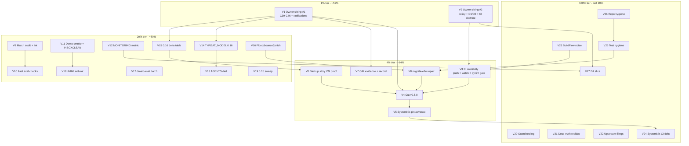

# SUPERB Pareto Backlog-Burn Plan — nix-email, 2026-10-18 (V-generation)

> **STATUS: ACTIVE PLAN (2026-10-18 22:20 CEST).** Point-in-time snapshot over
> the TODO_LIST state (living doc, last full verification sweep 2026-10-17;
> three rows added by the 2026-10-18 09:49 gate-recovery session). Living truth
> stays in `TODO_LIST.md`; this plan feeds docs-health HARVEST/ANNOTATE later.
> Customer = Lars (owner), SystemNix (the one consumer), future agent sessions.
>
> Format note: `.md` with mermaid per the user's explicit instruction (the
> skill's styled-HTML default is overridden - precedent: the 11-53 report, the
> 07-18 and 10-17 plans). ID namespace: **V-numbers** (this generation). The
> still-alive 10-17 plan owns P-numbers; the 07-18 plan owns N-numbers;
> archived plans own T/M. Where a P-task survives, the mapping is stated per
> row. Plan-only session: this file changes nothing in code. No
> Verschlimmbessern.

| Field        | Value                                                                                                                                                                                           |
| ------------ | ----------------------------------------------------------------------------------------------------------------------------------------------------------------------------------------------- |
| Date         | 2026-10-18 22:20 CEST (`date` CLI)                                                                                                                                                              |
| Method       | pareto-planning skill (1% → 4% → 20% → 100%) over ALL consolidated todos                                                                                                                        |
| Sources      | TODO_LIST.md (46 rows, 2026-10-17 sweep + 10-18 rows), decision-batch.md (C39-C46 open, 35 `[rec]` adoptions pending ratification), ROADMAP.md, the 10-17 P-plan, the 10-18 09:49 status report |
| Plan shape   | 27 tasks (30-100 min) → ~120 micro-tasks (≤12 min each)                                                                                                                                         |
| Ground truth | Gate GREEN (buildflow exit 0, 2026-10-18 09:03); v0.5.0 NOT cut (latest tag v0.4.0); master ahead 4 unpushed + 1 untracked report; decisions C42-C46 unanswered; AGENTS.md 451 lines vs cap 220 |

---

## 0. Errata (skill Step 0 — corrections against stale ancestors)

1. **The 10-17 P-plan is the live ancestor; most of it survives.** Verified
   against current state: P1/P2 sittings NOT held (C42-C46 + C39 + 35
   ratification markers still open in decision-batch); P4/P5 not executed
   (no v0.5.0 tag; `[Unreleased]` still carries the 0.16 payload); P6 backup
   research DONE (row 47), VM proof NOT; P3's push consumed once on 10-17
   (origin CI healed) but FOUR new daemon commits (7ef98a4..1cad363, the
   10-18 gate session) are unpushed again — this plan's own commit/push step
   carries them.
2. **New since the P-plan (must be scheduled, were absent):**
   - `migrate-e2e repair` (TODO row 48, added 10-17 post-plan): the
     0.15→0.16 migration e2e is UNREGISTERED and known-broken. → V8.
   - The 2026-10-18 ruff-red incident: error-class lint findings shipped via
     `f9ab833` and sat red through 3 gate runs (daemon pushes bypass the
     pre-push hook; CI python-lint presence unverified). Fixed in-session;
     the systemic fix (CI python gate + EXE001 root cause) is new work. → V3.
   - AGENTS.md size: 451 lines vs the BuildFlow preflight cap 220 (row 87).
     → V13 (was P11 at 30 KB; the metric is now lines-vs-cap, same task).
   - BuildFlow findings noise: bandit 54-vs-4 count gap, ruff findings
     identity bug (`missing_file=55`), vulture confidence policy, binary
     rebuild when the concurrent BuildFlow session lands. → V23 (extends P21).
3. **Dead framings NOT carried forward:** "origin master red" (P3 healed it;
   today's unpushed set is routine daemon velocity, not a red); "exit-69
   buildflow posture" (long dead); "quota retry signature" (journal silence
   pinned); "unattended admin bootstrap" (shipped with 0.16 provisioning).
4. **TODO_LIST is trusted as ground truth** (full sweep 2026-10-17 + the
   10-18 rows); spot-verified: tags, push state, decision markers, gate log.

---

## 1. Pareto breakdown

Value unit = progress toward: **a released, verified 0.16 stack (v0.5.0) that
SystemNix rides, with zero unverified product claims, zero armed landmines,
and a gate that cannot ship lint reds silently** — plus the decided path to
production (D1/D2).

| Tier     | Tasks (of 27)                                                                                                                                                                                                          | Delivers | Why                                                                                                                                                                                                                               |
| -------- | ---------------------------------------------------------------------------------------------------------------------------------------------------------------------------------------------------------------------- | -------- | --------------------------------------------------------------------------------------------------------------------------------------------------------------------------------------------------------------------------------- |
| **1%**   | 3 → V1 owner sitting #1 (C42-C46 + C39/C41 + ratifications), V2 owner sitting #2 (policy + D1/D2 + Resend key + CI-lint doctrine), V3 CI-credibility batch (push+watch+triage, python-lint CI gate, EXE001 root cause) | **~51%** | 14 rows are BLOCKED on exactly these calls; the sittings gate the release path AND the production half; V3 heals fleet master today and closes the class that shipped the 10-18 ruff red.                                         |
| **4%**   | 5 → V4 cut v0.5.0, V5 SystemNix pin advance, V6 backup-story VM proof, V7 C42 evidence+record, V8 migrate-e2e repair                                                                                                   | **~64%** | The release checkpoints 0.16 for the fleet; the pin advance is the payoff; the backup proof retires the largest UNVERIFIED product claim; V8 re-registers the migration safety net; C42 settles half the dmarc-monitor rationale. |
| **20%**  | 11 → V9-V19 (match audit+lint, fast eval checks, demo smoke+INBOXCLEAN, MONITORING metric, AGENTS diet, THREAT_MODEL, delta table, flood/bounce/polish, dmarc-eval, JMAP anti-rot, 0.15 sweep)                         | **~80%** | The verification/anti-rot batch: paid-for bug classes linted at eval time, the only quota signal instrumented, the human contract re-anchored, the security doc stops lying, the docs diet enforced.                              |
| **100%** | remaining 8 → V20-V27 (guard tooling, docs-truth, upstream filings, BuildFlow noise, SystemNix CI debt, test hygiene, repo hygiene, D1 slice) + watch/backlog lanes                                                    | last 20% | Guard tooling mechanizes yesterday's hand-audits, upstream noise classes retire, cross-repo debt clears, and the gated production half starts the moment D1 lands.                                                                |

---

## 2. Consolidated inventory — ALL todos (superset proof)

Sources: **T** = TODO_LIST row (2026-10-18 state), **D** = decision-batch,
**R** = ROADMAP idea/watch, **S** = 10-18 status-report residue. Gates in
**bold**. Every open row maps to exactly one V-task or an explicit lane.

| ID  | Todo                                                                                                                                                                                                                  | Src | Gate              | V-task       |
| --- | --------------------------------------------------------------------------------------------------------------------------------------------------------------------------------------------------------------------- | --- | ----------------- | ------------ |
| R01 | Ratify the 2026-10-05 adoptions (C35/C17a/C20/C38/Q6)                                                                                                                                                                 | D   | **owner**         | V1           |
| R02 | Answer C43 (vendored v0.5.0 vs wait)                                                                                                                                                                                  | D   | **owner**         | V1, V4       |
| R03 | Answer C45 (0.16.22 vs overlay + delta table)                                                                                                                                                                         | D   | **owner**         | V1, V15      |
| R04 | Answer C44 (account-secrets doctrine)                                                                                                                                                                                 | D   | **owner**         | V1, V14      |
| R05 | Answer C42 (parsedmarc retire-or-keep, 0.16-conditioned)                                                                                                                                                              | D   | **owner**         | V1, V7       |
| R06 | Answer C39 (MemoryMax) + C41/C46 (AGENTS cap, restart flap tolerance)                                                                                                                                                 | D   | **owner**         | V1, V13, V14 |
| R07 | Policy batch: C18 bypass, C19 Renovate, C22 Discussions, C24 channel, C29 vantage, C34 webmail, Q4                                                                                                                    | D   | **owner**         | V2           |
| R08 | CI python-lint doctrine (fail-closed ruff in ci.yml? bandit/vulture scope?) - new from the 10-18 incident                                                                                                             | S   | **owner**         | V2, V3       |
| R09 | Demo g1/g2 verdicts + qcow2 purge-or-accept                                                                                                                                                                           | D/T | **owner**         | V2, V26      |
| R10 | D1/D2 timeline (Workspace fork, VPS placement)                                                                                                                                                                        | D   | **owner**         | V2, V27      |
| R11 | Resend API key handoff (Resend smoke rides it)                                                                                                                                                                        | D/T | **owner**         | V2           |
| R12 | Push the 4 unpushed commits + CI watch + red triage                                                                                                                                                                   | S   | -                 | V3           |
| R13 | Cut v0.5.0 (dry-run → tag → release → Unreleased pass)                                                                                                                                                                | T   | **V1, V3**        | V4           |
| R14 | SystemNix consumer pin advance to v0.5.0                                                                                                                                                                              | T   | **V4**            | V5           |
| R15 | 0.16 backup story VM proof (research DONE 10-17) + FEATURES/README/SystemNix notes                                                                                                                                    | T   | -                 | V6           |
| R16 | C42 evidence fetch (inbound failure parsing on 0.16) + record                                                                                                                                                         | T   | **V1 record**     | V7           |
| R17 | migrate-e2e two-node repair + re-register (3 guard sites)                                                                                                                                                             | T   | -                 | V8           |
| R18 | Match-property audit for provision plans (upsert match keys, idempotent sets)                                                                                                                                         | T   | -                 | V9           |
| R19 | Eval match-key lint + provision-plan-eval + local lockstep guard + gate-log 4-vs-7 closure                                                                                                                            | T   | -                 | V9, V10      |
| R20 | Host-side demo smoke + INBOXCLEAN re-verify + quickstart walk (+ arch-diagram regen trigger)                                                                                                                          | T   | -                 | V11          |
| R21 | MONITORING queue-depth metric rule + provision-failure alert + TELEMETRY spot-check on 0.16.22                                                                                                                        | T   | -                 | V12          |
| R22 | AGENTS diet: 451 lines → ≤220 (cap-informed, editorial)                                                                                                                                                               | T   | **C41@V1**        | V13          |
| R23 | THREAT_MODEL 0.16 revisit (REST shrunk, store secrets grew) + MemoryMax doc                                                                                                                                           | T   | **V1**            | V14          |
| R24 | 0.16.22→0.16.26 delta table (README ledger)                                                                                                                                                                           | T   | **V1**            | V15          |
| R25 | Flood robustness + relay bounce-path + e2e polish (TTL trim, restart idempotence)                                                                                                                                     | T   | -                 | V16          |
| R26 | dmarc-eval unit-hardening pin + IFD cleanup                                                                                                                                                                           | T   | -                 | V17          |
| R27 | JMAP anti-rot set (EventSource probe, Junk-filing, StateChange assert)                                                                                                                                                | T   | -                 | V18          |
| R28 | 0.15-only API reference sweep                                                                                                                                                                                         | T   | -                 | V19          |
| R29 | Guard-tooling batch: pipes argless mode, prose-wrap lint, check-set drift alarm, ports single-source, check-inventory CI twin, nix bisect helper                                                                      | T   | -                 | V20          |
| R30 | Docs-truth residue: CHANGELOG `--stat` diff, 19-23 strike reconcile, metadata.yaml verdict                                                                                                                            | T   | -                 | V21          |
| R31 | Upstream evidence filings (#552103 transcripts, dnsmasq note, T13b dprint)                                                                                                                                            | T   | -                 | V22          |
| R32 | BuildFlow noise batch: gate reds, nix-checker 12-vs-2, bandit 54-vs-4, ruff identity bug, detect-only-under-failure, vulture confidence policy, masking docs + threshold config, binary rebuild + delta review        | T/S | -                 | V23          |
| R33 | buildflow local-noise batch (devShell members ruff/vulture/bandit, nix-hash-fix WARN, lychee policy, skip re-evals)                                                                                                   | T   | -                 | V23 (ride)   |
| R34 | SystemNix CI-debt residue (their repo)                                                                                                                                                                                | T   | **their repo**    | V24          |
| R35 | Test-hygiene batch: convert-smoke migrate_v016, TLS-node coverage, host-parse flake app, debug-driver script, apps.vm guard, fixture dedup                                                                            | T/S | -                 | V25          |
| R36 | Repo hygiene: result symlinks, GC roots, /tmp artifacts, demo disk CWD footgun                                                                                                                                        | T   | -                 | V26          |
| R37 | D1 enablement slice: secrets rotation, live dmarc poll, migration compare, monitoring encoding start                                                                                                                  | T/R | **D1, V2**        | V27          |
| R38 | Upstream watch (#563651/52/777, mailsuite#65, #566282 port, #552103 merge watch, stalwart rename collision)                                                                                                           | T   | standing          | watch lane   |
| R39 | EXE001 root cause (who strips mode bits) + convert-smoke fixture                                                                                                                                                      | S   | -                 | V3, V25      |
| R40 | Declarative catch-all wrapper option; typed secrets option (post-C44); queue-depth observability surface; parsedmarc on REAL 0.16; wrapper option-surface review; OIDC wiring; branch-protection + Renovate execution | R/D | **post-decision** | backlog lane |
| R41 | aarch64 posture; treefmt standardization; vulnix replacement (osv-scanner); DOMAIN_LANGUAGE.md; mailcow et al. non-goals                                                                                              | R   | standing          | backlog lane |

Superset check: all 46 TODO_LIST rows + all open decisions + actionable
ROADMAP ideas + the 10-18 report residue map to exactly one V-task (or an
explicit lane). Nothing double-booked, nothing dropped.

---

## 3. TABLE A — Comprehensive plan: 27 tasks (30-100 min each), sorted by importance/impact/effort/customer-value

| #   | Task                                                                                                                                                                                                                                                                                            | Gate               | Impact   | Effort | Value                                                 |
| --- | ----------------------------------------------------------------------------------------------------------------------------------------------------------------------------------------------------------------------------------------------------------------------------------------------- | ------------------ | -------- | ------ | ----------------------------------------------------- |
| V1  | **Owner sitting #1** - release + product doctrine: C43 (vendored v0.5.0?), C45 (package), C44 (secrets), C42 (parsedmarc), C39 (MemoryMax), C41 (AGENTS cap), C46 (flap), ratify the `[rec]` adoptions                                                                                          | 👤 owner           | Critical | 30m    | ~51% unlock: 14 blocked rows                          |
| V2  | **Owner sitting #2** - policy + timeline: C18/C19/C22/C24/C29/C34, Q4, CI python-lint doctrine, demo g1/g2, qcow2 verdict, D1/D2 timeline, Resend key handoff                                                                                                                                   | 👤 owner           | Critical | 30m    | unblocks the production half + the CI-credibility fix |
| V3  | **CI-credibility batch**: push the 4 commits + CI watch + red-triage play; verify ci.yml python coverage; add fail-closed ruff step (post-V2); EXE001 root-cause `git log -p`                                                                                                                   | **V2 (gate part)** | Critical | 60m    | fleet master heals; the 10-18 red class dies          |
| V4  | **Cut v0.5.0**: Unreleased date/link pass → gates → scratch-tag dry-run → annotated tag → tag-CI → gh release                                                                                                                                                                                   | **V1, V3**         | Critical | 60m    | the 0.16 upgrade checkpoints for the fleet            |
| V5  | **SystemNix pin advance** to v0.5.0 (runbook step 3; contract-test fixes; their gates + push)                                                                                                                                                                                                   | **V4**             | Critical | 60m    | the fleet moves to 0.16                               |
| V6  | **0.16 backup story VM proof**: export/restore loop on the PIN (0.16.22 vs 0.16.26-era docs discrepancy), FEATURES/README/SystemNix backup-coordination notes                                                                                                                                   | -                  | Critical | 100m   | kills the largest UNVERIFIED product claim            |
| V7  | **C42 evidence + record**: one stalw.art fetch (inbound failure parsing on 0.16?), decision recorded, README/FEATURES rationale updated                                                                                                                                                         | **V1**             | High     | 30m    | the dmarc-monitor question settles                    |
| V8  | **migrate-e2e repair**: two-node redesign (0.15.5 phase-A seeds store via shared dir, 0.16 node boots with it), re-register in checks.nix + BOTH ci.yml lists + check-inventory.sh                                                                                                              | -                  | High     | 100m   | the migration safety net is registered again          |
| V9  | **Match-property audit + eval lint**: enumerate every provision set (wrapper + tests), audit match keys, fix gaps, hostname=Domain assert                                                                                                                                                       | -                  | High     | 60m    | kills the paid-for bug class at the source            |
| V10 | **Fast eval checks**: provision-plan-eval (~10 s schema signal), local lockstep guard, gate-log 4-vs-7 closure - ALL with the both-ci.yml-lists + check-inventory rule                                                                                                                          | -                  | High     | 100m   | schema signal in seconds; drift fails locally         |
| V11 | **0.16 demo smoke + contract**: `nix run .#vm` probes (ports/banner/admin/JMAP/SMTP/IMAPS), probes manifest, INBOXCLEAN re-verification, quickstart live walk (+ arch regen trigger)                                                                                                            | -                  | High     | 100m   | the human contract, re-anchored on 0.16               |
| V12 | **MONITORING metric rule + TELEMETRY spot-check**: queue-depth alert from the metrics dump (journal is silent); stalwart-provision failure alert; 60 s verify-budget doc; key check vs 0.16.22                                                                                                  | -                  | High     | 60m    | the only quota signal, instrumented                   |
| V13 | **AGENTS diet**: 451 → ≤220 lines (or a blessed repo-local cap if V1 says so); ledger owns the facts; keep paid-for lessons                                                                                                                                                                     | **C41@V1**         | Med      | 60m    | preflight warn dies; discipline restored              |
| V14 | **THREAT_MODEL 0.16 revisit**: exposure delta (REST shrunk, store-readable secrets grew), C44 note, MemoryMax documentation (post-C39)                                                                                                                                                          | **V1**             | Med      | 60m    | the security doc stops lying by omission              |
| V15 | **0.16 delta table**: 0.16.23-26 upstream changes into the README ledger, next to the C45 verdict                                                                                                                                                                                               | **V1**             | Med      | 30m    | the version decision gets its fact base               |
| V16 | **Flood robustness + relay bounce + e2e polish**: pre-wait/relaxed bounds, bounce-path via Mailpit/queue state, TTL trim investigation, restart-persistence idempotence assert                                                                                                                  | -                  | Med      | 100m   | CI-stable tests; the bounce path finally covered      |
| V17 | **dmarc-eval batch**: upstream unit-hardening pin assertion (`DynamicUser`, `SystemCallFilter`, `RestrictAddressFamilies`) + IFD cleanup                                                                                                                                                        | -                  | Med      | 60m    | pin advances fail loudly                              |
| V18 | **JMAP anti-rot set**: EventSource push probe on 0.16, push e2e assertion, Junk-filing automation verify, StateChange assert                                                                                                                                                                    | -                  | Med      | 100m   | the InboxClean seam stays honest on 0.16              |
| V19 | **0.15-reference sweep**: grep `/api/principal`/`--export`/`startDate`/`emailAddress` across docs; fix or era-mark every hit                                                                                                                                                                    | -                  | Low      | 30m    | no dead recipes outside the marked zones              |
| V20 | **Guard-tooling batch**: check-md-table-pipes argless mode, prose-wrap list-marker lint, check-set drift alarm, demo ports single-source, check-inventory CI twin, nix bisect helper                                                                                                            | -                  | Low      | 100m   | yesterday's hand-audits become lints                  |
| V21 | **Docs-truth residue**: CHANGELOG `--stat` content diff (the overstated b/6), 19-23 strike reconcile, metadata.yaml verdict                                                                                                                                                                     | -                  | Low      | 60m    | the honesty debts close                               |
| V22 | **Upstream evidence filings** (verify-before-filing first): #552103 ExecStartPost + bootstrap-fallback transcripts, dnsmasq note, T13b dprint with the eaten-rows incident                                                                                                                      | -                  | Low      | 60m    | paid-for evidence goes upstream                       |
| V23 | **BuildFlow noise batch** (their repo + local): gate reds, nix-checker 12-vs-2, bandit 54-vs-4, ruff findings identity, detect-only-under-failure, vulture confidence policy, masking docs + threshold config, binary rebuild + ef32fa0..HEAD delta review, devShell members, local-noise skips | -                  | Low      | 100m   | the gate's noise floor and honesty improve fleet-wide |
| V24 | **SystemNix CI-debt residue** (their repo): branching-flow credential, canary allowlist, 2 pin flips, scheduled-vs-push divergence                                                                                                                                                              | **their repo**     | Med      | 100m   | the consumer's CI stops being a mystery               |
| V25 | **Test-hygiene batch**: convert-smoke for migrate_v016.py, TLS-node fixture coverage, host-parse flake app + closure re-check, debug-driver script pin, apps.vm eval guard, fixture dedup decision                                                                                              | -                  | Low      | 100m   | tribal memory becomes tooling                         |
| V26 | **Repo hygiene**: result* symlinks, /tmp GC roots + debug scripts, demo disk non-CWD-relative or auto-scratch                                                                                                                                                                                   | -                  | Low      | 30m    | the working tree stops lying                          |
| V27 | **D1 enablement slice + monitoring encoding** (post-sitting): placeholder-secrets rotation, live dmarc poll, vandelay-vs-imapsync compare, alert-channel encoding start                                                                                                                         | **D1, V2**         | High     | 100m   | the production half starts the moment D1 lands        |

Blocked lanes (NOT scheduled - no gate lifted): R40 (post-decision backlog:
catch-all option, typed secrets, queue observability, parsedmarc-on-real-0.16,
option-surface review, OIDC, branch-protection + Renovate execution), R38
(standing upstream watch), R41 (standing ROADMAP posture).

---

## 4. TABLE B — Fine breakdown: ~120 micro-tasks (≤12 min each, ALL todos)

### V1 — Owner sitting #1 (30 min, 👤)

| #    | Micro-task                                                                      | Time |
| ---- | ------------------------------------------------------------------------------- | ---- |
| V1.1 | Read decision-batch C39-C46 + the blocked TODO rows fresh (nothing from memory) | 8m   |
| V1.2 | Answer C43: ship the vendored module in v0.5.0, or wait for the upstream PR     | 4m   |
| V1.3 | Answer C45 (0.16.22 vs 0.16.26 overlay) + C44 (account-secrets doctrine)        | 8m   |
| V1.4 | Answer C42 (parsedmarc), C39 (MemoryMax), C41 (AGENTS cap), C46 (restart flap)  | 6m   |
| V1.5 | Ratify/override the `[rec]` adoptions (C35/C17a/C20/C38/Q6)                     | 2m   |
| V1.6 | Record verdicts in decision-batch; flip the blocked TODO statuses               | 2m   |

### V2 — Owner sitting #2 (30 min, 👤)

| #    | Micro-task                                                                       | Time |
| ---- | -------------------------------------------------------------------------------- | ---- |
| V2.1 | Policy batch: C18 (push bypass), C19 (Renovate), C22 (Discussions)               | 6m   |
| V2.2 | Alerting doctrine: C24 (channel), C29 (canary vantage); C34 (webmail)            | 6m   |
| V2.3 | CI python-lint doctrine: fail-closed ruff in ci.yml yes/no; bandit/vulture scope | 4m   |
| V2.4 | Q4 (README ops level), demo g1/g2, qcow2 purge-or-accept verdict                 | 6m   |
| V2.5 | D1/D2: even a "not before \<date\>" makes the plan honest; Resend key handoff    | 6m   |
| V2.6 | Record verdicts; flip TODO statuses                                              | 2m   |

### V3 — CI-credibility batch (60 min)

| #    | Micro-task                                                                               | Time |
| ---- | ---------------------------------------------------------------------------------------- | ---- |
| V3.1 | Push the 4 unpushed commits (this plan's commit rides along); note the head              | 2m   |
| V3.2 | `gh run watch` to green; triage any red step by NAME (`--log-failed`)                    | 10m  |
| V3.3 | Grep ci.yml for python linting (ruff/bandit/vulture presence) - evidence, not guess      | 5m   |
| V3.4 | Post-V2 blessing: add the fail-closed ruff step (tracked .py files; pinned nixpkgs ruff) | 20m  |
| V3.5 | Dry-run the new CI step locally (act or a pushed scratch branch)                         | 12m  |
| V3.6 | EXE001 root cause: `git log -p` the mode lines of both scripts; record the verdict       | 11m  |

### V4 — Cut v0.5.0 (60 min, gated V1+V3)

| #    | Micro-task                                                                                   | Time |
| ---- | -------------------------------------------------------------------------------------------- | ---- |
| V4.1 | CHANGELOG `[Unreleased]` date/link pass over the 0.16 payload                                | 8m   |
| V4.2 | Full gates green on the release tree (`nix flake check` redirected, never piped)             | 10m  |
| V4.3 | Scratch-tag dry-run of the CONTRIBUTING release procedure (throwaway tag, delete)            | 12m  |
| V4.4 | Cut the real annotated tag `v0.5.0`                                                          | 5m   |
| V4.5 | Push the tag; watch tag-CI to green                                                          | 10m  |
| V4.6 | `gh release create` with the CHANGELOG section as notes                                      | 8m   |
| V4.7 | Post-release: verify `go get`-style consumer resolvability (flake ref) + README version pins | 7m   |

### V5 — SystemNix pin advance (60 min, gated V4)

| #    | Micro-task                                                                                                 | Time |
| ---- | ---------------------------------------------------------------------------------------------------------- | ---- |
| V5.1 | Flip the flake input `?ref=v0.4.0` → `v0.5.0` in SystemNix                                                 | 5m   |
| V5.2 | Run their eval/contract tests; fix the wrapper-API deltas (settings→datastore descriptor, provision plans) | 25m  |
| V5.3 | Adapt consumer config for renamed demo domain + REST removal fallout                                       | 10m  |
| V5.4 | Their gates green; push; CI watch                                                                          | 12m  |
| V5.5 | Record the advance in both CHANGELOGs                                                                      | 8m   |

### V6 — 0.16 backup story VM proof (100 min)

| #    | Micro-task                                                                                                       | Time |
| ---- | ---------------------------------------------------------------------------------------------------------------- | ---- |
| V6.1 | Boot the demo/debug VM via the FIFO-console pattern; seed accounts + mail                                        | 12m  |
| V6.2 | Prove offline copy: stop server, `cp -a` data dir, restart, verify mail intact                                   | 10m  |
| V6.3 | Prove `stalwart-cli snapshot` (NDJSON, secrets stripped) round-trip via `apply`                                  | 12m  |
| V6.4 | Prove MAIN-binary `--export/--import` on the PIN (0.16.22 - availability itself unverified; the C45 delta class) | 15m  |
| V6.5 | Prove per-account Vandelay export on 0.16                                                                        | 10m  |
| V6.6 | Restore-loop drill: import into a fresh store, verify delivery + login                                           | 12m  |
| V6.7 | Update FEATURES backup row (🔴 BROKEN → verified), README ledger, wrapper posture                                | 12m  |
| V6.8 | SystemNix backup-coordination note (consumer layer)                                                              | 7m   |

### V7 — C42 evidence + record (30 min, gated V1 for the record)

| #    | Micro-task                                                                                     | Time |
| ---- | ---------------------------------------------------------------------------------------------- | ---- |
| V7.1 | Fetch the stalw.art DMARC/forensic docs section; verify inbound failure-report parsing on 0.16 | 10m  |
| V7.2 | Record the C42 verdict + rationale in decision-batch                                           | 8m   |
| V7.3 | Update README ledger + FEATURES dmarc-monitor rows to the verdict                              | 12m  |

### V8 — migrate-e2e repair (100 min)

| #    | Micro-task                                                                                           | Time |
| ---- | ---------------------------------------------------------------------------------------------------- | ---- |
| V8.1 | Re-read the wedge transcript + tests/stalwart-migrate-e2e.nix header                                 | 8m   |
| V8.2 | Design the two-node shape: 0.15.5 phase-A node seeds the store via shared dir                        | 12m  |
| V8.3 | Implement node A (0.15.5 boot + account seeding + poison-preflight pass)                             | 15m  |
| V8.4 | Implement node B (0.16 boot against the seeded store; guard + apply assertions)                      | 15m  |
| V8.5 | Local run to green (single check first, then the gate - never the reverse)                           | 15m  |
| V8.6 | Re-register: flake-modules/checks.nix + BOTH ci.yml lists + scripts/check-inventory.sh in ONE commit | 12m  |
| V8.7 | Verify the lockstep guards fire (deliberate-list-mismatch dry-run)                                   | 10m  |

### V9 — Match-property audit + eval lint (60 min)

| #    | Micro-task                                                                      | Time |
| ---- | ------------------------------------------------------------------------------- | ---- |
| V9.1 | Enumerate every provision set the wrapper + tests emit                          | 8m   |
| V9.2 | Audit: upserts carry their match property; sets have explicit match keys        | 12m  |
| V9.3 | Fix the gaps found (transcript-verified assertions only)                        | 12m  |
| V9.4 | hostname = provisioned-Domain eval assert                                       | 10m  |
| V9.5 | dkimManagement survival check in the e2e                                        | 10m  |
| V9.6 | Wrapper option-surface review ride (which 0.15-era options are dead under 0.16) | 8m   |

### V10 — Fast eval checks (100 min)

| #     | Micro-task                                                       | Time |
| ----- | ---------------------------------------------------------------- | ---- |
| V10.1 | Build `provision-plan-eval` (sorted-plan schema eval, ~10 s)     | 20m  |
| V10.2 | Eval-time systemd Exec* lint against raw multi-line strings      | 12m  |
| V10.3 | Fallback port-set eval pin (smtp 25 + http 8080)                 | 10m  |
| V10.4 | Local lockstep guard check (checks attrNames == ci.yml expected) | 15m  |
| V10.5 | Gate-log "running 4 flake checks" vs 7 defined reconciliation    | 12m  |
| V10.6 | Register ALL new checks in the THREE guard sites, one commit     | 12m  |
| V10.7 | Full gate green with the enlarged set; timings note              | 12m  |

### V11 — 0.16 demo smoke + contract (100 min)

| #     | Micro-task                                                                          | Time |
| ----- | ----------------------------------------------------------------------------------- | ---- |
| V11.1 | Realize + boot `nix run .#vm` from a scratch dir (CWD-relative disk rule)           | 8m   |
| V11.2 | Probe LAYERED: guest service → guest loopback → HOST port (firewall signature rule) | 12m  |
| V11.3 | Banner/admin/JMAP session path on 0.16 (session endpoint moved)                     | 12m  |
| V11.4 | SMTP/submission/IMAPS round-trip with swaks + a client probe                        | 12m  |
| V11.5 | Save transcripts under `docs/probes/<date-topic>/` + README manifest                | 10m  |
| V11.6 | INBOXCLEAN.md re-verification walk (auth identity = synthesized address)            | 12m  |
| V11.7 | README quickstart live walk (port pairs, provision roles, fallback admin)           | 12m  |
| V11.8 | Trigger the arch-diagram content audit if labels drifted                            | 10m  |

### V12 — MONITORING metric rule + TELEMETRY spot-check (60 min)

| #     | Micro-task                                                                             | Time |
| ----- | -------------------------------------------------------------------------------------- | ---- |
| V12.1 | Pull the queue-depth series names from the e2e metrics-subtest dump (transcript-first) | 12m  |
| V12.2 | Write the queue-depth alert rule into MONITORING.md; delete the journal-grep guidance  | 12m  |
| V12.3 | Wire the stalwart-provision failure alert (bootstrap signal)                           | 10m  |
| V12.4 | Document the 60 s post-restart verify budget inside the 3 min TimeoutStartSec          | 8m   |
| V12.5 | TELEMETRY.md key spot-check against the 0.16.22 binary (metrics.enable, tracing)       | 12m  |
| V12.6 | Consumer-owner split note update (Gatus side stays theirs)                             | 6m   |

### V13 — AGENTS diet (60 min, gated C41@V1)

| #     | Micro-task                                                                             | Time |
| ----- | -------------------------------------------------------------------------------------- | ---- |
| V13.1 | Inventory AGENTS.md sections vs README/ledger ownership (dup map)                      | 10m  |
| V13.2 | Move command recipes + ledger restatements to their owning docs                        | 15m  |
| V13.3 | Compress the 0.16 doctrine to pointers (ledger owns the facts)                         | 12m  |
| V13.4 | Keep: poison-store class, VM debug rules, gate rituals, known noise                    | 8m   |
| V13.5 | dprint + `nix fmt -- . --check` + pipes lint; verify ≤220 lines                        | 8m   |
| V13.6 | Fresh-session readback: a new agent finds the critical rules without README spelunking | 7m   |

### V14 — THREAT_MODEL 0.16 revisit (60 min, gated V1)

| #     | Micro-task                                                                            | Time |
| ----- | ------------------------------------------------------------------------------------- | ---- |
| V14.1 | Exposure delta table: REST `/api` removal (shrinks) vs store-readable secrets (grows) | 15m  |
| V14.2 | C44 outcome woven in (sops-rendered apply vs admin-created vs credential file)        | 12m  |
| V14.3 | File-secret paths + plan-in-store note                                                | 10m  |
| V14.4 | MemoryMax documentation (post-C39 verdict)                                            | 8m   |
| V14.5 | SECURITY.md supported-versions cross-check                                            | 8m   |
| V14.6 | dprint + links lint                                                                   | 7m   |

### V15 — 0.16 delta table (30 min, gated V1)

| #     | Micro-task                                                                   | Time |
| ----- | ---------------------------------------------------------------------------- | ---- |
| V15.1 | Upstream changelog 0.16.23-26 sweep (DNSBL fix class, x86-64-v2 requirement) | 12m  |
| V15.2 | Write the delta table next to the C45 verdict in the README ledger           | 12m  |
| V15.3 | Cross-link C45/TODO row 46                                                   | 6m   |

### V16 — Flood/bounce/polish (100 min)

| #     | Micro-task                                                                                 | Time |
| ----- | ------------------------------------------------------------------------------------------ | ---- |
| V16.1 | Flood subtest: pre-wait or relaxed-bound transcript check (fix the TEST, never the module) | 18m  |
| V16.2 | Relay bounce-path: refusing smarthost via Mailpit/queue state, never the journal           | 20m  |
| V16.3 | E2E runtime trim investigation (35 s TTL + 75 s reports; test-profile TTL doctrine)        | 20m  |
| V16.4 | Restart-persistence: provision unit must NOT re-run after `systemctl restart`              | 15m  |
| V16.5 | Full gate green; step-timing comparison vs the 10-17 baseline                              | 12m  |

### V17 — dmarc-eval batch (60 min)

| #     | Micro-task                                                                     | Time |
| ----- | ------------------------------------------------------------------------------ | ---- |
| V17.1 | Eval assertion pinning the parsedmarc unit-hardening shape (lines 568/584/589) | 18m  |
| V17.2 | Negative test: flip one key, verify the eval fails loudly                      | 10m  |
| V17.3 | IFD cleanup: build-time grep instead of `builtins.readFile`                    | 15m  |
| V17.4 | dmarc-eval single-check build, then full gate                                  | 12m  |

### V18 — JMAP anti-rot set (100 min)

| #     | Micro-task                                                                  | Time |
| ----- | --------------------------------------------------------------------------- | ---- |
| V18.1 | EventSource push probe on 0.16 (re-verify the 0.15 closeafter/ping verdict) | 20m  |
| V18.2 | Push e2e assertion from the probe transcript                                | 15m  |
| V18.3 | Junk-filing automation path end-to-end (0.16 filing behavior UNVERIFIED)    | 20m  |
| V18.4 | StateChange/state-field assertion after delivery                            | 15m  |
| V18.5 | INBOXCLEAN.md contract update from the fresh transcripts                    | 15m  |
| V18.6 | GTUBE/JMAP subtest gate run                                                 | 10m  |

### V19 — 0.15-reference sweep (30 min)

| #     | Micro-task                                                                                    | Time |
| ----- | --------------------------------------------------------------------------------------------- | ---- |
| V19.1 | Grep `/api/principal`, `--export`, `--import`, `startDate`, `emailAddress` across living docs | 12m  |
| V19.2 | Fix or era-mark every hit (probe transcripts stay historical by design)                       | 12m  |
| V19.3 | dprint + links lint                                                                           | 6m   |

### V20 — Guard-tooling batch (100 min)

| #     | Micro-task                                                                           | Time |
| ----- | ------------------------------------------------------------------------------------ | ---- |
| V20.1 | check-md-table-pipes.sh argless mode + indented-fence coverage                       | 15m  |
| V20.2 | Prose-wrap list-marker lint (the `-`/`+` continuation class; awk word-boundary rule) | 20m  |
| V20.3 | Check-set drift alarm lint (AGENTS/README restating names/counts fail)               | 18m  |
| V20.4 | Demo ports/credentials single-source (AGENTS points at README)                       | 10m  |
| V20.5 | check-inventory.sh CI-step twin evaluation + decision                                | 12m  |
| V20.6 | Nix health-check bisect helper into the devShell                                     | 12m  |
| V20.7 | CI wiring + one deliberate-failure proof each                                        | 13m  |

### V21 — Docs-truth residue (60 min)

| #     | Micro-task                                                                | Time |
| ----- | ------------------------------------------------------------------------- | ---- |
| V21.1 | Row-by-row CHANGELOG vs `git log --stat` content diff 2026-10-05..HEAD    | 20m  |
| V21.2 | Correction note in `[Unreleased]` where the 06-58 b/6 verdict overstated  | 10m  |
| V21.3 | 19-23 plan strike reconcile (`git log -S '~~'`) vs the ~350-markers claim | 15m  |
| V21.4 | `.config/metadata.yaml` keep-or-gitignore verdict + execution             | 8m   |
| V21.5 | dprint + pipes lint                                                       | 7m   |

### V22 — Upstream evidence filings (60 min)

| #     | Micro-task                                                                       | Time |
| ----- | -------------------------------------------------------------------------------- | ---- |
| V22.1 | verify-before-filing gates over each claim (source-level)                        | 15m  |
| V22.2 | #552103 evidence comment: ExecStartPost-restart + bootstrap-fallback transcripts | 12m  |
| V22.3 | dnsmasq-forward upstream note (VM-test resolver rule)                            | 10m  |
| V22.4 | T13b dprint filing with the 120-row eaten-cells incident                         | 15m  |
| V22.5 | Link the filings into the upstream-watch TODO row                                | 8m   |

### V23 — BuildFlow noise batch (100 min)

| #     | Micro-task                                                                               | Time |
| ----- | ---------------------------------------------------------------------------------------- | ---- |
| V23.1 | Rebuild + reinstall their binary once HEAD settles; `git log ef32fa0..HEAD` delta review | 15m  |
| V23.2 | Reproduce + reconcile nix-checker 12-vs-2 and bandit 54-vs-4 count gaps                  | 20m  |
| V23.3 | File/fix the ruff findings-identity bug (`--output-format json` parsing)                 | 15m  |
| V23.4 | Detect-only-steps-run-under-sibling-failure proposal (issue or PR, their repo)           | 12m  |
| V23.5 | Vulture confidence-policy doc (gate filters 60%-confidence findings - verify)            | 8m   |
| V23.6 | Local side: devShell members (ruff/vulture/bandit) or accept-noise config; skip re-evals | 15m  |
| V23.7 | Masking docs + threshold config + edge cases (the standing follow-ups)                   | 15m  |

### V24 — SystemNix CI-debt residue (100 min, their repo)

| #     | Micro-task                                                      | Time |
| ----- | --------------------------------------------------------------- | ---- |
| V24.1 | Actions credential for the private branching-flow input         | 20m  |
| V24.2 | Digest-based canary allowlist (TODO 509; `re_bzp5m` provenance) | 20m  |
| V24.3 | The 2 remaining pin flips                                       | 15m  |
| V24.4 | Scheduled-vs-push CI divergence explanation                     | 15m  |
| V24.5 | Their gates + push + CI watch                                   | 15m  |
| V24.6 | Record in their CHANGELOG                                       | 10m  |

### V25 — Test-hygiene batch (100 min)

| #     | Micro-task                                                                             | Time |
| ----- | -------------------------------------------------------------------------------------- | ---- |
| V25.1 | Convert-smoke: store a 0.15 dump fixture; run `migrate_v016.py convert`; diff the plan | 25m  |
| V25.2 | TLS-node coverage for Netease + LinkedIn fixtures                                      | 15m  |
| V25.3 | host-parse-fixture.py as flake app + closure re-check                                  | 15m  |
| V25.4 | Pin the VM debug-driver recipe as a script (GC root + test-script dance)               | 15m  |
| V25.5 | apps.vm store-closure eval guard                                                       | 10m  |
| V25.6 | Fixture dedup decision (shared tests/fixtures.nix - decide, don't default)             | 10m  |
| V25.7 | Gate green with the additions                                                          | 10m  |

### V26 — Repo hygiene (30 min)

| #     | Micro-task                                                         | Time |
| ----- | ------------------------------------------------------------------ | ---- |
| V26.1 | `trash` stale repo-root `result*` symlinks                         | 5m   |
| V26.2 | Drop `/tmp/st-debug-driver` + sibling GC roots (debug loop closed) | 5m   |
| V26.3 | Sweep `/tmp` debug scripts                                         | 5m   |
| V26.4 | Demo disk non-CWD-relative or auto-scratch decision + execution    | 15m  |

### V27 — D1 enablement slice + monitoring encoding (100 min, gated D1+V2)

| #     | Micro-task                                                                  | Time |
| ----- | --------------------------------------------------------------------------- | ---- |
| V27.1 | Rotate the three placeholder secrets (sops; audit flags rotation-due first) | 15m  |
| V27.2 | Live dmarc-monitor poll against the real `dmarc@` mailbox; JSON/CSV lands   | 20m  |
| V27.3 | vandelay-vs-imapsync compare on scratch mailboxes                           | 20m  |
| V27.4 | Alert-channel encoding start (C24/C29-gated; non-mail-channel rule)         | 15m  |
| V27.5 | Round-trip canary probe skeleton                                            | 15m  |
| V27.6 | Record the slice in CHANGELOG + ROADMAP truth update                        | 15m  |

Micro-task total: 121 (every V-task decomposed; every inventory row covered).

---

## 5. Execution graph (mermaid)

Solid = hard gates (blocked-until); tier order top-to-bottom is also the
default execution order inside a tier. V6/V8 feed V4's release confidence
(prefer completing before tagging, not strictly blocking). Watch/backlog
lanes (R38/R40/R41) sit outside the graph by design.

---

## 6. Post-plan actions

- HARVEST executed with this plan: TODO_LIST gains the two new 10-18 rows
  (CI python-lint gate doctrine+build; EXE001 root cause) and the BuildFlow
  row extension (detect-only-under-failure, vulture confidence policy,
  binary rebuild + delta review). Nothing else new; every other V-task
  already had a living row.
- The 10-17 P-plan stays as the annotated ancestor; on the next docs-health
  sweep, mark it superseded-by-V with per-task disposition.
- This plan's own commit + push (user-requested) carries the 4 unpushed
  daemon commits and the untracked 09:49 status report - which is V3.1
  executed early. Only the CI watch remains of V3 after this session.
