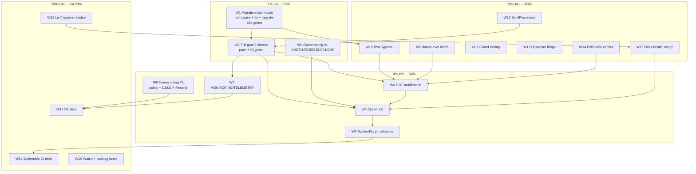

# SUPERB Pareto Backlog-Burn Plan — nix-email, 2026-10-19 (W-generation)

> **STATUS: ACTIVE PLAN (2026-10-19 02:34 CEST).** Point-in-time snapshot
> over the TODO_LIST state (living doc; truth-up executed this session:
> 7 completed rows deleted, 5 rows advanced to IN_PROGRESS with evidence).
> Living truth stays in `TODO_LIST.md`; this plan feeds docs-health
> HARVEST/ANNOTATE later. Customer = Lars (owner), SystemNix (the one
> consumer), future agent sessions.
>
> Format note: `.md` with mermaid per the user's explicit instruction (the
> skill's styled-HTML default is overridden - precedent: the 11-53 report,
> the 07-18, 10-17, and 10-18 plans). ID namespace: **W-numbers** (this
> generation). The 10-18 V-plan owns V-numbers (partially executed,
> superseded by this plan - see errata); the 10-17 P-plan owns P-numbers;
> the 07-18 plan owns N-numbers; archived plans own T/M. Plan-only
> session: this file changes nothing in code. No Verschlimmbessern.

| Field        | Value                                                                                                                                                                                                                                                  |
| ------------ | ------------------------------------------------------------------------------------------------------------------------------------------------------------------------------------------------------------------------------------------------------ |
| Date         | 2026-10-19 02:34 CEST (`date` CLI)                                                                                                                                                                                                                     |
| Method       | pareto-planning skill (1% → 4% → 20% → 100%) over ALL consolidated todos                                                                                                                                                                               |
| Sources      | TODO_LIST.md (post-truth-up), the 02-16 status report (a-g + 50-item f-list), decision-batch.md (C39-C46 open, 35 `[rec]` markers), ROADMAP.md, the 10-18 V-plan + 10-17 P-plan ancestors                                                              |
| Plan shape   | 19 tasks (30-100 min) → ~115 micro-tasks (≤12 min each)                                                                                                                                                                                                |
| Ground truth | Session payload committed but the FULL GATE has NEVER run with the 9-check set; `stalwart-migrate-e2e` is registered with ONE product bug open (post-migration exit-101 panic); v0.5.0 NOT cut (latest tag v0.4.0); working tree clean, HEAD `ef17a69` |

---

## 0. Errata (skill Step 0 — corrections against stale ancestors)

1. **The 10-18 V-plan is ~60% EXECUTED** (the 22:20-02:16 session). Done
   and verified: V3 (CI credibility, CI-green), V6 (backup story,
   VM-proven), V7 (C42 evidence re-verified), V9+V10-core
   (`provision-plan-eval` shipped green + registered), V11 (demo smoke;
   found+fixed the DNS boot race), V13 (AGENTS 451→229), V14
   (THREAT_MODEL delta), V15 (0.16.22→26 table in README), V18-probe-side
   (EventSource, closeafter, Junk-filing; INBOXCLEAN re-verified), V19
   (0.15 sweep: one stale banner fixed), V21 (docs-truth), V26 (hygiene
   incl. demo-disk fix), V25.3 (host-parse-fixture app). TODO rows
   deleted/updated accordingly - this plan carries only the remainders.
2. **V8 changed shape**: the two-node redesign is WRITTEN + REGISTERED
   (3 guard sites; 9-check set) with subtests 1-6 green in real runs.
   What remains is ONE product bug (the post-migration normal-boot
   exit-101 panic) plus the green run - tracked as W1 with the run-6
   transcript and the killed run-7 instrumentation as evidence.
3. **V2's qcow2 verdict is HALF-MOOT**: the demo disk now lives at
   `~/.cache/nix-email-demo/` (future boots never pollute), but the
   ~140 MB history-blob purge-or-accept verdict stays open (owner).
4. **New since the V-plan**: (a) the migration-script product bug
   (W1); (b) the full gate never having run with 9 checks (W2); (c) the
   detached-builds process lesson (status report e/1 - session tooling,
   no repo row); (d) the snapshot-vs-wrapper matchOn divergence
   (ledger-line candidate, rides W15); (e) BuildFlow's `sd_notify`
   discovery (0.16.26) touching the vendored module's notify comment
   (rides the upstream-watch lane).
5. **TODO_LIST trusted as ground truth after this session's truth-up**
   (7 deletions verified against CHANGELOG entries written in the same
   change); spot-verified: check set (9 via attrNames), tags (v0.4.0),
   decision markers (C39-C46 open), HEAD clean.

---

## 1. Pareto breakdown

Value unit = progress toward: **a green 9-check gate on the 0.16 tree, a
migration path that actually boots, the v0.5.0 release cut and ridden by
the fleet, and zero unverified product claims left standing**.

| Tier     | Tasks (of 19)                                                                                                                                                                                                                                                                                                                                                      | Delivers | Why                                                                                                                                                                                                                                                              |
| -------- | ------------------------------------------------------------------------------------------------------------------------------------------------------------------------------------------------------------------------------------------------------------------------------------------------------------------------------------------------------------------ | -------- | ---------------------------------------------------------------------------------------------------------------------------------------------------------------------------------------------------------------------------------------------------------------- |
| **1%**   | 3 → W1 migration-path root-cause + fix + migrate-e2e green; W2 full gate (9 checks) + push + CI green; W3 owner sitting #1 (C43 release, C44 secrets, C45 package, C39/C41/C46 + ratifications)                                                                                                                                                                    | **~51%** | W1 closes a REAL product bug in the 0.15→0.16 safety net (the pbx-outage class) and un-reds the registered check; W2 proves the whole 22:20-02:16 payload end-to-end (nothing is verified until the gate says so); W3 unblocks the release AND 10+ blocked rows. |
| **4%**   | 5 → W4 cut v0.5.0; W5 SystemNix pin advance; W6 e2e stabilization batch (dkim-survival + flood/bounce/restart + JMAP StateChange subtest); W7 MONITORING/TELEMETRY from the gate metrics dump; W8 owner sitting #2 (policy + CI lint scope + D1/D2 + Resend key)                                                                                                   | **~64%** | The release checkpoints 0.16 for the fleet (W4) and the pin advance is the payoff (W5); W6 makes the edited e2e evidence real; W7 rides W2's log (transcript-first, zero extra VM time); W8 unblocks the production half.                                        |
| **20%**  | 7 → W9 dmarc-eval hardening + IFD cleanup; W10 test-hygiene remainder (convert-smoke, TLS-node, debug-driver script, apps.vm guard, fixture dedup, app dry-runs); W11 guard-tooling batch; W12 upstream evidence filings; W13 BuildFlow noise batch; W14 provision-vs-resolv.conf module verdict; W15 docs-health sweep (annotate P+V plans, harvest, ledger line) | **~80%** | The anti-rot batch: paid-for classes mechanized (W11), the migration script's only functional test (W10.1), upstream debts retired or filed, and the planning corpus kept honest.                                                                                |
| **100%** | remaining 4 + lanes → W16 SystemNix CI debt (their repo); W17 D1 enablement slice; W18 lint/hygiene residue (statix pre-push hook, refactor-identity script, apply-log dump proof, external-link sweep); W19 upstream watch + backlog lanes                                                                                                                        | last 20% | Cross-repo debt, the owner-gated production half, and the long tail of hygiene rows that each cost <45 min but gate nothing.                                                                                                                                     |

---

## 2. Consolidated inventory — ALL todos (superset proof)

Sources: **T** = TODO_LIST row (post-truth-up state), **D** =
decision-batch, **R** = ROADMAP idea/watch, **S** = 02-16 status-report
residue. Gates in **bold**. Every open row maps to exactly one W-task or
an explicit lane.

| ID  | Todo                                                                                                                                                                                                       | Src | Gate              | W-task         |
| --- | ---------------------------------------------------------------------------------------------------------------------------------------------------------------------------------------------------------- | --- | ----------------- | -------------- |
| R01 | Root-cause the post-migration exit-101 panic (run-7 artifacts: config.json + recovery.log); fix `stalwart-migrate-from-015`; migrate-e2e to green                                                          | S   | -                 | W1             |
| R02 | Full `nix flake check` with the 9-check set (first ever run of provision-plan-eval + migrate-e2e + edited stalwart-e2e); triage reds by step name; push + CI green                                         | S   | -                 | W2             |
| R03 | Owner sitting #1: C43 (ship vendored v0.5.0), C44 (secrets doctrine), C45 (0.16.22 vs 0.16.26 overlay), C39 (MemoryMax), C41 (AGENTS cap), C46 (flap), ratify the `[rec]` adoptions                        | D   | **owner**         | W3             |
| R04 | Cut v0.5.0 (Unreleased date/link pass → gates → scratch-tag dry-run → annotated tag → tag-CI → gh release)                                                                                                 | T   | **W2, W3**        | W4             |
| R05 | SystemNix pin advance to v0.5.0 (wrapper API deltas: settings→datastore descriptor, provision plans, REST removal, demo domain rename)                                                                     | T   | **W4**            | W5             |
| R06 | Prove the dkim-survival subtest + flood robustness + relay bounce-path + e2e runtime trim + restart-persistence extension in real gate runs                                                                | T   | -                 | W6             |
| R07 | JMAP e2e side: StateChange/push assertion + `ping` parameter probe (probe side verified 2026-10-18)                                                                                                        | T   | -                 | W6             |
| R08 | MONITORING.md queue-depth metric rule from the gate-log metrics dump + provision-failure alert + 60 s verify-budget note; TELEMETRY key spot-check on 0.16.22                                              | T   | **W2 log**        | W7             |
| R09 | Owner sitting #2: C18/C19/C22/C24/C29/C34, Q4, CI bandit/vulture scope doctrine, D1/D2 timeline, Resend key handoff; demo g1/g2                                                                            | D/T | **owner**         | W8             |
| R10 | dmarc-eval unit-hardening eval pin + negative test + IFD cleanup (build-time grep)                                                                                                                         | T   | -                 | W9             |
| R11 | Convert-smoke for migrate_v016.py (stored 0.15 dump fixture → convert → plan diff)                                                                                                                         | T   | -                 | W10            |
| R12 | TLS-node coverage for Netease + LinkedIn fixtures                                                                                                                                                          | T   | -                 | W10            |
| R13 | VM debug-driver recipe as a script (GC root + test-script dance)                                                                                                                                           | T   | -                 | W10            |
| R14 | `apps.vm` store-closure eval guard + `apps.host-parse-fixture` dry-run + closure re-check                                                                                                                  | T   | -                 | W10            |
| R15 | Fixture dedup decision (shared tests/fixtures.nix - decide, don't default)                                                                                                                                 | T   | -                 | W10            |
| R16 | Guard tooling: pipes argless mode, prose-wrap list-marker lint, check-set drift alarm, check-inventory CI twin, nix bisect helper, statix in pre-push                                                      | T   | -                 | W11 (part W18) |
| R17 | Upstream evidence filings: #552103 ExecStartPost+bootstrap transcripts, dnsmasq-forward note, dprint T13b (verify-before-filing first)                                                                     | T   | -                 | W12            |
| R18 | BuildFlow noise batch: nix-checker 12-vs-2, bandit 54-vs-4, ruff identity bug, detect-only-under-failure, vulture confidence policy, masking docs + threshold config, binary rebuild + ef32fa0..HEAD delta | T   | -                 | W13            |
| R19 | buildflow local-noise batch (devShell members, nix-hash-fix WARN, lychee policy, skip re-evals)                                                                                                            | T   | -                 | W13 (ride)     |
| R20 | Provision-vs-resolv.conf module verdict: network-online ordering vs documented singleton requirement (real-host reasoning, not a blind reorder)                                                            | T   | -                 | W14            |
| R21 | Docs-health sweep: annotate 10-17 P-plan + 10-18 V-plan superseded-by-W; snapshot-vs-wrapper matchOn ledger line; probe-manifest freshness                                                                 | S   | -                 | W15            |
| R22 | SystemNix CI-debt residue (their repo: Actions credential, digest allowlist, 2 pin flips, scheduled-vs-push divergence)                                                                                    | T   | **their repo**    | W16            |
| R23 | D1 slice: secrets rotation, live dmarc poll, vandelay-vs-imapsync compare, alert-channel encoding, canary skeleton                                                                                         | T/R | **D1, W8**        | W17            |
| R24 | Refactor-identity proof as a script (outPath + registrationTime dating)                                                                                                                                    | T   | -                 | W18            |
| R25 | Prove the apply-log dump fires on failure (fault injection) + audit dump-on-failure rule across VM tests                                                                                                   | T   | -                 | W18            |
| R26 | External-link re-verification sweep (T15 procedure; last full run predates 0.16)                                                                                                                           | T   | -                 | W18            |
| R27 | Gate-log "running N flake checks" vs 9 defined reconciliation                                                                                                                                              | T   | **W2 log**        | W7 (ride)      |
| R28 | Upstream watch (#563651/52/777, mailsuite#65, #566282 merge fallout, #552103 merge watch + retirement checklist, stalwart rename collision, 0.16.26 `sd_notify` note)                                      | T   | standing          | watch lane     |
| R29 | qcow2 history-blob purge-or-accept (~140 MB; verdict owner-gated; future-boot half is moot via the disk relocation)                                                                                        | T   | **owner**         | W8 (verdict)   |
| R30 | Declarative catch-all option; typed secrets option (post-C44); queue-depth observability surface; parsedmarc on REAL 0.16; OIDC wiring; branch-protection + Renovate execution                             | R/D | **post-decision** | backlog lane   |
| R31 | aarch64 posture; treefmt standardization; vulnix replacement (osv-scanner); DOMAIN_LANGUAGE.md; non-goals confirmations                                                                                    | R   | standing          | backlog lane   |

Superset check: all post-truth-up TODO_LIST rows + all open decisions +
actionable ROADMAP ideas + the 02-16 report's open residue map to exactly
one W-task (or an explicit lane). Nothing double-booked, nothing dropped.

---

## 3. TABLE A — Comprehensive plan: 19 tasks (30-100 min each), sorted by importance/impact/effort/customer-value

| #   | Task                                                                                                                                                                                                                                                                                                                                                                                                    | Gate               | Impact   | Effort | Value                                              |
| --- | ------------------------------------------------------------------------------------------------------------------------------------------------------------------------------------------------------------------------------------------------------------------------------------------------------------------------------------------------------------------------------------------------------- | ------------------ | -------- | ------ | -------------------------------------------------- |
| W1  | **Migration-path repair**: re-run the instrumented migrate-e2e DETACHED (artifact dumps: `migration-v016/config.json`, `recovery.log`); root-cause which store recovery actually wiped (vs UPGRADING/v0_16.md); fix `stalwart-migrate-from-015` (suspects: convert's config.json datastore path; poisoned-settings wipe interaction); correct the script's "[DONE]" banner semantics; migrate-e2e green | -                  | Critical | 90m    | real product bug closed; registered check green    |
| W2  | **Full gate + fleet heal**: `nix flake check` (9-check set, first run) redirected-never-piped; triage any red by step name; push; CI watch to green; harvest the metrics dump + gate-log count from the run                                                                                                                                                                                             | -                  | Critical | 60m    | the session payload becomes verified truth         |
| W3  | **Owner sitting #1** - release + product doctrine: C43 (vendored v0.5.0), C44 (secrets), C45 (package + delta verdict), C39 (MemoryMax), C41 (AGENTS cap), C46 (flap), ratify the `[rec]` adoptions                                                                                                                                                                                                     | 👤 owner           | Critical | 30m    | ~51% unlock: the release + 10 blocked rows         |
| W4  | **Cut v0.5.0**: Unreleased date/link pass → gates green → scratch-tag dry-run of the CONTRIBUTING procedure → annotated tag → tag-CI → gh release → SECURITY.md supported-version bump                                                                                                                                                                                                                  | **W2, W3**         | Critical | 60m    | the 0.16 upgrade checkpoints for the fleet         |
| W5  | **SystemNix pin advance** to v0.5.0: input flip, wrapper-API delta fixes (settings→descriptor, provision plans), their gates + push + CI, both CHANGELOGs                                                                                                                                                                                                                                               | **W4**             | Critical | 60m    | the fleet moves to 0.16                            |
| W6  | **E2E stabilization batch**: prove the dkim-survival subtest green; flood robustness (pre-wait or relaxed bound, transcript-first); relay bounce-path via Mailpit/queue state; runtime-trim investigation; restart-persistence (provision must NOT re-run after restart); JMAP StateChange/push e2e assertion + `ping` probe                                                                            | **W2**             | High     | 100m   | the edited e2e claims become evidence              |
| W7  | **MONITORING/TELEMETRY 0.16**: queue-depth rule from W2's metrics dump (or the honest no-gauge verdict); provision-failure alert; 60 s verify-budget note; TELEMETRY key spot-check; gate-log count reconciliation                                                                                                                                                                                      | **W2 log**         | High     | 60m    | the only quota signal, instrumented honestly       |
| W8  | **Owner sitting #2** - policy + timeline: C18/C19/C22/C24/C29/C34, Q4, CI bandit/vulture scope, demo g1/g2, qcow2 history verdict, D1/D2 timeline, Resend key handoff                                                                                                                                                                                                                                   | 👤 owner           | Critical | 30m    | unblocks the production half + the CI scope end    |
| W9  | **dmarc-eval batch**: unit-hardening eval pin (DynamicUser/SystemCallFilter/RestrictAddressFamilies), negative test (flip one key → eval fails loudly), IFD cleanup (build-time grep)                                                                                                                                                                                                                   | -                  | Med      | 60m    | pin-advance hardening, no silent drops             |
| W10 | **Test-hygiene batch**: convert-smoke fixture for migrate_v016.py; TLS-node coverage; debug-driver script; apps.vm store-closure guard; apps.host-parse-fixture dry-run + closure re-check; fixture-dedup decision                                                                                                                                                                                      | -                  | Med      | 100m   | the migration script gains its first behavior test |
| W11 | **Guard-tooling batch**: pipes argless mode + fence coverage; prose-wrap list-marker lint; check-set drift alarm; check-inventory CI twin; nix bisect helper into devShell; CI wiring + deliberate-failure proofs                                                                                                                                                                                       | -                  | Med      | 100m   | yesterday's hand-audits mechanized                 |
| W12 | **Upstream evidence filings** (verify-before-filing + github-voice gates first): #552103 ExecStartPost-restart + bootstrap-fallback transcripts; dnsmasq-forward VM note; dprint T13b eaten-cells incident                                                                                                                                                                                              | -                  | Med      | 60m    | upstream debts retired with evidence               |
| W13 | **BuildFlow noise batch**: count-gap reproductions (nix-checker 12-vs-2, bandit 54-vs-4), ruff identity bug filing, detect-only-under-failure proposal, vulture confidence policy, masking docs + threshold config, binary rebuild + delta review (when the concurrent session lands), local-noise ride-along                                                                                           | concurrent session | Med      | 100m   | the gate's findings become trustworthy again       |
| W14 | **Provision-vs-resolv.conf module verdict**: reason the real-host matrix (static resolv, systemd-resolved, late DHCP), decide network-online ordering vs documented-singleton requirement; implement or document; demo transcript is the evidence base                                                                                                                                                  | -                  | Med      | 45m    | the boot-race class closes at the module level     |
| W15 | **Docs-health sweep**: annotate the 10-17 P-plan AND the 10-18 V-plan superseded-by-W with per-task dispositions; snapshot-vs-wrapper matchOn ledger line; probe-manifest freshness audit; TODO harvest                                                                                                                                                                                                 | -                  | Med      | 60m    | the planning corpus stays trustworthy              |
| W16 | **SystemNix CI debt** (their repo): Actions credential for the private input, digest-based canary allowlist, the 2 pin flips, scheduled-vs-push divergence, their gates + CHANGELOG                                                                                                                                                                                                                     | their repo         | Med      | 100m   | consumer CI credibility                            |
| W17 | **D1 enablement slice**: rotate the three placeholder secrets, live dmarc-monitor poll against the real mailbox, vandelay-vs-imapsync compare, alert-channel encoding start, canary probe skeleton, CHANGELOG + ROADMAP truth                                                                                                                                                                           | **D1, W8**         | High     | 100m   | the production half starts                         |
| W18 | **Lint/hygiene residue**: pinned-statix in the pre-push hook; refactor-identity proof script; apply-log dump-on-failure proof (fault injection); external-link re-verification sweep                                                                                                                                                                                                                    | -                  | Low      | 100m   | the long tail, each <45 min, gates nothing         |
| W19 | **Standing lanes** (watch + backlog): upstream watch re-checks (#552103 merge → vendored retirement checklist; #566282 pin-advance fallout; 0.16.26 `sd_notify` note for the vendored comment), post-decision backlog grooming                                                                                                                                                                          | standing           | Low      | -      | nothing rots unwatched                             |

---

## 4. TABLE B — Micro breakdown (≤12 min each)

### W1 — Migration-path repair (90 min)

| #     | Micro-task                                                                                                                                           | Time |
| ----- | ---------------------------------------------------------------------------------------------------------------------------------------------------- | ---- |
| W1.1  | Re-run the instrumented migrate-e2e DETACHED (nohup + log path; the run-7 lesson)                                                                    | 5m   |
| W1.2  | Read `migration-v016/config.json`: which datastore path did recovery boot against?                                                                   | 5m   |
| W1.3  | Read `recovery.log`: did the wipe/migration path trigger ("detects the old data")?                                                                   | 5m   |
| W1.4  | Compare against UPGRADING/v0_16.md step 5 (recovery on the LIVE store) - write the divergence hypothesis                                             | 8m   |
| W1.5  | If config.json points at the dump copy: fix the script to rewrite the path to the LIVE storeDir post-convert                                         | 12m  |
| W1.6  | If the wipe did not trigger on the poisoned store: test the poison-free flow (guard refusal without poison simulation) as the control                | 12m  |
| W1.7  | Patch `stalwart-migrate-from-015` + fix the "[DONE]" banner semantics (no DONE until the end-state boots)                                            | 12m  |
| W1.8  | migrate-e2e single-check run to green (build THAT check first)                                                                                       | 10m  |
| W1.9  | CHANGELOG correction entry for the script fix + banner semantics                                                                                     | 5m   |
| W1.10 | TODO row close + README migration-section update (the run-6 caveat paragraph gets the root cause)                                                    | 8m   |
| W1.11 | Contingency: if the root cause is upstream-shaped (recovery refuses poisoned stores by design), encode the sanctioned pre-poison order in the script | 8m   |

### W2 — Full gate + fleet heal (60 min)

| #    | Micro-task                                                                                           | Time |
| ---- | ---------------------------------------------------------------------------------------------------- | ---- |
| W2.1 | `nix flake check > /tmp/gate.log 2>&1; echo EXIT` (redirected, never piped; no concurrent buildflow) | 8m   |
| W2.2 | Triage: any red by CHECK name, then step name; single-check rebuilds for diagnosis                   | 12m  |
| W2.3 | Fix findings at root cause (test-side only unless a real product bug surfaces)                       | 12m  |
| W2.4 | Harvest `/metrics/prometheus` dump from the stalwart-e2e section of the log (series names for W7)    | 5m   |
| W2.5 | Harvest the "running N flake checks" count line vs the 9 defined (R27)                               | 3m   |
| W2.6 | `nix fmt .` + dprint over touched files + pipes lint                                                 | 5m   |
| W2.7 | Commit + push; `gh run watch` to green; `--log-failed` triage if red                                 | 10m  |
| W2.8 | Record timings (check-set grew 7→9; CI budget check against the 45-min timeout)                      | 5m   |

### W3 — Owner sitting #1 (30 min, 👤)

| #    | Micro-task                                                                                          | Time |
| ---- | --------------------------------------------------------------------------------------------------- | ---- |
| W3.1 | Read decision-batch C39-C46 + the blocked rows fresh (nothing from memory)                          | 6m   |
| W3.2 | Answer C43 (ship vendored v0.5.0?) + C45 (0.16.22 vs overlay - the README delta table is the input) | 8m   |
| W3.3 | Answer C44 (secrets) + C39 (MemoryMax) + C41 (AGENTS cap: 229 vs 220) + C46 (flap)                  | 8m   |
| W3.4 | Ratify/override the `[rec]` adoptions; record verdicts; flip blocked TODO statuses                  | 8m   |

### W4 — Cut v0.5.0 (60 min, gated W2+W3)

| #    | Micro-task                                                                          | Time |
| ---- | ----------------------------------------------------------------------------------- | ---- |
| W4.1 | `[Unreleased]` date/link pass over the 0.16 payload                                 | 8m   |
| W4.2 | SECURITY.md supported-versions bump (v0.5.0 Current)                                | 3m   |
| W4.3 | Gates green on the release tree (redirected)                                        | 10m  |
| W4.4 | Scratch-tag dry-run of the CONTRIBUTING procedure (throwaway tag, delete)           | 12m  |
| W4.5 | Cut the annotated tag `v0.5.0` (edit + commit in the SAME tool call - daemon races) | 5m   |
| W4.6 | Push the tag; watch tag-CI to green                                                 | 10m  |
| W4.7 | `gh release create` with the CHANGELOG section as notes                             | 7m   |
| W4.8 | Post-release: consumer resolvability spot-check + README version pins               | 5m   |

### W5 — SystemNix pin advance (60 min, gated W4)

| #    | Micro-task                                                                                             | Time |
| ---- | ------------------------------------------------------------------------------------------------------ | ---- |
| W5.1 | Flip the flake input `?ref=v0.4.0` → `v0.5.0` in SystemNix                                             | 5m   |
| W5.2 | Run their eval/contract tests; fix wrapper-API deltas (settings→datastore descriptor, provision plans) | 20m  |
| W5.3 | Adapt consumer config for the renamed demo domain + REST-removal fallout                               | 10m  |
| W5.4 | Their gates green; push; CI watch                                                                      | 12m  |
| W5.5 | Record the advance in both CHANGELOGs                                                                  | 8m   |
| W5.6 | Ride-along: nixpkgs lock-sync check (compat doctrine - both locks same rev)                            | 5m   |

### W6 — E2E stabilization batch (100 min, gated W2)

| #    | Micro-task                                                                                 | Time |
| ---- | ------------------------------------------------------------------------------------------ | ---- |
| W6.1 | Read the dkim-survival subtest result from W2's gate log (it ran for the first time there) | 5m   |
| W6.2 | Flood subtest: pre-wait or relaxed-bound transcript check (fix the TEST, never the module) | 12m  |
| W6.3 | Relay bounce-path: refusing smarthost via Mailpit/queue state, never the journal           | 20m  |
| W6.4 | Runtime trim: 35 s TTL + 75 s reports investigation; test-profile TTL doctrine decision    | 15m  |
| W6.5 | Restart-persistence: assert provision does NOT re-run after `systemctl restart`            | 10m  |
| W6.6 | JMAP StateChange e2e assertion (point-in-time needle query misses stale-cache classes)     | 12m  |
| W6.7 | EventSource `ping` parameter probe on the demo VM (the one unprobed 0.16 quirk)            | 10m  |
| W6.8 | Full e2e single-check runs green; step-timing comparison vs the 10-17 baseline             | 16m  |

### W7 — MONITORING/TELEMETRY (60 min, gated W2's log)

| #    | Micro-task                                                                                    | Time |
| ---- | --------------------------------------------------------------------------------------------- | ---- |
| W7.1 | Grep the queue-depth series names from W2's harvested metrics dump (transcript-first)         | 8m   |
| W7.2 | Write the queue-depth alert rule (or the honest no-gauge verdict + consumer-poll spec update) | 12m  |
| W7.3 | Delete the 0.15 journal-grep quota guidance that 0.16 falsified                               | 8m   |
| W7.4 | Wire the stalwart-provision failure alert (bootstrap signal)                                  | 10m  |
| W7.5 | Document the 60 s post-restart verify budget inside the 3 min TimeoutStartSec                 | 6m   |
| W7.6 | TELEMETRY.md key spot-check vs the 0.16.22 binary (metrics.enable, tracing)                   | 12m  |
| W7.7 | Gate-log count reconciliation note (R27); dprint + pipes lint                                 | 4m   |

### W8 — Owner sitting #2 (30 min, 👤)

| #    | Micro-task                                                                                                      | Time |
| ---- | --------------------------------------------------------------------------------------------------------------- | ---- |
| W8.1 | Policy batch: C18 (push bypass), C19 (Renovate), C22 (Discussions), C24 (channel), C29 (vantage), C34 (webmail) | 8m   |
| W8.2 | CI lint scope: bandit/vulture into ci.yml or buildflow-owned (the 5-vs-0 gap)                                   | 5m   |
| W8.3 | Q4 (README ops level) + demo g1/g2 verdicts                                                                     | 5m   |
| W8.4 | qcow2 history-blob purge-or-accept (~140 MB)                                                                    | 4m   |
| W8.5 | D1/D2 timeline ("not before <date>" counts) + Resend key handoff                                                | 6m   |
| W8.6 | Record verdicts; flip TODO statuses                                                                             | 2m   |

### W9 — dmarc-eval batch (60 min)

| #    | Micro-task                                                                           | Time |
| ---- | ------------------------------------------------------------------------------------ | ---- |
| W9.1 | Eval assertion pinning the parsedmarc unit-hardening shape (pin's lines 568/584/589) | 15m  |
| W9.2 | Negative test: flip one key, verify the eval fails loudly                            | 10m  |
| W9.3 | IFD cleanup: build-time grep instead of `builtins.readFile`                          | 15m  |
| W9.4 | dmarc-eval single-check build, then the full gate                                    | 12m  |
| W9.5 | Register-if-added guard-site check (no new check expected here)                      | 8m   |

### W10 — Test-hygiene batch (100 min)

| #     | Micro-task                                                                                           | Time |
| ----- | ---------------------------------------------------------------------------------------------------- | ---- |
| W10.1 | Convert-smoke: store a minimal 0.15 dump fixture; run `migrate_v016.py convert`; diff the plan shape | 25m  |
| W10.2 | TLS-node coverage for the Netease + LinkedIn fixtures (IMAPS node wiring)                            | 15m  |
| W10.3 | `nix run .#host-parse-fixture <fixture> --check parsedmarc-e2e` end-to-end dry-run                   | 10m  |
| W10.4 | parsedmarc-e2e closure re-check after the upgrade (the app walks it)                                 | 8m   |
| W10.5 | `nix run .#vm` smoke after the disk-wrapper change (boot + one probe + ~/.cache disk confirmed)      | 10m  |
| W10.6 | Pin the VM debug-driver recipe as a script (GC root + test-script dance)                             | 12m  |
| W10.7 | `apps.vm` store-closure eval guard                                                                   | 10m  |
| W10.8 | Fixture-dedup decision (shared tests/fixtures.nix - decide, don't default)                           | 10m  |

### W11 — Guard-tooling batch (100 min)

| #     | Micro-task                                                                           | Time |
| ----- | ------------------------------------------------------------------------------------ | ---- |
| W11.1 | check-md-table-pipes.sh argless mode + indented-fence coverage                       | 15m  |
| W11.2 | Prose-wrap list-marker lint (the `-`/`+` continuation class; awk word-boundary rule) | 20m  |
| W11.3 | Check-set drift alarm lint (AGENTS/README restating names/counts fail)               | 18m  |
| W11.4 | check-inventory.sh CI-step twin evaluation + decision                                | 12m  |
| W11.5 | Nix health-check bisect helper into the devShell                                     | 12m  |
| W11.6 | CI wiring for the new lints + one deliberate-failure proof each                      | 13m  |
| W11.7 | Self-test doctrine pass: every new lint gets its negative test in the same change    | 10m  |

### W12 — Upstream filings (60 min)

| #     | Micro-task                                                                                       | Time |
| ----- | ------------------------------------------------------------------------------------------------ | ---- |
| W12.1 | verify-before-filing gates over each claim (source-level, transcripts on disk)                   | 15m  |
| W12.2 | #552103 evidence comment: ExecStartPost-restart + bootstrap-fallback transcripts (bind-e2e logs) | 12m  |
| W12.3 | dnsmasq-forward upstream note (VM-test resolver rule)                                            | 10m  |
| W12.4 | dprint T13b filing with the eaten-cells incident                                                 | 15m  |
| W12.5 | Link the filings into the upstream-watch TODO row (github-voice for tone)                        | 8m   |

### W13 — BuildFlow noise batch (100 min; binary rebuild waits on the concurrent session)

| #     | Micro-task                                                                              | Time |
| ----- | --------------------------------------------------------------------------------------- | ---- |
| W13.1 | Reproduce + reconcile nix-checker 12-vs-2 (their repo, read-only diagnosis first)       | 20m  |
| W13.2 | Reproduce + reconcile bandit 54-vs-4 (invocation diff hypothesis)                       | 20m  |
| W13.3 | File the ruff findings-identity bug (`missing_file=55`, `--output-format json` parsing) | 15m  |
| W13.4 | Detect-only-steps-run-under-sibling-failure proposal (issue, their repo)                | 12m  |
| W13.5 | Vulture confidence-policy doc question + threshold config ask                           | 10m  |
| W13.6 | Binary rebuild + `git log ef32fa0..HEAD` delta review ONCE the concurrent session lands | 15m  |
| W13.7 | Local-noise ride-along: devShell members decision, skip re-evaluations                  | 8m   |

### W14 — Provision-vs-resolv.conf verdict (45 min)

| #     | Micro-task                                                                                      | Time |
| ----- | ----------------------------------------------------------------------------------------------- | ---- |
| W14.1 | Reason the real-host matrix: static resolv.conf, systemd-resolved, late-DHCP (when is it late?) | 12m  |
| W14.2 | Decide: `after = ["network-online.target"]` ordering vs documented-singleton requirement        | 10m  |
| W14.3 | Implement the verdict (unit ordering + comment, or README doctrine paragraph + demo precedent)  | 12m  |
| W14.4 | Eval guard: provision-plan-eval or module-import-eval pins whatever shape ships                 | 11m  |

### W15 — Docs-health sweep (60 min)

| #     | Micro-task                                                                    | Time |
| ----- | ----------------------------------------------------------------------------- | ---- |
| W15.1 | Annotate the 10-18 V-plan superseded-by-W (per-task disposition, strike form) | 12m  |
| W15.2 | Annotate the 10-17 P-plan superseded (the deferred item from the V-plan)      | 10m  |
| W15.3 | `annotate.go check-rows` after every formatter pass over annotated files      | 8m   |
| W15.4 | Snapshot-vs-wrapper matchOn divergence ledger line (CONTRIBUTING ledger pass) | 10m  |
| W15.5 | Probe-manifest freshness audit (docs/probes dirs vs living docs)              | 10m  |
| W15.6 | TODO_LIST final harvest + this plan's residue routing                         | 10m  |

### W16 — SystemNix CI debt (100 min, their repo)

| #     | Micro-task                                                            | Time |
| ----- | --------------------------------------------------------------------- | ---- |
| W16.1 | Actions credential for the private branching-flow input               | 20m  |
| W16.2 | Digest-based canary allowlist (their TODO 509, `re_bzp5m` provenance) | 20m  |
| W16.3 | The 2 remaining pin flips                                             | 15m  |
| W16.4 | Scheduled-vs-push CI divergence explanation                           | 15m  |
| W16.5 | Their gates + push + CI watch                                         | 15m  |
| W16.6 | Record in their CHANGELOG                                             | 10m  |

### W17 — D1 slice (100 min, gated D1+W8)

| #     | Micro-task                                                                  | Time |
| ----- | --------------------------------------------------------------------------- | ---- |
| W17.1 | Rotate the three placeholder secrets (sops; audit flags rotation-due first) | 15m  |
| W17.2 | Live dmarc-monitor poll against the real `dmarc@` mailbox; JSON/CSV lands   | 20m  |
| W17.3 | vandelay-vs-imapsync compare on scratch mailboxes                           | 20m  |
| W17.4 | Alert-channel encoding start (C24/C29-gated; non-mail-channel rule)         | 15m  |
| W17.5 | Round-trip canary probe skeleton                                            | 15m  |
| W17.6 | Record the slice in CHANGELOG + ROADMAP truth update                        | 15m  |

### W18 — Lint/hygiene residue (100 min)

| #     | Micro-task                                                                  | Time |
| ----- | --------------------------------------------------------------------------- | ---- |
| W18.1 | Pinned-statix into the pre-push hook (mirror CI; the 4x-red W20 class)      | 15m  |
| W18.2 | Refactor-identity proof as a script (outPath + registrationTime dating)     | 15m  |
| W18.3 | Apply-log dump-on-failure proof (deliberate fault injection in a debug run) | 20m  |
| W18.4 | Audit all VM-test steps that redirect to VM-local files for the dump rule   | 15m  |
| W18.5 | External-link re-verification sweep over living docs (T15 procedure)        | 25m  |
| W18.6 | dprint + pipes + nix fmt closing pass                                       | 10m  |

### W19 — Standing lanes

| #     | Micro-task                                                                      | Time |
| ----- | ------------------------------------------------------------------------------- | ---- |
| W19.1 | `gh` re-check: #552103 merge state (retirement checklist trigger)               | 5m   |
| W19.2 | `gh` re-check: #563651/#563652/#563777, mailsuite#65, stalwart rename           | 5m   |
| W19.3 | 0.16.26 `sd_notify` note onto the vendored module's notify comment (watch item) | 5m   |
| W19.4 | Backlog grooming: post-decision rows from R30 once W3/W8 land                   | 10m  |

Micro-task total: 115 (every W-task decomposed; every inventory row covered).

---

## 5. Execution graph (mermaid)

Solid = hard gates (blocked-until); tier order top-to-bottom is also the
default execution order inside a tier. W6/W7 both feed W4's release
confidence (prefer completing before tagging, not strictly blocking).
Watch/backlog lanes (R28-R31) sit outside the graph by design.

---

## 6. Post-plan actions

- TODO_LIST truth-up executed WITH this plan (7 completed rows deleted
  with CHANGELOG entries written in the same change; 5 rows advanced to
  IN_PROGRESS with session evidence; the migrate-e2e row now carries the
  run-6 bug + the detached-run instruction).
- The 10-18 V-plan is annotated as the executed ancestor by THIS file's
  errata; the formal superseded-by-W strike pass is W15.1 (docs-health
  ANNOTATE, never rewrite).
- This plan's own commit + push carries the TODO truth-up, the CHANGELOG
  additions, and the 02-16 status report.
