<!-- X-generation master plan. Generated 2026-10-19 07:35 CEST (`date` CLI).
     Sources: TODO_LIST.md (2026-10-19 truth-up), decision-batch.md, the
     W-plan residues (W3-W5, W6.3-W6.4, W8, W12.3-W12.4, W16-W19), and the
     2026-10-18/19 status reports (02-16, 02-35, 03-59, 04-43, 05-18,
     05-56, 06-05, 07-18). Every open TODO_LIST row maps to exactly one
     X-task (appendix A proves coverage). Supersedes the task routing of
     the P/V/W plans (their executed tasks live in CHANGELOG). -->

# X-generation: release ship + residue burn (Pareto plan)

## 0. State of the world (verified 2026-10-19 07:35 CEST)

- FULL `nix flake check` GREEN on the **10-check set** (first ever,
  2026-10-19 03:5x; CI run 39191414206 green). `stalwart-e2e` at 19/19
  subtests incl. the JMAP-push assertion; `stalwart-migrate-e2e` GREEN 9/9
  and REGISTERED (two-node redesign landed); `migrate-convert-eval` is new.
- The 0.15 -> 0.16 migration is e2e-PROVEN (guard refusal, poison refusal,
  `--backup-dir` recovery, 0.15 password on 0.16, restart persistence;
  three stacked root causes transcript-pinned and fixed).
- The 0.16 backup story is EXECUTED and documented (V-generation).
- Tooling floor shipped (W11): list-marker lint, check-set drift alarm,
  README anti-drift step, `nix-health` bisect, pinned statix in pre-push,
  devShell pins dprint/lychee/ruff.
- AGENTS.md diet EXECUTED (253 -> 220 lines; C41 moot); VM debug loops +
  0.16-upgrade rules moved to CONTRIBUTING.
- The release is the ONLY thing between the fleet and 0.16: SystemNix
  hard-pins `?ref=v0.4.0` (the 0.15 world) and can only move when v0.5.0
  exists. Everything release-shaped is gated on ONE human call (C43).

## 1. Doctrine constraints (non-negotiable while executing)

1. Adding/removing a check = **FOUR guard sites** in one change (both
   ci.yml lists, `scripts/check-inventory.sh`, README check list) —
   pre-flight `grep -rn '<name>' .github scripts README.md`.
2. Never weaken module defaults to make a test pass — fix the test
   (doctrine: "fix the test, not the module").
3. Upstream filings pass **verify-before-filing** first, then
   **github-voice** for tone.
4. No claim without a transcript (probe/journal/gate log) — the
   transcript rule extends to every new assertion.
5. Heavy VM builds serialize ACROSS repos; `--max-time >= 30m` for
   buildflow runs that build VM checks.
6. Daemon races explicit commits on release-critical files: edit and
   commit in the SAME tool call; concurrent sessions: mtime-probe,
   view-before-edit, hand off via TODO rows.
7. Gate commands redirect, never pipe; empty build log = cache hit.

## 2. Pareto breakdown (value estimates are judgment, not measurement)

### The 1% that delivers ~51%

**X1 — the owner decision sitting** (one human, ~40 minutes). C43
(vendored-module release?) is the single gate on the entire release
chain; C45/C44/C42/C39/C46/C52/C53 + the ratifications clear ~10 blocked
rows and settle every open doctrine question. Nothing else in this plan
matters until this happens. Everything the sitter needs is staged in
`decision-batch.md` with [rec]s.

### The 4% that delivers ~64%

**X1 + the release execution chain (X2 -> X3 -> X4)** — four tasks, ~4.5h
total. Turns the doctrine call into: CHANGELOG release-ready, scratch-tag
dry-run passed, **v0.5.0 tagged + released**, SystemNix advanced to the
0.16 stack. This is the fleet checkpoint; ~64% of the plan's total value
sits here.

### The 20% that delivers ~80%

The four above, plus the two highest-value engineering debts:

- **X5 — pbx-artmann flip + leg re-adds** (their gate is red BY DESIGN
  since our bootstrap fix; the outage-class consumer stays red until
  flipped).
- **X6 — match-property remainder** (option-surface review closes the
  "which 0.15-era options are dead" question; matchOn ledger line kills a
  documented divergence).

Six tasks, ~35% of the planned effort, ~80% of the value: release shipped,
consumer moved, both cross-repo debts burned, the provision surface fully
audited.

### The remaining 80% of work -> 100%

X7-X20: CI lint doctrine, e2e stability, local guards, docs truth, ruff
debt, upstream filings, BuildFlow/buildflow batches, TLS-node coverage,
debug-driver script, apply-log proof, SystemNix CI residue, the D1-unlock
prep slice, and the second owner sitting (policy + timeline). Each is
bounded, none gates the release.

## 3. TABLE A — comprehensive plan (30-100 min per task, ALL open TODOs)

Sorted by impact-then-effort. Gates reference other X-tasks or owners.
"their repo" = the work lands in that repository, not this one.

| #   | Task                                                                                                                                                                                                                                                                                                                                               | Gate            | Impact   | Effort | Value                                                         |
| --- | -------------------------------------------------------------------------------------------------------------------------------------------------------------------------------------------------------------------------------------------------------------------------------------------------------------------------------------------------- | --------------- | -------- | ------ | ------------------------------------------------------------- |
| X1  | **Owner sitting #1 — release + product doctrine**: C43 (ship vendored v0.5.0?), C45 (0.16.22 vs overlay + delta table), C44 (account secrets), C42 (parsedmarc retire-or-keep; the one stalw.art fetch rides as prep), C39 (MemoryMax), C46 (flap tolerance), C52 (README-as-ledger), C53 (bootstrap doctrine) + ratify the 2026-10-05 adoptions   | **owner**       | Critical | 40m    | ~51% unlock; unblocks the release chain + ~10 rows            |
| X2  | **Release prep**: CHANGELOG `[Unreleased]` date/link pass (upstream PR/issue refs resolve); the C45 0.16.22 -> 0.16.26 delta table into the README ledger (next to the verdict); scratch-tag dry-run of the CONTRIBUTING release procedure                                                                                                         | **X1**          | Critical | 45m    | the tag lands minutes after the dry-run passes                |
| X3  | **Cut v0.5.0**: annotated tag -> tag-CI watch (read failing STEP names if red) -> `gh release` -> verify `nix flake show`/github tarball + pkg.go.dev absence expected (flake only)                                                                                                                                                                | **X2**          | Critical | 45m    | the fleet checkpoint exists                                   |
| X4  | **SystemNix pin advance to v0.5.0** (their repo): runbook step 3, contract-test fixes (wrapper API changed: settings = datastore descriptor, `services.stalwart.provision`, REST recipes gone, demo domain `mail.demo.test`), their gates + push                                                                                                   | **X3**          | Critical | 2h     | the consumer moves to 0.16; the pin doctrine stays intact     |
| X5  | **pbx-artmann flip + leg re-adds** (their repo): flip the deliberate `machine.fail` deadlock-pin (test line 166; predates our bootstrap fix `e6245c8`) to a success wait, then re-add the TLS/webadmin/admin legs (TLS leg is D1-adjacent - real cert)                                                                                             | -               | High     | 45m    | the outage-class consumer gate goes green                     |
| X6  | **Match-property remainder**: wrapper option-surface review (which 0.15-era wrapper options are dead/no-op under the 0.16 object model; audit `mail-server.nix` against the vendored module's option set) + the snapshot-vs-wrapper matchOn divergence ledger line                                                                                 | -               | High     | 60m    | the provision surface fully audited; divergence documented    |
| X7  | **CI python-lint doctrine** (owner V2.3, prep by agent): bandit/vulture scope call + whether buildflow's deeper ruleset (PERF/FURB/BLE) moves into CI; record the verdict next to the ruff step                                                                                                                                                    | **owner (15m)** | Med      | 30m    | the lint floor stops growing ad hoc                           |
| X8  | **E2E stability batch**: relay bounce-path subtest (W6.3: refusing smarthost, assert via Mailpit/queue counters - never journal greps); runtime-trim investigation (75 s ingestion + 35 s TTL windows; test-profile TTL doctrine); flood-refill flake capture protocol (journal + bucket state BEFORE any rerun)                                   | -               | Med      | 100m   | CI-stable tests; the last uncovered mail path gets coverage   |
| X9  | **Local guards batch**: flake eval check asserting `checks` attrNames == the ci.yml expected list (lockstep drift fails LOCALLY); the check-inventory CI-twin evaluate-then-decide; the CLI count-line reconcile ("running 7" vs 10)                                                                                                               | -               | Med      | 45m    | drift fails before push, not in CI                            |
| X10 | **Docs truth batch**: external-link re-verification sweep over the living docs (T15 procedure; last full run 2026-10-05, predates the 0.16 rewrite); fix or era-mark every dead target                                                                                                                                                             | -               | Med      | 30m    | no dead links in the sales page + ledger                      |
| X11 | **Tooling hygiene micro-batch**: ruff debt (`carddav_probe.py` F841 `token0` + RUF059 `headers2`; `gen-repair-spec.py` SIM115 x2) AFTER the owning CardDAV session lands; EventSource `ping` parameter probe on the demo VM (+ INBOXCLEAN line - the last unprobed 0.16 JMAP quirk)                                                                | -               | Low      | 30m    | the gate goes fully green; the JMAP probe matrix closes       |
| X12 | **Upstream filings batch** (verify-before-filing + github-voice first): the dnsmasq-forward VM-test resolver note (venue TBD); the T13b dprint markdown pipe-cell filing (eaten-rows incident transcript); the standing upstream watch re-check (#563651/#563652/#563777, mailsuite#65, #552103; rename-watch rides)                               | -               | Low      | 60m    | paid-for evidence goes upstream; the watch cadence holds      |
| X13 | **BuildFlow upstream batch** (their repo): triage gate reds; the nix-checker 12-vs-2 AND bandit 54-vs-4 count gaps; ruff findings-identity parsing (`missing_file=55`); detect-only steps under sibling repair failure; vulture confidence policy; threshold config + masking docs + edge tests; binary rebuild after the concurrent session lands | **their repo**  | Low      | 100m   | the fleet gate's noise floor drops; count gaps explained      |
| X14 | **buildflow local-noise batch**: `nix-hash-fix` WARN, lychee private-repo policy residue, interrogate/jest skip configs, timings cleanup, `BUILDFLOW_TELEMETRY_DISABLED` note; re-evaluate mypy-check + pytest-test skip rationales                                                                                                                | -               | Low      | 60m    | local gate output is signal, not noise                        |
| X15 | **TLS-node coverage**: the Netease + LinkedIn parsedmarc fixtures ride the IMAPS 993 node (production-shaped, DEFAULT cert verification) instead of plaintext-only                                                                                                                                                                                 | -               | Low      | 60m    | fixture breadth matches production shapes                     |
| X16 | **VM debug-driver recipe as a script**: GC root + `--test-script` dance mechanized; bake in the 00-03 rules (probes settle before probing, `machine.succeed` + file capture, artifacts dump on failure)                                                                                                                                            | -               | Low      | 45m    | tribal memory becomes a tool the next session gets free       |
| X17 | **Apply-log dump-on-failure proof** (W18.3/W18.4): deliberate fault injection in a debug run proves the dump fires; audit remaining VM-test output redirects for the same rule                                                                                                                                                                     | -               | Low      | 45m    | the failure-forensics guarantee is proven, not assumed        |
| X18 | **SystemNix CI-debt residue** (their repo): Actions credential for the private branching-flow input, digest-based canary allowlist (TODO 509 incl. the `re_bzp5m` provenance call), 2 remaining pin flips, explain scheduled-vs-push CI divergence                                                                                                 | **their repo**  | Med      | 100m   | the consumer's CI stops being a mystery                       |
| X19 | **D1-unlock prep slice** (executes the moment D1 lands): secrets-rotation runbook for the three SystemNix placeholders; vandelay-vs-imapsync compare plan; dmarc-live-poll checklist; the real-host resolv.conf boot-race verdict step (03-59 item 22)                                                                                             | **D1**          | Med      | 45m    | the production half starts the hour D1 is answered            |
| X20 | **Owner sitting #2 — policy + timeline**: C18 (branch protection), C19 (Renovate), C22 (Discussions), C24/C29 (alert channel + canary), C34 (webmail), Q4 (README ops detail), demo g1/g2, qcow2 history verdict, D1/D2 timeline, Resend key handoff                                                                                               | **owner**       | High     | 30m    | clears every user-blocked row; the production timeline exists |

Effort total: ~20h across 20 tasks. Owner time: ~70m across two sittings.

## 4. TABLE B — micro-tasks (<= 12 min each, ALL TODOs)

Every Table A task decomposed. Run top-to-bottom inside a task; the graph
(section 5) owns inter-task ordering.

| #     | Micro-task                                                                                                             | Time | Parent |
| ----- | ---------------------------------------------------------------------------------------------------------------------- | ---- | ------ |
| X1.1  | Read decision-batch fresh (C39-C46, C52, C53 + adoption list; nothing from memory)                                     | 10m  | X1     |
| X1.2  | Prep C42: the one stalw.art docs fetch (inbound failure parsing on 0.16?) - attach the answer to the C42 entry         | 8m   | X1     |
| X1.3  | Answer C43 (release doctrine) - THE gate                                                                               | 5m   | X1     |
| X1.4  | Answer C45 (package) + C44 (secrets)                                                                                   | 8m   | X1     |
| X1.5  | Answer C42, C39, C46, C52, C53                                                                                         | 8m   | X1     |
| X1.6  | Ratify/override the adoptions (C35/C17/C17a/C20/C38/Q6)                                                                | 5m   | X1     |
| X1.7  | Record every verdict in decision-batch; flip the blocked TODO statuses                                                 | 6m   | X1     |
| X2.1  | CHANGELOG `[Unreleased]`: verify dates + every upstream PR/issue link resolves                                         | 10m  | X2     |
| X2.2  | Write the 0.16.22 -> 0.16.26 delta table into the README ledger (next to C45)                                          | 12m  | X2     |
| X2.3  | Finish the delta table (DNSBL `bit_and`, x86-64-v2, remaining 0.16.23-26 items)                                        | 12m  | X2     |
| X2.4  | Scratch tag: walk CONTRIBUTING release procedure end-to-end (tag, tag-CI, release draft)                               | 12m  | X2     |
| X2.5  | Verify the dry-run artifacts; delete the scratch tag + draft; record gotchas in CONTRIBUTING if any                    | 6m   | X2     |
| X3.1  | Final pre-tag gate: `nix flake check` + buildflow, redirect-style logs                                                 | 12m  | X3     |
| X3.2  | Cut the annotated v0.5.0 tag (edit + commit same call - daemon races release files)                                    | 5m   | X3     |
| X3.3  | Watch tag-CI to green (read failing STEP names if red)                                                                 | 8m   | X3     |
| X3.4  | Publish the gh release from the CHANGELOG `[Unreleased]` payload                                                       | 10m  | X3     |
| X3.5  | Post-tag verify: flake resolves at the tag, README banner + badges updated                                             | 8m   | X3     |
| X4.1  | SystemNix: pull, branch, read the v0.5.0 delta against their wrapper usage                                             | 12m  | X4     |
| X4.2  | SystemNix: advance the pin to `?ref=v0.5.0`; update their lock                                                         | 8m   | X4     |
| X4.3  | Fix their contract test for the new wrapper API (settings descriptor, `provision`, domain rename)                      | 12m  | X4     |
| X4.4  | Continue contract-test fixes until green                                                                               | 12m  | X4     |
| X4.5  | Run their gates (serialize with any running VM builds); fix what falls over                                            | 12m  | X4     |
| X4.6  | Continue gate repairs (their repo, serialized)                                                                         | 12m  | X4     |
| X4.7  | Commit + push their repo; watch their CI; update their CHANGELOG/README pin note                                       | 12m  | X4     |
| X4.8  | Truth pass: this repo's README banner + FEATURES SystemNix row reflect the advanced pin                                | 10m  | X4     |
| X5.1  | pbx repo: read `tests/stalwart-host-wiring.nix:166` + header comment; flip the pin to a success wait                   | 10m  | X5     |
| X5.2  | Run their gate; confirm the bootstrap path goes green on their lock                                                    | 12m  | X5     |
| X5.3  | Re-add the webadmin + admin legs (from their first draft)                                                              | 12m  | X5     |
| X5.4  | Add the TLS leg behind a real-cert precondition (D1-adjacent); document the gate                                       | 12m  | X5     |
| X5.5  | Commit + push pbx repo; cross-link the nix-email issue #4 thread                                                       | 8m   | X5     |
| X6.1  | Enumerate every `mail-server.nix` option; diff against the vendored module's 0.16 option set                           | 12m  | X6     |
| X6.2  | Continue the option audit (mark dead/no-op 0.15-era options with evidence)                                             | 12m  | X6     |
| X6.3  | Finish the audit; decide remove-vs-era-mark per dead option                                                            | 12m  | X6     |
| X6.4  | Apply the decisions (removals or comments); eval gates green                                                           | 12m  | X6     |
| X6.5  | Write the snapshot-vs-wrapper matchOn divergence line into the README ledger                                           | 10m  | X6     |
| X7.1  | Draft the bandit/vulture scope doctrine (what belongs in CI vs buildflow vs nothing)                                   | 12m  | X7     |
| X7.2  | Draft the PERF/FURB/BLE deeper-ruleset recommendation (5 open findings as the test case)                               | 10m  | X7     |
| X7.3  | Owner blesses (async OK); record the verdict beside the ruff step; implement if approved                               | 8m   | X7     |
| X8.1  | Relay bounce-path: add the refusing-smarthost node + submission to the relay e2e                                       | 12m  | X8     |
| X8.2  | Assert the bounce via Mailpit/queue counters (journal is silent); make it green                                        | 12m  | X8     |
| X8.3  | Runtime trim: pull the gate-log step timings; decompose the 75 s + 35 s windows                                        | 12m  | X8     |
| X8.4  | Draft the test-profile TTL doctrine (what a test may shorten, what it may never touch)                                 | 10m  | X8     |
| X8.5  | Flood flake: write the capture-first protocol (journal + limiter bucket before any rerun) into the test header comment | 8m   | X8     |
| X9.1  | Write the lockstep eval guard (`attrNames == expected`) as a flake check or a pre-push step - decide placement         | 12m  | X9     |
| X9.2  | Negative-test the guard (drift one name; it must fail); register per the FOUR-site rule if it becomes a check          | 10m  | X9     |
| X9.3  | check-inventory CI twin: evaluate the CI-step mirror, write the decision (do it or record why not)                     | 12m  | X9     |
| X9.4  | Count-line reconcile: reproduce "running 7" vs 10; root-cause in the nix CLI or document as noise (README/AGENTS line) | 10m  | X9     |
| X10.1 | External-link sweep: extract every link from README + ledger; batch-check with lychee/curl                             | 12m  | X10    |
| X10.2 | Continue the sweep (INBOXCLEAN, MONITORING, TELEMETRY, CONTRIBUTING, SECURITY)                                         | 12m  | X10    |
| X10.3 | Fix or era-mark every dead target; re-run the sweep to zero                                                            | 8m   | X10    |
| X11.1 | Ruff debt: fix `carddav_probe.py` F841 (`token0`) + RUF059 (`headers2`) - ONLY after the owning session lands          | 8m   | X11    |
| X11.2 | Ruff debt: wrap `gen-repair-spec.py` open() calls (SIM115 x2); ruff clean                                              | 6m   | X11    |
| X11.3 | Ping probe: run the es_probe shape with `ping=` on the demo VM; transcript under `docs/probes/`                        | 12m  | X11    |
| X11.4 | Record the ping verdict in INBOXCLEAN.md; close the JMAP anti-rot row if it is the last item                           | 6m   | X11    |
| X12.1 | Upstream watch re-check (the five watches + the rename watch); refresh the TODO row with dates                         | 10m  | X12    |
| X12.2 | dnsmasq note: verify-before-filing pass (reproduce the forward-vs-blackhole behavior claim first)                      | 12m  | X12    |
| X12.3 | dnsmasq note: pick the venue, file it in github-voice                                                                  | 8m   | X12    |
| X12.4 | T13b: assemble the dprint pipe-cell report (eaten-rows incident + our lint as mitigation)                              | 12m  | X12    |
| X12.5 | T13b: file it (github-voice pass first); cross-link from the TODO row                                                  | 8m   | X12    |
| X13.1 | BuildFlow: reproduce the 12-vs-2 nix-checker gap; note the aggregation path                                            | 12m  | X13    |
| X13.2 | BuildFlow: reproduce the 54-vs-4 bandit gap (flags vs direct invocation)                                               | 12m  | X13    |
| X13.3 | BuildFlow: fix the ruff findings-identity parsing (`missing_file=55` pseudo-findings)                                  | 12m  | X13    |
| X13.4 | BuildFlow: implement detect-only-steps-under-sibling-repair-failure                                                    | 12m  | X13    |
| X13.5 | BuildFlow: document masking semantics + the 1024 threshold; expose threshold as config                                 | 12m  | X13    |
| X13.6 | BuildFlow: add mask-function edge-case tests; vulture confidence policy note                                           | 12m  | X13    |
| X13.7 | BuildFlow: rebuild the binary after the concurrent session lands; ef32fa0..HEAD delta review; reinstall                | 12m  | X13    |
| X13.8 | BuildFlow: triage any remaining Build/Lint Gate reds; push their repo                                                  | 10m  | X13    |
| X14.1 | buildflow: investigate the `nix-hash-fix` WARN; fix or document                                                        | 12m  | X14    |
| X14.2 | buildflow: lychee private-repo policy + interrogate/jest skip configs                                                  | 12m  | X14    |
| X14.3 | buildflow: re-evaluate mypy-check + pytest-test skip rationales; timings cleanup; telemetry note                       | 12m  | X14    |
| X15.1 | Read the parsedmarc-e2e IMAPS node shape; map the Netease fixture onto it                                              | 12m  | X15    |
| X15.2 | Add the Netease fixture to the IMAPS node; green run                                                                   | 12m  | X15    |
| X15.3 | Add the LinkedIn fixture; green run + the FOUR-site bookkeeping if any check surface changed                           | 12m  | X15    |
| X16.1 | Write the debug-driver wrapper script (GC root + `--test-script`, existing-dir `-o`)                                   | 12m  | X16    |
| X16.2 | Bake in the succeed-capture + settle-before-probe + dump-on-failure rules; self-test on a real check                   | 12m  | X16    |
| X16.3 | Document it in CONTRIBUTING "VM debug loops"; wire the TODO row closed                                                 | 8m   | X16    |
| X17.1 | Fault-inject a failing apply in a debug run; prove the log dump fires                                                  | 12m  | X17    |
| X17.2 | Audit remaining VM-test output redirects for the dump-on-failure rule; fix gaps                                        | 12m  | X17    |
| X18.1 | SystemNix: create the Actions credential for the private branching-flow input                                          | 12m  | X18    |
| X18.2 | SystemNix: digest-based canary allowlist (TODO 509 incl. `re_bzp5m` provenance)                                        | 12m  | X18    |
| X18.3 | SystemNix: the 2 remaining pin flips                                                                                   | 12m  | X18    |
| X18.4 | SystemNix: explain the scheduled-vs-push CI divergence; document                                                       | 12m  | X18    |
| X19.1 | Write the secrets-rotation runbook (the three SystemNix placeholders + sops-key-audit check)                           | 12m  | X19    |
| X19.2 | Write the vandelay-vs-imapsync compare plan (scratch mailboxes, metrics, verdict form)                                 | 12m  | X19    |
| X19.3 | Write the dmarc-live-poll checklist + the resolv.conf real-host verdict step                                           | 12m  | X19    |
| X20.1 | Package sitting #2: one decision file section with [rec]s for C18/C19/C22/C24/C29/C34/Q4/demo g1-g2/qcow2/D1-D2/Resend | 12m  | X20    |
| X20.2 | Owner answers; record verdicts; flip the statuses; archive resolved decision entries                                   | 12m  | X20    |

Micro-total ~= the Table A effort sum (~20h). Nothing open is unmapped.

## 5. Execution graph

```mermaid
flowchart TD
    X1["X1 Owner sitting #1 (~51%)<br/>C43/C45/C44/C42/C39/C46/C52/C53 + ratify"]
    X2["X2 Release prep + C45 delta table + dry-run"]
    X3["X3 Cut v0.5.0"]
    X4["X4 SystemNix pin advance (their repo)"]
    X5["X5 pbx flip + legs (their repo)"]
    X6["X6 Match-property remainder"]
    X7["X7 CI python-lint doctrine"]
    X8["X8 E2E stability batch"]
    X9["X9 Local guards batch"]
    X10["X10 Docs truth batch"]
    X11["X11 Tooling hygiene micro-batch"]
    X12["X12 Upstream filings + watch"]
    X13["X13 BuildFlow upstream (their repo)"]
    X14["X14 buildflow local-noise"]
    X15["X15 TLS-node coverage"]
    X16["X16 Debug-driver script"]
    X17["X17 Apply-log dump proof"]
    X18["X18 SystemNix CI debt (their repo)"]
    X19["X19 D1-unlock prep slice"]
    X20["X20 Owner sitting #2 (policy + timeline)"]
    D1{{"D1: live enablement"}}
    REL{{"v0.5.0 released"}}

    X1 --> X2 --> X3 --> X4
    X3 -.-> REL
    X1 -.->|"C45 delta"| X2
    X20 -.->|"D1/D2 timeline"| D1
    X19 --> D1
    D1 -.->|"live dmarc poll, compare, rotation"| X19
    X11 -.->|"ruff debt: wait for the CardDAV session"| X11
    X13 -.->|"binary rebuild: wait for the concurrent session"| X13
```

Lanes: the release chain (X1->X4) is the spine; X5/X6 ride in parallel
before or after it; X7-X20 are independent lanes executable in any order
by any session (respecting the their-repo and wait-for notes).

## 6. Verschlimm: how this plan avoids making things worse

- NOTHING in this plan weakens module defaults, deletes doctrine, or
  edits a concurrent session's in-flight files (the ruff debt and the
  BuildFlow rebuild both carry wait-for notes).
- Every upstream action passes verify-before-filing + github-voice; every
  new assertion carries a transcript; every check change updates all
  FOUR guard sites in one commit.
- The plan is docs-only: it re-routes existing, verified TODO rows - it
  invents no new product surface. Executed tasks leave TODO_LIST per the
  canon (deleted, logged in CHANGELOG).

## Appendix A - coverage proof (TODO_LIST row -> X-task)

| TODO_LIST row (2026-10-19 truth-up)              | X-task |
| ------------------------------------------------ | ------ |
| v0.5.0 cut (C43)                                 | X2, X3 |
| SystemNix pin advance                            | X4     |
| C42 dmarc-monitor retire-or-keep                 | X1     |
| C44 account-secrets doctrine                     | X1     |
| C45 package + delta table                        | X1, X2 |
| Match-property remainder                         | X6     |
| dmarc-monitor live validation (D1)               | X19    |
| C39 MemoryMax                                    | X1     |
| SystemNix CI-debt residue                        | X18    |
| pbx-artmann flip + leg re-adds                   | X5     |
| CI python-lint bandit/vulture doctrine           | X7     |
| Relay bounce-path (W6.3)                         | X8     |
| E2E runtime trim (W6.4)                          | X8     |
| Flood-subtest refill flake                       | X8     |
| EventSource `ping` probe                         | X11    |
| Apply-log dump-on-failure proof (W18.3)          | X17    |
| External-link re-verification sweep              | X10    |
| Upstream filings remainder (W12.3/W12.4 + T13b)  | X12    |
| Ruff debt (carddav_probe + gen-repair-spec)      | X11    |
| Upstream watch (+ nixpkgs rename watch)          | X12    |
| JMAP anti-rot remainder (= the ping probe)       | X11    |
| BuildFlow upstream follow-ups                    | X13    |
| buildflow local-noise batch                      | X14    |
| TLS-node coverage (Netease + LinkedIn)           | X15    |
| VM debug-driver recipe as a script               | X16    |
| Local lockstep guard                             | X9     |
| Full-gate count-line reconcile                   | X9     |
| check-inventory.sh runner-side twin              | X9     |
| Migration tooling compare (D1)                   | X19    |
| Secrets rotation (D1)                            | X19    |
| Resend smoke + C18 + C19 + C22 + qcow2 + sitting | X20    |
