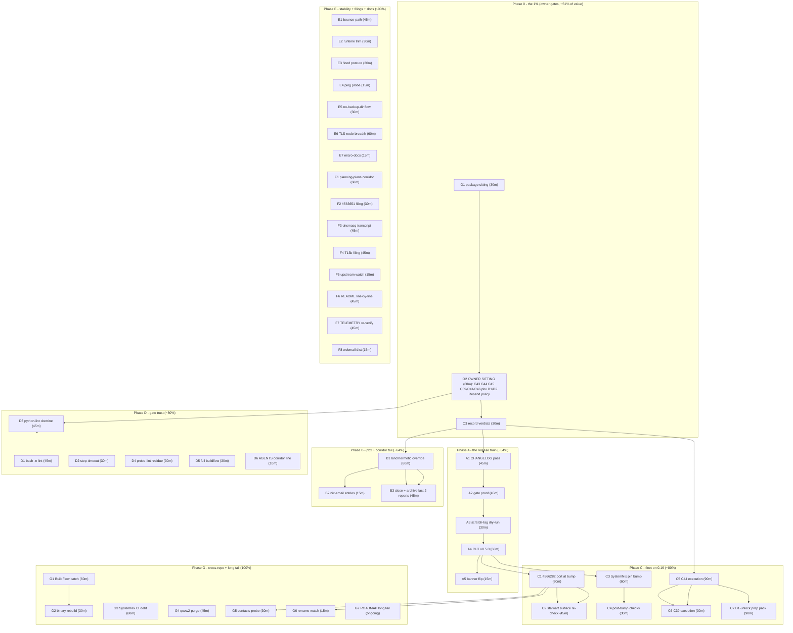

<!-- Y-generation master plan. Generated 2026-10-23 11:49 CEST (`date` CLI).
     Sources: TODO_LIST.md (2026-10-23 truth-up, the docs-health corridor
     pass), decision-batch.md (C38-C53), the two KEPT-LIVE status reports
     (2026-10-19_12-17 X-parent, 2026-10-20_14-19 closeout), the archived
     corridor (11 reports, manifest 2026-10-23), and the session residue
     list in docs/status/2026-10-23_11-26_*.md (section c + f). Every open
     TODO_LIST row + every open residue maps to exactly one task here
     (appendix C proves coverage). Supersedes the task routing of the
     P/V/W/X plans (their executed tasks live in CHANGELOG); those four
     files plus the 10-16 ancestor were ARCHIVED 2026-10-23 with per-task
     Appendix R dispositions (task F1, executed same day). -->

# Y-generation: release train through the owner gates (Pareto plan)

## 0. State of the world (verified 2026-10-23 11:4x CEST)

- FULL `nix flake check` GREEN, **11-check set** (incl. `check-set-lockstep`);
  origin CI green end-to-end (run 39864876276, 2026-10-22: ruff ->
  lockstep -> shape -> flake-check, first full exercise).
- The 0.16 migration is e2e-PROVEN (`stalwart-migrate-e2e` 9/9,
  `migrate-convert-eval`); the 0.16 backup story EXECUTED; JMAP contract
  re-verified; CardDAV probe transcripts landed; contacts assessment
  ratified (AGENTS pointer).
- The docs corridor is CLOSED: 13 reports annotated (575 verdicts), 11
  archived with manifest; exactly TWO live owners of open work remain
  (12-17 + 14-19), both waiting on ONE owner call (the pbx blessing).
- The fleet still runs **v0.4.0 = the 0.15 world** (SystemNix hard-pin).
  The breaking 0.16 upgrade sits fully loaded in CHANGELOG [Unreleased].
  Everything release-shaped is gated on ONE human sitting (C43 + friends).
- New tooling debt is small and bounded: bash -n lint, buildflow
  step-timeout, CI python-lint scope doctrine, probe-lint residue
  (four warning-level findings).

## 1. Doctrine constraints (non-negotiable while executing - the anti-Verschlimmbesserung contract)

1. **Never weaken module defaults to make a test pass** - fix the test.
2. Check add/remove = the **TWO sanctioned sites** (tests/check-expected.json
   - README prose row); the lockstep check enforces the rest. Pre-flight:
     `grep -rn '<name>' .github scripts tests README.md`.
3. Upstream filings: **verify-before-filing first, github-voice second**;
   no filing without a measured victim.
4. **No claim without a transcript** (probe/journal/gate log) - for new
   assertions AND for docs claims.
5. Annotated reports: per-cell strikes, `check-rows` before AND after
   dprint, archive only via git mv with a manifest row.
6. AGENTS.md stays at/below 220 lines - lessons EDIT existing bullets.
7. Release-critical files (CHANGELOG above all): **edit and commit in the
   same tool call** - the daemon races explicit commits.
8. Never `rm` (use trash), never `git reset --hard`, never bare
   `git checkout`; gate commands redirect, never pipe.
9. Do not "fix" the deliberate-OFF hardening defaults (rateLimits, DNSBL)
   and do not weaken the CI ruff floor - both are doctrine, not bugs.
10. One change = one logical unit; the gate (`nix flake check`) decides -
    not vibes, not cache hits (`--rebuild` when execution is the claim).

## 2. The Pareto cut (what actually moves the result)

**The result** = "Lars's fleet runs production mail on Stalwart 0.16 via
SystemNix, monitored, with a trustworthy gate and a burnable backlog."

| Slice                         | Tasks                                                                                              | Cumulative outcome                                                                                                                 | Why this slice                                                                                                        |
| ----------------------------- | -------------------------------------------------------------------------------------------------- | ---------------------------------------------------------------------------------------------------------------------------------- | --------------------------------------------------------------------------------------------------------------------- |
| **1% -> 51%**                 | O1-O3 (ONE owner sitting: C43, C44, C45, C39/C41/C46, pbx blessing, D1/D2, Resend, policy batch)   | Every blocked row unblocks; the release train, the pin advance, the corridor tail, and all live-enablement work get their verdicts | ~60 min of owner time gates >half of ALL remaining value; nothing else in the repo comes close                        |
| **4% -> 64%**                 | + A1-A5 (cut v0.5.0) + B1-B3 (land pbx flip, close the corridor)                                   | The breaking 0.16 upgrade is TAGGED and releasable; pbx master greens; the last two live reports archive                           | The release is the ONLY thing between the fleet and 0.16; the corridor tail is 24 arrows waiting on the same blessing |
| **20% -> 80%**                | + C1-C7 (SystemNix pin advance + post-verdict executions) + D1-D6 (gate-trust hygiene)             | The fleet ACTUALLY runs 0.16; every future landing is protected by the lint/timeout/doctrine trio                                  | A release nobody consumes is half a release; an untrustworthy gate quietly rots everything after it                   |
| **the remaining 80% -> 100%** | E (e2e stability lanes), F (docs corridors + upstream filings), G (cross-repo batches + long tail) | Bounce/trim/ping/TLS coverage, upstream truth, cross-repo debt, ROADMAP ideas                                                      | Real but deferrable: none of it blocks the fleet, and each lane is session-sized                                      |

The ordering below is exactly this cut, top to bottom. Nothing in E/F/G
may jump ahead of an unblocked A/B/C/D task (the only exception: a lane
whose external dependency lands early, e.g. BuildFlow's binary).

## 3. Level-1 plan (30-100 min tasks, ALL open TODOs, impact-sorted)

| ID | Phase | Task                                                                                                                                                                                                                                                                        | Impact | Effort  | Value | Depends on           |
| -- | ----- | --------------------------------------------------------------------------------------------------------------------------------------------------------------------------------------------------------------------------------------------------------------------------- | ------ | ------- | ----- | -------------------- |
| O1 | 0     | Package the owner sitting: fresh-read decision-batch, mark expired recommendations, draft the one-page ratification + verdict sheet (C38-C53, D1/D2, Resend, policy batch)                                                                                                  | High   | 30m     | 51%   | -                    |
| O2 | 0     | OWNER SITTING (Lars): answer C43 (v0.5.0 doctrine), C44 (secrets), C45 (package), C39/C41/C46, pbx hermetic blessing, D1/D2 timeline, Resend key, C18/C19/C22/C24/C29/C34/Q4, [rec] ratifications                                                                           | High   | 60m     | 51%   | O1                   |
| O3 | 0     | Record verdicts: decision-batch answers, TODO_LIST re-rows (delete closed, unblock gated), README banner truth-up                                                                                                                                                           | High   | 30m     | 51%   | O2                   |
| A1 | A     | CHANGELOG `[Unreleased]` date/link pass (links resolve, no duplicate blocks) + same-tool-call commit                                                                                                                                                                        | High   | 45m     | 64%   | O3 (C43=cut)         |
| A2 | A     | Release-tree gate proof: full `nix flake check` + full `buildflow` (30m budget), archive the log evidence                                                                                                                                                                   | High   | 45m     | 64%   | A1                   |
| A3 | A     | Scratch-tag dry-run of the CONTRIBUTING release procedure (walk it end-to-end on a throwaway tag, then delete)                                                                                                                                                              | High   | 30m     | 64%   | A2                   |
| A4 | A     | CUT v0.5.0: rename Unreleased, merge blocks, SECURITY.md bump, annotated tag, push, tag-CI watch, gh release + pkg.go.dev check                                                                                                                                             | High   | 60m     | 64%   | A3                   |
| A5 | A     | README banner flip to v0.5.0 + AGENTS/FEATURES release-state lines                                                                                                                                                                                                          | Med    | 15m     | 64%   | A4                   |
| B1 | B     | Land the pbx hermetic override (post-blessing): re-read their test-header spec, edit, VM run, their full gate green                                                                                                                                                         | High   | 60m     | 64%   | O2                   |
| B2 | B     | nix-email side of the pbx landing: CHANGELOG entry + TODO row close + cross-link issue #4                                                                                                                                                                                   | Med    | 15m     | 64%   | B1                   |
| B3 | B     | Corridor closeout: convert the open arrows in the two kept-live reports to verdicts, annotate, check-rows, git mv + manifest row                                                                                                                                            | Med    | 45m     | 64%   | B1                   |
| C1 | C     | Execute the #566282 port at the pin advance: `grep -rn 566282` preflight, rename `provision.elasticsearch` -> `opensearch`, strip guard, dmarc-eval + parsedmarc-e2e green                                                                                                  | High   | 60m     | 80%   | A4 (new pin exists)  |
| C2 | C     | Stalwart surface re-check per runbook: #552103 retirement if merged (vendored dir out), C45 execution if overlay chosen (VM cpu + module comment)                                                                                                                           | High   | 45m     | 80%   | C1                   |
| C3 | C     | SystemNix side: contract-test fix for the v0.5.0 wrapper API, their pin bump to v0.5.0, their CI green (their repo)                                                                                                                                                         | High   | 60m     | 80%   | A4                   |
| C4 | C     | Post-bump checks: aarch64 lockstep shape, dovecot rename warning gone, upstream watch re-check + evidence-cell dating                                                                                                                                                       | Med    | 30m     | 80%   | C1                   |
| C5 | C     | C44 execution: implement the chosen account-secrets doctrine (sops-rendered apply OR credential-file type OR admin-created doc), THREAT_MODEL update                                                                                                                        | High   | 90m     | 80%   | O2                   |
| C6 | C     | C39 execution: MemoryMax ownership verdict landed (wrapper mkDefault or consumer-layer doc)                                                                                                                                                                                 | Med    | 30m     | 80%   | O2                   |
| C7 | C     | D1-unlock prep pack: secrets-rotation runbook (SystemNix placeholders), vandelay-vs-imapsync compare plan, dmarc-live-poll checklist, Resend SASL smoke (needs key)                                                                                                         | Med    | 90m     | 80%   | O2, C5               |
| D1 | D     | bash -n lint over testScript shell fragments (extract + `bash -n`, new script or BuildFlow provider, self-test on the 28e5dd7 shape)                                                                                                                                        | Med    | 45m     | 80%   | -                    |
| D2 | D     | Bake `step-timeout` (nix-build ~25m) into `.buildflow.yml` + rationale; validate against one cold-ish full run                                                                                                                                                              | Med    | 30m     | 80%   | D5 (order swap ok)   |
| D3 | D     | CI python-lint doctrine: draft bandit/vulture scope + deeper-ruleset recommendation (5-min owner read), land on blessing                                                                                                                                                    | Med    | 45m     | 80%   | O2 (blessing)        |
| D4 | D     | Probe-lint residue + doctrine: SIM115 x4, FURB167 x2, PLW1510 x3 + the per-file-ignores-vs-chmod decision, encode it                                                                                                                                                        | Low    | 30m     | 80%   | -                    |
| D5 | D     | Full buildflow run on the final tree + fold the count-line residue note into the BuildFlow row                                                                                                                                                                              | Med    | 30m     | 80%   | -                    |
| D6 | D     | AGENTS.md corridor-scope line (EDIT the session-start ritual bullet: corridors sweep docs/{status,planning,reviews}) + AGENTS cap check                                                                                                                                     | Low    | 10m     | 80%   | -                    |
| E1 | E     | Relay bounce-path e2e subtest (refusing smarthost -> Mailpit/queue counters, never journal greps)                                                                                                                                                                           | Low    | 45m     | 100%  | -                    |
| E2 | E     | E2E runtime-trim investigation + test-profile TTL doctrine (35s TTL + 75s reports windows)                                                                                                                                                                                  | Low    | 30m     | 100%  | -                    |
| E3 | E     | Flood-subtest posture decision (owner taste) + capture-first protocol into the test header; demo-banner ritual while the VM is up                                                                                                                                           | Low    | 30m     | 100%  | O2 (posture)         |
| E4 | E     | EventSource `ping` parameter probe on the demo VM (last unprobed 0.16 JMAP quirk) + INBOXCLEAN line                                                                                                                                                                         | Low    | 15m     | 100%  | -                    |
| E5 | E     | migrate-e2e NO-backup-dir flow coverage (clean live store path)                                                                                                                                                                                                             | Low    | 30m     | 100%  | -                    |
| E6 | E     | TLS-node coverage for the Netease + LinkedIn parsedmarc fixtures (IMAPS node)                                                                                                                                                                                               | Low    | 60m     | 100%  | -                    |
| E7 | E     | Micro-doc batch: bind-e2e SAN comment + parsedmarc fixture-cert distinction note (14-19 f/32, f/34)                                                                                                                                                                         | Low    | 15m     | 100%  | -                    |
| F1 | F     | Planning-plans corridor: check W/X/P/V plans for strikes, annotate what is bare, archive all four to docs/planning/archived/ + manifest                                                                                                                                     | Med    | 60m     | 100%  | -                    |
| F2 | F     | #563651 follow-up comment: verify-before-filing reproduction, github-voice pass, post + retitle (post-O2 go)                                                                                                                                                                | Med    | 30m     | 100%  | O2 (go)              |
| F3 | F     | dnsmasq forward-vs-blackhole transcript FIRST, then fix the relay-e2e comment or forward, then venue + note                                                                                                                                                                 | Low    | 45m     | 100%  | -                    |
| F4 | F4    | T13b dprint pipe-cell filing (verify gates on the eaten-cells repro, then file)                                                                                                                                                                                             | Low    | 45m     | 100%  | -                    |
| F5 | F     | Upstream watch re-check (5 filings) + evidence-cell dating + mailsuite nudge decision (~11-05)                                                                                                                                                                              | Med    | 15m     | 100%  | -                    |
| F6 | F     | README full line-by-line verify pass (the only living doc never read end-to-end in a corridor pass)                                                                                                                                                                         | Med    | 45m     | 100%  | -                    |
| F7 | F     | TELEMETRY.md full key re-verify against the 0.16.22 binary (replace the standing caveat with a dated verdict)                                                                                                                                                               | Low    | 45m     | 100%  | -                    |
| F8 | F     | Webmail dist check (does nixpkgs `stalwart_0_16` bundle the UI?) + README/FEATURES line                                                                                                                                                                                     | Low    | 15m     | 100%  | -                    |
| G1 | G     | BuildFlow upstream batch (count gaps 12-vs-2 + 54-vs-4, ruff identity parsing, detect-only proposal, vulture policy, masking docs) (their repo)                                                                                                                             | Low    | 60m     | 100%  | their session landed |
| G2 | G     | BuildFlow binary rebuild + ef32fa0..HEAD delta review + reinstall + `buildflow -d` re-run (their repo)                                                                                                                                                                      | Low    | 30m     | 100%  | G1                   |
| G3 | G     | SystemNix CI-debt lanes: Actions credential, digest canary allowlist, 2 pin flips, scheduled-vs-push divergence (their repo)                                                                                                                                                | Med    | 60m     | 100%  | -                    |
| G4 | G     | qcow2 history purge (git-filter-repo + daemon-pause + force-with-lease) OR record the accept-clone-weight verdict (post-O2)                                                                                                                                                 | Low    | 45m     | 100%  | O2                   |
| G5 | G     | Pin-advance contacts probe set (carddav_probe.py 17/18 baseline + README dialect diff) - rides the first real bump                                                                                                                                                          | Low    | 30m     | 100%  | C1                   |
| G6 | G     | stalwart rename watch (disabledModules collision) - fold into the next pin advance                                                                                                                                                                                          | Low    | 15m     | 100%  | C1                   |
| G7 | G     | ROADMAP long tail (standing ideas, one session each when scheduled): DOMAIN_LANGUAGE.md, arch-diagram audit, vulnix replacement, OIDC wiring, catch-all + typed-secrets options, queue-depth surface, parsedmarc-real-0.16, non-goals pass, CI ruff caching, vm-debug ideas | Low    | ongoing | 100%  | -                    |

Sum of scheduled (non-owner, non-ongoing) work: roughly 20-24 h across
~35 tasks. Nothing here is larger than one focused session.

## 4. Level-2 plan (micro-tasks, max 12 min active work each, ALL TODOs)

Waits (gate/CI/VM runs) are marked `[wait]` - unattended, started by the
micro before them. Owner-time micros are marked `[owner]`.

| ID   | Task (max 12 min active)                                                                                                                                                                                                        | Parent | Depends  |
| ---- | ------------------------------------------------------------------------------------------------------------------------------------------------------------------------------------------------------------------------------- | ------ | -------- |
| O1.1 | Read decision-batch.md C38-C53 fresh; flag stale recommendations                                                                                                                                                                | O1     | -        |
| O1.2 | Draft the one-page ratification + verdict sheet (per decision: options, [rec], cost-of-delay)                                                                                                                                   | O1     | O1.1     |
| O1.3 | Attach the three evidence packs owners actually need: pbx runs-15/16 verdict, C45 delta table pointer, C44 options                                                                                                              | O1     | O1.2     |
| O2.1 | `[owner]` C43 + C45 + C44 + C39/C41/C46 verdicts                                                                                                                                                                                | O2     | O1       |
| O2.2 | `[owner]` pbx hermetic blessing + D1/D2 timeline + Resend key                                                                                                                                                                   | O2     | O1       |
| O2.3 | `[owner]` policy batch: C18/C19/C22/C24/C29/C34/Q4 + [rec] ratifications                                                                                                                                                        | O2     | O1       |
| O3.1 | Write verdicts into decision-batch.md (answer lines, dates)                                                                                                                                                                     | O3     | O2       |
| O3.2 | TODO_LIST re-row pass: delete closed rows, flip BLOCKED -> TODO, re-date the sweep banner                                                                                                                                       | O3     | O3.1     |
| O3.3 | README banner + FEATURES release-state truth-up; same-tool-call commit                                                                                                                                                          | O3     | O3.2     |
| A1.1 | Inventory `[Unreleased]` links; list every PR/issue ref                                                                                                                                                                         | A1     | O3       |
| A1.2 | Resolve/verify each link target; fix dead ones                                                                                                                                                                                  | A1     | A1.1     |
| A1.3 | Merge duplicate Added/Changed/Fixed blocks (sessions append in parallel); commit (same tool call)                                                                                                                               | A1     | A1.2     |
| A2.1 | `nix flake check` on the release tree, redirect to log `[wait]`                                                                                                                                                                 | A2     | A1       |
| A2.2 | `buildflow --max-time 30m` full run `[wait]`; read per-step findings                                                                                                                                                            | A2     | A2.1     |
| A2.3 | Archive both logs as release evidence; note warnings-only verdicts                                                                                                                                                              | A2     | A2.2     |
| A3.1 | Read CONTRIBUTING "Release procedure" once, note deviations since v0.3.1                                                                                                                                                        | A3     | A2       |
| A3.2 | Cut scratch tag; push; watch tag-CI `[wait]`                                                                                                                                                                                    | A3     | A3.1     |
| A3.3 | Delete scratch tag; write the deviation notes into the procedure if any                                                                                                                                                         | A3     | A3.2     |
| A4.1 | Rename `[Unreleased]` -> `[v0.5.0] - <date>`; fresh empty Unreleased; commit (same tool call)                                                                                                                                   | A4     | A3       |
| A4.2 | SECURITY.md supported-versions bump; commit                                                                                                                                                                                     | A4     | A4.1     |
| A4.3 | Annotated tag v0.5.0; push master + tag                                                                                                                                                                                         | A4     | A4.2     |
| A4.4 | Watch tag-CI `[wait]`; triage by STEP name if red (never "the known one")                                                                                                                                                       | A4     | A4.3     |
| A4.5 | gh release create + verify pkg.go.dev + `nix run github:...?ref=v0.5.0` smoke                                                                                                                                                   | A4     | A4.4     |
| A5.1 | README banner flip to v0.5.0; AGENTS/FEATURES release lines; lints; commit                                                                                                                                                      | A5     | A4       |
| B1.1 | Re-read the pbx test-header hermetic spec + their TODO row (their repo)                                                                                                                                                         | B1     | O2       |
| B1.2 | Edit the pocketid Directory override (`mkVMOverride`, non-remote `@type`)                                                                                                                                                       | B1     | B1.1     |
| B1.3 | VM run of stalwart-host-wiring `[wait]`; read the transcript                                                                                                                                                                    | B1     | B1.2     |
| B1.4 | Their full gate `[wait]`; watch the three legs (993/995 TLS greeting, 8082 401, admin auth)                                                                                                                                     | B1     | B1.3     |
| B1.5 | Fold the run transcript into the test header; their daemon commits                                                                                                                                                              | B1     | B1.4     |
| B2.1 | nix-email CHANGELOG entry + TODO row close + issue #4 cross-link; commit                                                                                                                                                        | B2     | B1       |
| B3.1 | Spec the arrow-verdicts for the two kept-live reports (12-17, 14-19) from the specs TSV format                                                                                                                                  | B3     | B1       |
| B3.2 | Apply via annotate.go repair; sweep the bullet arrows with the house grammar                                                                                                                                                    | B3     | B3.1     |
| B3.3 | check-rows + dprint + pipes lint; `grep -L '~~'` completeness                                                                                                                                                                   | B3     | B3.2     |
| B3.4 | git mv both to archived/ + manifest rows + AGENTS pointer sweep                                                                                                                                                                 | B3     | B3.3     |
| C1.1 | Pre-flight `grep -rn 566282` (the four retire-together surfaces)                                                                                                                                                                | C1     | A4       |
| C1.2 | Bump the nixpkgs input (lock only, compat doctrine); eval attrNames guards both arches                                                                                                                                          | C1     | C1.1     |
| C1.3 | Port dmarc-monitor.nix: rename option, re-point strip guard, module comment                                                                                                                                                     | C1     | C1.2     |
| C1.4 | dmarc-eval green; parsedmarc-e2e green `[wait]`                                                                                                                                                                                 | C1     | C1.3     |
| C1.5 | imapclient py3.13 pin revert (>= 4.1.0 check) + ExecStart mkForce review                                                                                                                                                        | C1     | C1.4     |
| C2.1 | Runbook step 2 bullet 3: is #552103 merged into the new pin? If yes: vendored-dir retirement checklist                                                                                                                          | C2     | C1       |
| C2.2 | C45 execution IF overlay chosen: VM cpu-type + vendored module comment + gate; else record stand-verdict                                                                                                                        | C2     | C1       |
| C3.1 | SystemNix: read their contract test; list the v0.5.0 API deltas it asserts (their repo)                                                                                                                                         | C3     | A4       |
| C3.2 | Fix their contract test for the wrapper API; their eval green                                                                                                                                                                   | C3     | C3.1     |
| C3.3 | Their pin bump to `?ref=v0.5.0` + their CI `[wait]` (their repo)                                                                                                                                                                | C3     | C3.2     |
| C4.1 | aarch64 lockstep shape eval; dovecot rename warning check                                                                                                                                                                       | C4     | C1       |
| C4.2 | Upstream watch re-check + date the watch row evidence cell                                                                                                                                                                      | C4     | C1       |
| C5.1 | Draft the chosen C44 mechanism (option type, sops flow, or admin-created doc) - one page, THREAT_MODEL delta                                                                                                                    | C5     | O2       |
| C5.2 | Implement the wrapper side (option + credential wiring OR doc-only posture)                                                                                                                                                     | C5     | C5.1     |
| C5.3 | Eval + e2e proof of the secrets path; lints; commit                                                                                                                                                                             | C5     | C5.2     |
| C6.1 | Land the C39 verdict (wrapper MemoryMax mkDefault OR consumer-layer THREAT_MODEL note); commit                                                                                                                                  | C6     | O2       |
| C7.1 | Secrets-rotation runbook for the three SystemNix placeholders                                                                                                                                                                   | C7     | O2       |
| C7.2 | vandelay-vs-imapsync compare plan (scratch-mailbox procedure, R6)                                                                                                                                                               | C7     | O2       |
| C7.3 | dmarc-live-poll checklist (first-poll steps, JSON/CSV landing, alert encoding)                                                                                                                                                  | C7     | O2       |
| C7.4 | Resend SASL smoke vs smtp.resend.com:587 (needs the key from O2) `[wait]`                                                                                                                                                       | C7     | O2       |
| D1.1 | Write the fragment extractor (succeed/execute strings from tests/*.nix)                                                                                                                                                         | D1     | -        |
| D1.2 | `bash -n` each; self-test on the 28e5dd7 unclosed-brace shape (must FAIL)                                                                                                                                                       | D1     | D1.1     |
| D1.3 | Wire into CI or BuildFlow; pre-push parity; README bullet if a check (two sites)                                                                                                                                                | D1     | D1.2     |
| D2.1 | Add `step-timeout` to .buildflow.yml + rationale comment; commit                                                                                                                                                                | D2     | -        |
| D2.2 | Validate against a full run `[wait]`; adjust if tight                                                                                                                                                                           | D2     | D2.1     |
| D3.1 | Draft the bandit/vulture CI scope + deeper-ruleset recommendation (the 5-min owner read)                                                                                                                                        | D3     | -        |
| D3.2 | `[owner]` bless; land the ci.yml/.buildflow.yml change; negative self-test                                                                                                                                                      | D3     | D3.1, O2 |
| D4.1 | Fix SIM115 x4 + FURB167 x2 + PLW1510 x3 in docs/probes                                                                                                                                                                          | D4     | -        |
| D4.2 | Encode the doctrine (per-file-ignores block OR convention line); ruff clean; commit                                                                                                                                             | D4     | D4.1     |
| D5.1 | Full buildflow run on the final tree `[wait]`; compare counts vs CI floor                                                                                                                                                       | D5     | -        |
| D5.2 | Fold the count-line residue into the BuildFlow TODO row; commit                                                                                                                                                                 | D5     | D5.1     |
| D6.1 | EDIT the AGENTS session-start ritual bullet (corridor scope: docs/{status,planning,reviews}); cap check; commit                                                                                                                 | D6     | -        |
| E1.1 | Write the refusing-smarthost bounce subtest (Mailpit counters / queue state)                                                                                                                                                    | E1     | -        |
| E1.2 | Run stalwart-relay-e2e `[wait]`; green + transcript                                                                                                                                                                             | E1     | E1.1     |
| E2.1 | Profile the 35s TTL + 75s reports windows from the last gate log                                                                                                                                                                | E2     | -        |
| E2.2 | Write the test-profile TTL doctrine (never weaken module defaults); commit                                                                                                                                                      | E2     | E2.1     |
| E3.1 | `[owner]` flood posture (watch vs built-in retry-with-capture)                                                                                                                                                                  | E3     | O2       |
| E3.2 | Encode capture-first protocol into the stalwart-e2e header; demo-banner ritual if a VM is up                                                                                                                                    | E3     | E3.1     |
| E4.1 | Ping-parameter probe on the demo VM (es_probe.py shape) + INBOXCLEAN line; JMAP anti-rot row close                                                                                                                              | E4     | -        |
| E5.1 | Write the NO-backup-dir migrate-e2e flow (clean live store)                                                                                                                                                                     | E5     | -        |
| E5.2 | Run `[wait]`; green; commit                                                                                                                                                                                                     | E5     | E5.1     |
| E6.1 | Move the Netease fixture to the IMAPS node; run parsedmarc-e2e `[wait]`                                                                                                                                                         | E6     | -        |
| E6.2 | LinkedIn fixture same; green; commit                                                                                                                                                                                            | E6     | E6.1     |
| E7.1 | Bind-e2e SAN comment + parsedmarc fixture-cert distinction note; commit                                                                                                                                                         | E7     | -        |
| F1.1 | Grep the four plans for existing strikes (W15 covered V/P)                                                                                                                                                                      | F1     | -        |
| F1.2 | Annotate bare items (status-items/repair, house grammar)                                                                                                                                                                        | F1     | F1.1     |
| F1.3 | check-rows + dprint; git mv to planning/archived/ + manifest                                                                                                                                                                    | F1     | F1.2     |
| F2.1 | Reproduce the #563651 persistence claim against current master (verify-before-filing)                                                                                                                                           | F2     | O2       |
| F2.2 | github-voice pass; post + retitle; link into the watch row                                                                                                                                                                      | F2     | F2.1     |
| F3.1 | Driver-VM + demo-VM dnsmasq transcript (scope split documented)                                                                                                                                                                 | F3     | -        |
| F3.2 | Fix the relay-e2e comment or forward; venue + note/filing                                                                                                                                                                       | F3     | F3.1     |
| F4.1 | Reproduce the T13b eaten-cells repro on current dprint; gates; file                                                                                                                                                             | F4     | -        |
| F5.1 | Watch re-check (5 filings) + evidence-cell dating; mailsuite nudge call (~11-05)                                                                                                                                                | F5     | -        |
| F6.1 | README lines 1-200 verify (claims vs code)                                                                                                                                                                                      | F6     | -        |
| F6.2 | README lines 200-end verify; fix drift inline                                                                                                                                                                                   | F6     | F6.1     |
| F7.1 | Pull the metrics dump; diff TELEMETRY keys vs the 0.16.22 binary; dated verdict banner                                                                                                                                          | F7     | -        |
| F8.1 | nix eval the stalwart closure for a webmail dist; document or flag; commit                                                                                                                                                      | F8     | -        |
| G1.1 | Reproduce the two BuildFlow count gaps; read-only diagnosis (their repo)                                                                                                                                                        | G1     | -        |
| G1.2 | File the ruff identity-parsing bug + detect-only proposal (their gates first)                                                                                                                                                   | G1     | G1.1     |
| G2.1 | BuildFlow: rebuild binary, ef32fa0..HEAD delta review, reinstall, `buildflow -d` re-run (their repo)                                                                                                                            | G2     | G1       |
| G3.1 | SystemNix: Actions credential + digest canary allowlist (their repo)                                                                                                                                                            | G3     | -        |
| G3.2 | SystemNix: 2 pin flips + scheduled-vs-push divergence explanation (their repo)                                                                                                                                                  | G3     | G3.1     |
| G4.1 | `[owner]` qcow2 verdict; then purge (filter-repo + daemon pause + force-with-lease) or record accept                                                                                                                            | G4     | O2       |
| G5.1 | Pin-advance contacts probe (carddav 17/18 baseline + dialect diff); INBOXCLEAN procedure step                                                                                                                                   | G5     | C1       |
| G6.1 | stalwart rename watch at the bump (disabledModules collision check)                                                                                                                                                             | G6     | C1       |
| G7.x | ROADMAP long tail - one session per idea, scheduled on demand (DOMAIN_LANGUAGE, arch audit, vulnix, OIDC, catch-all/typed-secrets options, queue-depth surface, parsedmarc-real-0.16, non-goals, CI ruff cache, vm-debug ideas) | G7     | -        |

## 5. Execution graph (mermaid)

## 6. Coverage appendix - every open row maps to exactly one task

| Open item (source)                                    | Task                                                                              |
| ----------------------------------------------------- | --------------------------------------------------------------------------------- |
| Cut v0.5.0 (TODO 0.16 release path)                   | A1-A5                                                                             |
| SystemNix consumer pin advance                        | C1-C4                                                                             |
| C42 dmarc-monitor retire-or-keep (owner)              | O2 (verdict); execution rides G7 if keep (ARF probe) or a retire commit if retire |
| C44 account-secrets doctrine                          | O2 + C5                                                                           |
| C45 package decision                                  | O2 + C2.2                                                                         |
| dmarc-monitor live validation (D1)                    | C7 (prep), D1-lane execution                                                      |
| MemoryMax policy (C39)                                | O2 + C6                                                                           |
| SystemNix CI-debt residue                             | G3                                                                                |
| pbx-artmann flip (owner blessing)                     | O2 + B1-B3                                                                        |
| CI python-lint remainder (bandit/vulture scope)       | D3                                                                                |
| Relay bounce-path e2e subtest                         | E1                                                                                |
| E2E runtime trim investigation                        | E2                                                                                |
| Flood-subtest refill flake watch + posture            | E3                                                                                |
| EventSource ping probe (JMAP anti-rot remainder)      | E4                                                                                |
| Upstream filings remainder (dnsmasq, T13b)            | F3, F4                                                                            |
| Upstream watch (5 filings + retire checklists)        | F5 (+C2.1, G6)                                                                    |
| BuildFlow upstream follow-ups                         | G1-G2                                                                             |
| TLS-node coverage (Netease + LinkedIn)                | E6                                                                                |
| Watch nixpkgs stalwart rename past 0.16               | G6                                                                                |
| Pin-advance contacts probe set                        | G5                                                                                |
| NEW bash -n lint                                      | D1                                                                                |
| NEW probe-lint residue + doctrine                     | D4                                                                                |
| NEW buildflow step-timeout                            | D2                                                                                |
| NEW migrate-e2e no-backup-dir flow                    | E5                                                                                |
| NEW webmail dist check                                | F8                                                                                |
| Migration tooling compare (vandelay vs imapsync, D1)  | C7.2                                                                              |
| Rotate three SystemNix placeholder secrets (D1)       | C7.1                                                                              |
| Resend SASL verify + smoke (needs key)                | C7.4                                                                              |
| Branch-protection policy (C18)                        | O2.3 + settings micro on verdict                                                  |
| Renovate install-or-drop (C19)                        | O2.3 + app-install/drop micro                                                     |
| GitHub Discussions (C22)                              | O2.3 + settings micro                                                             |
| qcow2 history purge or accept verdict                 | G4                                                                                |
| Ratify/override [rec] adoptions + C39-C46 sitting     | O1-O3                                                                             |
| RESIDUE: W/X/P/V planning plans annotate/archive      | F1                                                                                |
| RESIDUE: AGENTS corridor-scope line                   | D6                                                                                |
| RESIDUE: buildflow full gate on final tree            | D5                                                                                |
| RESIDUE: kept-live reports closeout                   | B3                                                                                |
| RESIDUE: README line-by-line                          | F6                                                                                |
| RESIDUE: TELEMETRY full re-verify                     | F7                                                                                |
| RESIDUE: demo banner ritual / SAN comment / cert note | E3.2, E7                                                                          |
| ROADMAP standing ideas (10 items)                     | G7                                                                                |
| CI ruff caching, vm-debug --script-only/--check ideas | G7                                                                                |

## 7. Kill-switches (how this plan avoids Verschlimmbessering)

- The gate decides every landing: `nix flake check` + the md lints +
  buildflow - a task without its gate evidence is not done.
- Owner gates stay owner gates: O2 verdicts are recorded verbatim in
  decision-batch; the executor never "helpfully" defaults an unanswered
  decision (the C42/C44/C45 rows stay BLOCKED, visibly).
- The corridor closes only via the annotate grammar + check-rows +
  manifest - no bulk rewrites of history, no archived-file edits.
- Any task that turns out >2x its estimate stops and re-plans (the X5
  lesson: plans must price the assertions behind the pin, not the pin).
- Rollback posture: every phase lands as its own commit(s); a red gate
  reverts the task, not the doctrine.
