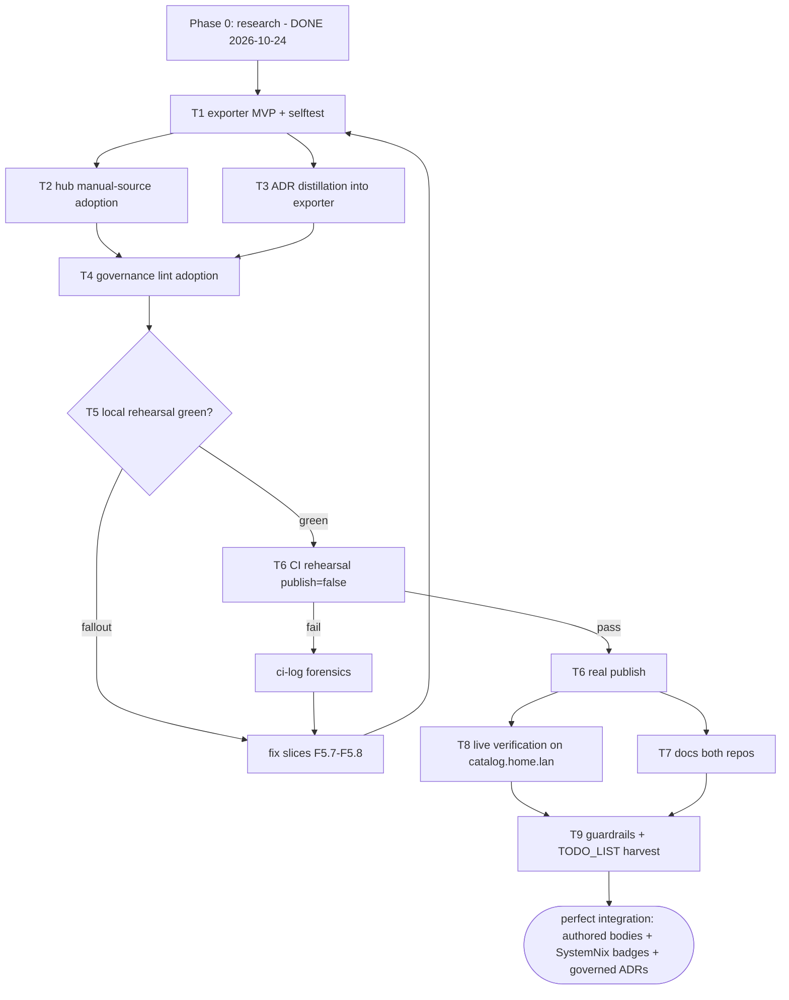

# nix-email → eventcatalog-hub: perfect integration

Goal: nix-email stops being a bare platform-inventory row on
catalog.home.lan and becomes a first-class, governed EventCatalog source —
rich authored service pages plus ADRs — while the SystemNix inventory keeps
owning deployment badges. Zero hub pipeline changes required (verified
below); all work is (a) an exporter in nix-email and (b) a manual-source
adoption in the hub.

## Errata — corrections of earlier session claims (research receipts)

1. **"Drop a `.eventcatalog-hub.json` convention file" was WRONG for
   nix-email.** Convention files are only read for consumers the depgraph
   CLI discovers (go-cqrs-lite `who-uses`, `scripts/generate-sources.sh:5-13`);
   nix-email is not a Go module and will never appear. The ONLY adoption
   path is `sources.manual.json` in the hub (verbatim inclusion, same
   script, lines 12-13).
2. **"The hub is TS" was imprecise.** The hub pipeline is bash
   (`build.sh`, `scripts/*.sh`) + Python (`merge.py`, `render-inventory.py`,
   `aggregate-error-insights.py`); Node appears only in the site-build step
   (`npm ci`, `@eventcatalog/linter`, `@eventcatalog/core generate/build` —
   `.forgejo/workflows/build.yml:389-486`). The TypeScript/Astro thing is
   EventCatalog CORE (`@eventcatalog/core` ^5.4.1, `package.json:16`), it
   runs hub-side only, and sources never execute it.
3. **Schema-verification vintage.** `docs/adr-exporter-contract.md` pinned
   frontmatter against core 5.1.1; the hub now pins ^5.4.1. The local
   rehearsal (T5) is the re-verification — linter + core build both run
   there.
4. **Exporter language verdict (the "why not TypeScript" question), now
   with receipts:**
   - Sources emit static MDX trees; the contract is `build` (shell string)
     - `export` (argv array, `eval`'d from the clone root, `build.sh:250-256`)
     - `tree` (path). Language is irrelevant to the hub.
   - Existing sources: six `go build` + one `nix build` (crm). Zero Node.
   - `python3` is a documented hard requirement of the whole pipeline
     (`build.sh:6`) and is used bare on the CI runner outside any nix wrap
     (`build.yml:93,331`); source jobs run inside
     `nix shell nixpkgs#go_1_27 nixpkgs#gcc -c bash` which overlays (does
     not replace) the runner PATH.
   - nix-email is 22% Python by line share (Forgejo stats, 2026-10-24):
     migration machinery, probes, fixtures; BuildFlow already lints its
     python (ruff/flake8/bandit). It has zero Node toolchain — a TS
     exporter would add package.json + node_modules + lockfile to a
     Nix-only repo for zero contract benefit.
   - CI clone dirs are NOEXEC (`build.sh:217-230`, the ECBIN rewrites):
     invoke as `python3 scripts/export-catalog.py …` (interpreter from
     PATH), never `./scripts/…` (direct exec of a file on the mount).

## Verified integration state (2026-10-24, all read from source)

| Layer                      | State            | Receipt                                                                                                                                                                                                                                             |
| -------------------------- | ---------------- | --------------------------------------------------------------------------------------------------------------------------------------------------------------------------------------------------------------------------------------------------- |
| Platform inventory         | DONE             | SystemNix `services.catalog` declares `mail-server`, `dmarc-monitor`, `mail-relay` (modules/nixos/services/catalog-platform.nix:69+); inventory.json carries all three; hourly `catalog-inventory-sync` timer rewrites + daemon commits             |
| Inventory → service pages  | DONE             | `render-inventory.py:130` writes `services/<id>/index.mdx` (version hardcoded `1.0.0`, line 56)                                                                                                                                                     |
| Badge-union composition    | DONE (mechanism) | `build.sh:285-292` merges trees sources-first, `work/out/systemnix` LAST; `merge.py:306-320` unions badges by `content`, body first-wins — "go sources win rich bodies on id collisions; the deployment badges union through" (build.sh comment 2b) |
| ADR ingestion              | DONE (hub side)  | `merge.py:37-39,452+`: `adrs/` discovered top-level, under `domains/`, under `services/`; strict gate validates `appliesTo` id + optional version + type-vs-collection agreement (`TYPE_TO_COLLECTION` merge.py:211-226)                            |
| Governance lint per source | DONE (hub side)  | `lint-sources.sh` runs `@eventcatalog/linter` full-severity against a source's `lint` tree; sources without a `lint` block are skipped by design                                                                                                    |
| Error-insights manifest    | N/A for us       | Manifest-free sources render "—" (`aggregate-error-insights.py:204+`); we will NOT emit `catalog.index.json` — zero schemaVersion risk                                                                                                              |
| Forgejo mirror             | DONE             | `lars/nix-email` exists, synced 2026-10-24 15:30, master, 537 commits                                                                                                                                                                               |
| Source adoption            | NOT DONE         | Absent from `sources.json` AND `excluded` AND `sources.manual.json`; depgraph cannot ever discover it (Go-module graph only)                                                                                                                        |
| depgraph CLI locally       | AVAILABLE        | `/run/current-system/sw/bin/project-dependency-graph` (needed by `generate-sources.sh`)                                                                                                                                                             |
| TODO_LIST overlap          | NONE             | No catalog rows in nix-email TODO_LIST.md                                                                                                                                                                                                           |

**"Perfect integration" definition (mechanically verified):** nix-email's
export tree provides the bodies for `services/mail-server` and
`services/dmarc-monitor` (merged before the inventory tree → first-wins
body), the SystemNix inventory tree contributes the deployment chips
(union-through), and nix-email's ADRs render at `/docs/adrs/<id>/…` with
self-resolving `appliesTo` pointers into its own services.

## Content scope (deliberately minimal — verschlimmbessern guard)

Emit ONLY:

```text
<tree>/
  services/mail-server/index.mdx      # body distilled from README module docs
  services/dmarc-monitor/index.mdx    # body distilled from README module docs
  adrs/<id>/index.mdx                 # 5-7 real decisions, statuses honest
```

- Service `version:` MUST be `1.0.0` — lockstep with
  `render-inventory.py:56` (else the union carries two versions for one id).
- `owners: [lars]` matches the inventory renderer's owner default.
- NO `catalog.index.json` (manifest-free → renders "—"), NO bootstrap
  files (hub owns them), NO channels/domains/flows/entities repurposing
  (EventCatalog channels mean async messaging between services; mail
  protocol endpoints are not that — deferred until real value appears).
- ADR candidates (from README ledger + ROADMAP, statuses honest):
  1. `thin-wrapper-doctrine` — accepted — wrap only what needs NixOS
     wiring, provision model owns the rest (validated by
     nixos-mailserver's removal of backup/monitoring options).
  2. `vendor-stalwart-016-module` — accepted — vendored module
     (nixpkgs PR #552103) with provenance + retirement checklist in-file.
  3. `hardening-defaults-off` — accepted — `rateLimits`/`spamFilter.dnsbl`
     opt-in; the empty DNSBL reconcile set destroying 0.16.22's 18
     shipped-broken rows ALWAYS ships.
  4. `store-boundary-guard` — accepted — 0.15→0.16 poison class; unit
     guard as the hard boundary; migration script preflight as hard stop.
  5. `hard-pin-compat-doctrine` — accepted — consumers pin release tags;
     nixpkgs pinned to SystemNix's lock rev; bump both together (C17a
     executed).
  6. `parsedmarc-keep-or-retire` — proposed — Stalwart 0.16 ingests
     aggregate reports natively; parsedmarc keeps file sinks + IMAP
     polling (C42, owner-gated).
  7. `stalwart-pin-vs-overlay` — proposed — stay on the pin's 0.16.22 vs
     overlay a newer 0.16.x (C45, owner-gated; the 0.16.23-26 delta is
     recorded evidence).
- Every `appliesTo` points at `service: mail-server` or
  `service: dmarc-monitor` (or both) — resolves in-union by construction.

## The `sources.manual.json` entry (T2 deliverable, exact shape)

```json
{
  "branch": "master",
  "build": "true",
  "export": [
    "python3",
    "scripts/export-catalog.py",
    "-o",
    "work/out/nix-email"
  ],
  "forgejo": "lars/nix-email",
  "lint": {
    "export": [
      "python3",
      "scripts/export-catalog.py",
      "-o",
      "work/lint/nix-email",
      "--plain"
    ],
    "tree": "work/lint/nix-email"
  },
  "name": "nix-email",
  "repo": "LarsArtmann/nix-email",
  "tree": "work/out/nix-email"
}
```

- `build: "true"` — nothing to compile; the exporter is committed source
  (contract requires a non-empty string, `build.sh:115`).
- `--plain` — bare-refs re-export for the governance lint tree
  (exporter flag; with no versioned outgoing refs it renders the same
  tree — the flag exists for lint-block parity, mesh-orders pattern).
- After editing `sources.manual.json`: run
  `scripts/generate-sources.sh` (regenerates `sources.json`; NEVER
  hand-edit it), verify `--check` clean, dprint the hub, commit BOTH
  files in one go (the daemon races explicit commits).

## Pareto breakdown

- **1% → 51%:** exporter MVP (2 service pages) + manual-source entry.
  nix-email goes from inventory row to authored architecture pages on
  catalog.home.lan; badge composition already works.
- **4% → 64%:** + the ADR set (decisions currently trapped in README
  prose + ROADMAP become first-class routed, gate-checked artifacts) +
  governance-lint adoption (nix-email becomes a fully governed source,
  not a skipped one).
- **20% → 80%:** + exporter selftest + local full-pipeline rehearsal
  green (strict gate, full-severity lint, dist assertions) + docs in both
  repos + TODO_LIST harvest.
- **The other 20% → 100%:** CI rehearsal (`publish=false`) then real
  publish; live post-land verification on catalog.home.lan; SystemNix
  description-sync discipline; deferred-kinds decision documented;
  dmarc-monitor go-live badge flip rides the inventory automatically
  (no source change needed when SystemNix flips `enable = true`).

## Comprehensive plan — medium granularity (30-100 min tasks)

Sorted by importance, then impact, then effort. Impact 1-10 (10 = the
integration visibly lands). "Value" = customer value on catalog.home.lan.

| ID | Task                                                                                                                                                                                                                                                                                                                 | Imp      | Impact | Effort          | Value | Depends |
| -- | -------------------------------------------------------------------------------------------------------------------------------------------------------------------------------------------------------------------------------------------------------------------------------------------------------------------- | -------- | ------ | --------------- | ----- | ------- |
| T1 | Exporter MVP `scripts/export-catalog.py` in nix-email: argparse (`-o`, `--plain`, `--selftest`), stdlib only, deterministic; service pages for mail-server + dmarc-monitor distilled from README module docs; `--selftest` golden test (tempdir export, assert file set + frontmatter keys + version lockstep 1.0.0) | Critical | 10     | M (~90min)      | H     | —       |
| T2 | Hub adoption: append entry to `sources.manual.json`, run `generate-sources.sh`, `--check` clean, dprint, commit manual+generated together                                                                                                                                                                            | Critical | 9      | S (~30min)      | H     | T1      |
| T3 | ADR distillation: 7 ADRs (list above) wired into exporter data with `appliesTo`; selftest extended to assert every pointer resolves inside the exported tree                                                                                                                                                         | High     | 8      | M (~90min)      | H     | T1      |
| T4 | Governance lint adoption: `--plain` mode verified, `lint` block in the manual entry, local `lint-sources.sh` run green                                                                                                                                                                                               | High     | 7      | S (~30min)      | M     | T2, T3  |
| T5 | Local full-pipeline rehearsal in the hub: `./build.sh` (BUILD_FROM_GITHUB=1 tokenless or GIT_CLONE_TOKEN), inspect merge.py strict gate (0 dangling), per-source lint, dist assertions, `npx eventcatalog preview` eyeball of both service pages + ADR routes; fix fallout until green                               | Critical | 9      | M-L (~60-90min) | H     | T4      |
| T6 | CI rehearsal then publish: `sudo bash scripts/ci-dispatch.sh` with `publish=false`; `scripts/ci-log.sh --steps` forensics; then the real dispatch; verify `build-stamp.json` covers the nix-email rev and `check-stale-sources.sh` stays quiet                                                                       | High     | 8      | M (~45min)      | H     | T5      |
| T7 | Docs: nix-email AGENTS.md integration section (exporter contract, version-lockstep rule, NOEXEC invocation form, sync discipline) + README section + CHANGELOG row; hub-side count/list touch-ups if any prose says "7 sources"                                                                                      | Medium   | 6      | S-M (~40min)    | M     | T6      |
| T8 | Live verification: after mirror (≤6h) + CI + sync-timer chain, open catalog.home.lan — service bodies are nix-email-authored, badges are SystemNix chips, ADR routes render; receipts (URLs/screenshots) into a status report under docs/status/                                                                     | Medium   | 7      | S (~30min)      | H     | T6      |
| T9 | Guardrails + harvest: TODO_LIST rows (SystemNix description-sync cadence; deferred kinds: channels/domains/flows; errorSurface stays N/A), then mark plan executed                                                                                                                                                   | Medium   | 5      | S (~30min)      | M     | T8      |

## Fine-grained breakdown (≤12 min per task)

| ID    | Sub-task                                                                                                                                                   | Min | Parent |
| ----- | ---------------------------------------------------------------------------------------------------------------------------------------------------------- | --- | ------ |
| F1.1  | Read `scripts/host-parse-fixture.py` + `.buildflow.yml` python lint config; note ruff/line-length rules for the new script                                 | 8   | T1     |
| F1.2  | Skeleton: argparse (`-o/--out` required, `--plain`, `--selftest`), outdir guard (refuse existing non-empty dir), `main()`                                  | 10  | T1     |
| F1.3  | Data: `mail-server` service dict (id, name, version 1.0.0, summary, owners [lars], body sections from README: listener table, options, provision doctrine) | 12  | T1     |
| F1.4  | Data: `dmarc-monitor` service dict (module doc + C42 caveat noted as status-proposed cross-ref)                                                            | 10  | T1     |
| F1.5  | Frontmatter renderer: YAML-safe scalars via json.dumps fallback (the crowdsec `:` lesson, `render-inventory.py:35-46` pattern)                             | 12  | T1     |
| F1.6  | Body renderer + tree writer; assert emitted paths match `services/<id>/index.mdx` shape                                                                    | 12  | T1     |
| F1.7  | `--selftest`: export to tempdir; assert file set, frontmatter keys, `version: 1.0.0` both services, no bare `\|` breakers in tables                        | 12  | T1     |
| F1.8  | Determinism: export twice, `diff -r` zero                                                                                                                  | 5   | T1     |
| F1.9  | `--plain` mode flag wired (same tree; documented lint parity)                                                                                              | 5   | T1     |
| F1.10 | buildflow/ruff pass over the new script (budget `--max-time >= 30m`)                                                                                       | 12  | T1     |
| F2.1  | Write the `sources.manual.json` entry (exact shape above), jq-validate                                                                                     | 10  | T2     |
| F2.2  | Run `scripts/generate-sources.sh`; confirm nix-email lands in `sources.json` sorted position (between mesh-* and pbx-lens)                                 | 10  | T2     |
| F2.3  | `generate-sources.sh --check` + hub dprint check                                                                                                           | 8   | T2     |
| F2.4  | Commit hub (manual + generated together; daemon races)                                                                                                     | 5   | T2     |
| F3.1  | ADR inventory pass: grep README ledger + ROADMAP for decision IDs (C42, C45, C17a, D1/D2) and dates; pin statuses                                          | 10  | T3     |
| F3.2  | ADR 1 `thin-wrapper-doctrine` content                                                                                                                      | 12  | T3     |
| F3.3  | ADR 2 `vendor-stalwart-016-module` content                                                                                                                 | 12  | T3     |
| F3.4  | ADR 3 `hardening-defaults-off` content                                                                                                                     | 10  | T3     |
| F3.5  | ADR 4 `store-boundary-guard` content                                                                                                                       | 12  | T3     |
| F3.6  | ADR 5 `hard-pin-compat-doctrine` content                                                                                                                   | 12  | T3     |
| F3.7  | ADR 6 `parsedmarc-keep-or-retire` (proposed)                                                                                                               | 10  | T3     |
| F3.8  | ADR 7 `stalwart-pin-vs-overlay` (proposed)                                                                                                                 | 10  | T3     |
| F3.9  | Wire ADR data into exporter; `appliesTo` typed pointers to own services                                                                                    | 12  | T3     |
| F3.10 | selftest: every `appliesTo` id+type resolves inside the exported tree (mirror of merge.py kind check)                                                      | 12  | T3     |
| F4.1  | lint tree export smoke: `--plain` into a scratch dir, eyeball frontmatter refs bare                                                                        | 8   | T4     |
| F4.2  | Add `lint` block to the manual entry; regenerate `sources.json`; `--check` + dprint                                                                        | 10  | T4     |
| F4.3  | Local `scripts/lint-sources.sh` run (or the rehearsal covers it — one manual run for fast feedback)                                                        | 12  | T4     |
| F5.1  | Hub prep: verify `node_modules` freshness (`npm ci` if lockfile moved)                                                                                     | 12  | T5     |
| F5.2  | `BUILD_FROM_GITHUB=1 GIT_REMOTE=https://github.com ./build.sh` (or Forgejo + token); watch nix-email clone+export step                                     | 12  | T5     |
| F5.3  | Inspect merge output: 2 service files + 7 ADR files copied; mail-server/dmarc-monitor union-merged with systemnix tree (bodies ours, badges unioned)       | 10  | T5     |
| F5.4  | Strict gate output: zero dangling; upgrade-bare-refs report sane                                                                                           | 5   | T5     |
| F5.5  | Per-source governance lint output for nix-email (owners/summaries/dup ids)                                                                                 | 10  | T5     |
| F5.6  | dist assertions + `npx eventcatalog preview`: eyeball service pages + ADR routes                                                                           | 12  | T5     |
| F5.7  | Fix-fallout slice 1 (content/frontmatter) — repeat as needed                                                                                               | 12  | T5     |
| F5.8  | Fix-fallout slice 2 (script/mechanics) — repeat as needed                                                                                                  | 12  | T5     |
| F6.1  | `sudo bash scripts/ci-dispatch.sh` with `publish=false` (read workflow inputs first)                                                                       | 12  | T6     |
| F6.2  | `sudo bash scripts/ci-log.sh --list` + `--steps <run>`; verify nix-email export + lint steps green                                                         | 12  | T6     |
| F6.3  | Real publish dispatch; watch run to green                                                                                                                  | 12  | T6     |
| F6.4  | Verify dist `build-stamp.json` includes nix-email rev; `check-stale-sources.sh` quiet                                                                      | 10  | T6     |
| F7.1  | nix-email AGENTS.md: "eventcatalog integration" section (contract, lockstep rule, NOEXEC form, sync discipline, manual-entry home)                         | 12  | T7     |
| F7.2  | nix-email README: short section pointing at the exporter + catalog pages                                                                                   | 10  | T7     |
| F7.3  | nix-email CHANGELOG row                                                                                                                                    | 5   | T7     |
| F7.4  | Hub AGENTS/README: touch any "N sources" counts/lists if stale                                                                                             | 12  | T7     |
| F8.1  | Wait out freshness chain; fetch catalog.home.lan service pages; assert body+badges composition                                                             | 12  | T8     |
| F8.2  | ADR routes check (`/docs/adrs/<id>/1.0.0`)                                                                                                                 | 8   | T8     |
| F8.3  | Status report under docs/status/ with receipts; corridor discipline (annotate, dprint, `git mv` rules)                                                     | 12  | T8     |
| F9.1  | TODO_LIST harvest rows (sync cadence, deferred kinds, C42/C45 ADR status flips when owner decides)                                                         | 10  | T9     |
| F9.2  | Final pass: mark this plan executed (annotation form per archive policy)                                                                                   | 8   | T9     |

## Execution graph



## Risks + guardrails

- **NOEXEC clone dir:** invoke `python3 scripts/export-catalog.py`, never
  `./scripts/export-catalog.py` (the ECBIN class, `build.sh:217-230`).
- **Version lockstep:** service `version: 1.0.0` must match
  `render-inventory.py:56` exactly; a mismatch silently forks the id's
  version set.
- **appliesTo vocabulary:** only `TYPE_TO_COLLECTION` keys (`merge.py:211-226`);
  unknown types are silently skipped, confidently-wrong ones fail the
  strict gate.
- **Determinism:** exporter output must be byte-stable (sorted keys,
  fixed section order) — sources.json regeneration and future diffs
  depend on stable trees.
- **Daemon races:** commit the hub edit (manual + generated sources.json)
  in the same tool call that produces it.
- **python drift runner vs host:** stdlib only (`argparse`, `json`,
  `pathlib`, `re`, `datetime`); no f-string nesting tricks; keep lines
  within the repo's ruff/line-length config.
- **dprint markdown traps** (this file included): escape literal `|` in
  table cells; never let a mid-sentence `-`/`+` start a line.
- **Freshness chain:** master push → Forgejo mirror ≤6h → CI → dist →
  architecture-catalog-sync timer. T8 timing must respect it.
- **Not doing (verschlimmbessern guard):** no channels/domains/flows
  repurposing; no `catalog.index.json` manifest; no convention file in
  nix-email (dead weight — depgraph never queries it); no hub pipeline
  changes; no weakening of module defaults or governance severities.

## Execution record (2026-10-24, same-day)

| Task | Verdict                                                                                                                                                                                                                                                                        |
| ---- | ------------------------------------------------------------------------------------------------------------------------------------------------------------------------------------------------------------------------------------------------------------------------------ |
| T1   | DONE - exporter @ `456840b` pushed; selftest + BuildFlow green                                                                                                                                                                                                                 |
| T2   | DONE - hub @ `0788a21` (manual entry + regenerated sources.json, check + dprint clean)                                                                                                                                                                                         |
| T3   | DONE - 7 ADRs shipped inside the exporter (one commit with T1; dependency order preserved)                                                                                                                                                                                     |
| T4   | DONE - lint block adopted; per-source linter green (10 files, no problems) after the users/lars.mdx fix the rehearsal caught                                                                                                                                                   |
| T5   | DONE (scoped) - full pipeline EXIT:0 in a hub snapshot with nix-email as sole source (two FOREIGN sources red mid-flight: webphone export, go-cqrs-lite MarkDemo - concurrent workstream, hands off); merge union + both linters + dist assertions + preview eyeball all green |
| T6   | HANDED OFF - publish fires on hub-master push (build.yml) or `sudo ci-dispatch.sh` on evo-x2; blocked on the concurrent workstream + the nix-email Forgejo mirror picking up `456840b` (TODO_LIST row)                                                                         |
| T7   | DONE - AGENTS/README/CHANGELOG @ `7153ed4`; hub prose counts verified current (no touch-up needed)                                                                                                                                                                             |
| T8   | PARTIAL - receipts in the 18-40 status report (local preview: bodies + chips + ADR routes render); catalog.home.lan verification rides T6                                                                                                                                      |
| T9   | DONE - TODO_LIST rows (publish handoff BLOCKED, description-sync TODO, deferred-kinds standing verdict) + this annotation                                                                                                                                                      |

Deviation note: T1/T3 landed as one exporter commit; T5 ran scoped after
foreign reds. Full detail + receipts: the 18-40 status report.

## Sources of truth used

eventcatalog-hub: `build.sh`, `merge.py`, `scripts/generate-sources.sh`,
`scripts/render-inventory.py`, `scripts/lint-sources.sh`,
`scripts/aggregate-error-insights.py`, `sources.manual.json`,
`sources.json`, `package.json`, `.forgejo/workflows/build.yml`,
`docs/adr-exporter-contract.md`, AGENTS.md, README.md. SystemNix:
`modules/nixos/services/catalog-platform.nix`,
`platforms/nixos/system/configuration.nix`. nix-email: README.md ledger,
ROADMAP.md, AGENTS.md, TODO_LIST.md, `dprint.json`. Forgejo:
`https://forgejo.home.lan/lars/nix-email` (mirror live, synced
2026-10-24 15:30). go-cqrs-lite: `catalog/eventcatalog/` (exporter tree
shapes, `catalog.index.json` manifest, goldens).
