<!-- Ω-generation master plan. Generated 2026-10-31 00:38 CET (`date` CLI).
     Sources: TODO_LIST.md (2026-10-30 docs-health truth-up: 4 dead rows
     deleted, 21 live rows verified), this pass's status report
     (docs/status/2026-10-30_20-29_*), decision-batch.md (C43 ANSWERED CUT
     + C45 SUPERSEDED 2026-10-28), the sitting sheet (Batches 1-7,
     coverage-re-proofed 2026-10-26), ROADMAP open questions 1-9, and the
     archived corridor (12 files, 2026-10-30 pass). Every open TODO_LIST
     row + every live residue maps to exactly one task here (appendix C
     proves coverage). Absorbs the Z-generation plan's unexecuted
     remainder (its A/C1-C4 lanes EXECUTED 2026-10-28; its banner carries
     the state). -->

# Ω-generation: push, sitting, filings, fleet wiring (Pareto plan)

## 0. State of the world (verified 2026-10-30/31, this pass)

- **Origin CI is RED on master** (run 40991974714, ruff floor F841 x2 in
  the 10-29 CalDAV probe) and **the fix is LOCAL**: `14934ac` (floor
  re-run green with CI's exact command). Master is **26 commits ahead**
  of origin. `gh auth` is LIVE (re-verified 2026-10-30) - pushes,
  filings, and CI watching are all unblocked mechanically.
- v0.5.0 SHIPPED 2026-10-28 (tag, tag-CI green, gh release); SystemNix
  floats this repo master via `nixpkgs.follows`; the pin (fe132422)
  ships stalwart_0_16 **0.16.26**, parsedmarc 11.0.2.
- The canonical check set is **12** (deliverability-e2e added 10-30);
  eval-level `nix flake check --no-build` EXIT 0 on the final tree.
- The docs corridor is CLOSED again (12 archived 2026-10-30 with
  manifests); four reports stay live BY DESIGN: the two pbx owners
  (12-17, 14-19), the pbx-deferred docs-health report (10-23_11-26),
  and the fresh 10-30 deliverability report.
- **ONE sitting** (sheet Batches 1-7, ~70 min) still owns: C42, C44,
  C39/C40/C41/C46, the pbx hermetic blessing, D1/D2, Resend key, the
  policy batch (C18/C19/C22/C24/C29/C34/Q4), REPORT-RENAME,
  REPORT-CADENCE, the AGENTS cap, C36/C37/Q5.
- The filings queue is AUTH-READY but owner-review-gated: #552103
  webui comment (draft ready, verified at PR head 9b15e1f), #563651
  follow-up (ON HOLD per owner 2026-10-28), mailsuite#65 nudge
  (~11-05), dnsmasq note (venue undecided).
- Upstream truth: #552103 OPEN (vendored dir stays), #563651 host-less
  `[opensearch]` persists on master, #563652/#563777 open, #566282
  merged (in-pin). EventCatalog publish: mirror condition satisfied
  2026-10-26; the hub demo-flagging workstream still pending.

## 1. Doctrine constraints (non-negotiable while executing - the anti-Verschlimmbesserung contract)

1. Never weaken module defaults or the CI ruff floor to make a test
   pass - fix the test (or the claim).
2. Check add/remove = the TWO sanctioned sites (`tests/check-expected.json`
   - README prose row); pre-flight `grep -rn '<name>' .github scripts
   tests README.md`.
3. Upstream filings: verify-before-filing first, github-voice second;
   no filing without a measured victim; owner-review-gated drafts stay
   gated.
4. No claim without a transcript (assertions, docs claims, timestamps).
5. Release-critical files (CHANGELOG above all): edit and commit in the
   SAME tool call - the daemon races explicit commits (bitten again
   2026-10-30, a31a8a2).
6. Gate commands redirect, never pipe; `--rebuild` when execution is
   the claim.
7. Owner-gated rows stay owner-gated: the executor records verdicts
   verbatim, never defaults an unanswered decision.
8. Annotated reports: per-cell/whole-line strikes in the house grammar,
   check-rows before AND after any formatter pass, archive only via
   git mv + manifest row.
9. Their-repo lanes (BuildFlow, SystemNix, pbx) run on their cadence,
   on their rules; foreign in-flight files are never touched.
10. One change = one logical unit; the gate decides - not vibes.

## 2. The Pareto cut (what actually moves the result)

**The result** = "Lars's fleet runs production mail on Stalwart 0.16 via
SystemNix, monitored, with a green origin CI, filed upstream truth, a
burnable backlog, and one sitting of owner verdicts recorded."

| Slice            | Tasks                                                                                                                                                 | Cumulative outcome                                                                                                                              | Why this slice                                                                                                          |
| ---------------- | ------------------------------------------------------------------------------------------------------------------------------------------------------ | ------------------------------------------------------------------------------------------------------------------------------------------------ | ------------------------------------------------------------------------------------------------------------------------ |
| **1% -> 51%**    | O2 (push master - one command, greens origin CI incl. the ruff fix) + O1 (THE SITTING: C42/C44/C39-C41/C46, pbx blessing, D1/D2, Resend, policy batch, REPORT-\*, AGENTS cap) + O3 (record verdicts) | Origin green; every blocked row unblocks at once - the filings, the pbx flip + corridor tail, all live-enablement work, the policy executions   | ~70 min of owner time + one push gate MORE than half of all remaining value; origin is red RIGHT NOW and the fix exists   |
| **4% -> 64%**    | + A1-A5 (the four upstream filings + the EventCatalog publish chain) + B1-B3 (pbx landing + corridor tail closeout)                                                                       | Upstream truth is filed, not drafted; pbx master greens; the last deferred reports archive; the watch rows shrink to true unknowns               | The filings are finished work behind one review; the corridor tail is pre-committed to close on the blessing              |
| **20% -> 80%**   | + C1-C10 (post-verdict executions) + D1-D10 (fleet wiring: SystemNix, BuildFlow, reconcile-destroy doctrine, README/TELEMETRY verify, D1 prep pack)     | The verdicts LAND as code/docs; the fleet wiring (deliverability alerts, CI debt) is done; the two never-verified living docs get dated verdicts | A verdict without execution is a verdict that never lands (the Q5 lesson); the consumer fleet is where the value shows     |
| **the remaining 80% -> 100%** | E1-E18 (tooling, exporter hardening, test ideas, DOMAIN_LANGUAGE, arch audit, OIDC, wrapper options, migration compare, standing rides)     | Burnable backlog: real but deferrable, each lane session-sized; the standing rides (pin advance, bump probe) are doctrine, not work             | None of it blocks the fleet; all of it is queued behind verdicts, external landings, or the next bump                      |

Ordering below is exactly this cut, top to bottom. Nothing in A-F may
jump ahead of an unblocked O task (exception: a lane whose external
dependency lands early, e.g. the EventCatalog workstream).

## 3. Level-1 plan (30-100 min tasks, ALL open TODOs, impact-sorted)

| ID | Phase | Task                                                                                                                                                                                                                                                                                            | Impact | Effort | Value | Depends on            |
| -- | ----- | ------------------------------------------------------------------------------------------------------------------------------------------------------------------------------------------------------------------------------------------------------------------------------------------------ | ------ | ------ | ----- | ----------------------- |
| O1 | 0     | `[owner]` THE SITTING: answer the sheet - C42 (dmarc retire/keep), C44 (secrets), C39/C40/C41/C46, pbx hermetic blessing, D1/D2 timeline, Resend key, C18/C19/C22/C24/C29/C34/Q4 ratifications, REPORT-RENAME, REPORT-CADENCE, AGENTS cap, C36/C37/Q5                                                        | High   | 70m    | 51%   | -                       |
| O2 | 0     | Push master (26 commits incl. the ruff-floor fix `14934ac`); watch origin CI to green; triage by STEP name if red                                                                                                                                                                                | High   | 15m    | 51%   | -                       |
| O3 | 0     | Record the O1 verdicts: decision-batch answer lines + TODO re-rows (delete closed, flip BLOCKED -> TODO) + sheet ANSWERED prefixes + README banner truth-up                                                                                                                                      | High   | 30m    | 51%   | O1                      |
| A1 | A     | #552103 webui-resource comment: owner reviews the draft -> re-verify at PR head -> post (github-voice) -> record the comment id in the watch row                                                                                                                                                  | Med    | 20m    | 64%   | O1 (review)             |
| A2 | A     | #563651 follow-up: re-verify the host-less `[opensearch]` shape on current nixpkgs master (cli.py probe) -> post per the owner go -> retitle if superseded                                                                                                                                        | Med    | 30m    | 64%   | O1 (go)                 |
| A3 | A     | mailsuite#65 nudge (~11-05 decision point): diff their master `imap.py` against the quoted lines -> post the nudge or record the skip in the watch row                                                                                                                                            | Low    | 20m    | 64%   | O2 (auth), calendar     |
| A4 | A     | dnsmasq forward-vs-blackhole: driver-vs-demo scope-split transcript FIRST -> fix the relay-e2e comment or forward -> venue -> file/note                                                                                                                                                           | Low    | 45m    | 64%   | O2                      |
| A5 | A     | EventCatalog publish chain: watch the hub demo-flagging workstream -> push hub master (or `ci-dispatch`) -> watch the first full-9-source run -> live-verify catalog.home.lan (T8: bodies ours, chips SystemNix, 7 ADR routes, build-stamp, stale-sources quiet)                                      | High   | 45m    | 64%   | external workstream     |
| B1 | B     | pbx landing (their repo, post-blessing): apply the spec'd whole-key `mkVMOverride` -> VM run of stalwart-host-wiring -> their FULL gate green (watch the three legs)                                                                                                                              | High   | 60m    | 64%   | O1 (blessing)           |
| B2 | B     | nix-email side of pbx: CHANGELOG entry + TODO row close + issue #4 cross-link/comment                                                                                                                                                                                                             | Med    | 15m    | 64%   | B1                      |
| B3 | B     | Corridor tail closeout: convert the open arrows in 12-17 + 14-19 to done-verdicts, strike the 10-23_11-26 residue, check-rows, git mv the THREE deferred reports + manifest rows                                                                                                                  | Med    | 45m    | 64%   | B1                      |
| C1 | C     | C42 execution: dmarc-monitor retire (module removal + eval/test/demo updates + gate) or keep (stalw.art docs fetch + ledger row + close the ADR)                                                                                                                                                  | High   | 45m    | 80%   | O1 (verdict)            |
| C2 | C     | C44 execution: implement the chosen account-secrets doctrine (sops-rendered apply / credential-file type / admin-created doc) + THREAT_MODEL update + eval/e2e proof                                                                                                                              | High   | 90m    | 80%   | O1 (verdict)            |
| C3 | C     | C39 execution: MemoryMax ownership verdict landed (wrapper mkDefault OR consumer-layer doc in module header/THREAT_MODEL)                                                                                                                                                                         | Med    | 30m    | 80%   | O1 (verdict)            |
| C4 | C     | C41 + C46 landing: AGENTS size-floor acceptance recorded; deploy-flap tolerance verdict encoded where cross-repo lanes read it                                                                                                                                                                    | Low    | 15m    | 80%   | O1 (verdicts)           |
| C5 | C     | Policy executions: branch protection per C18, Renovate install-or-drop per C19, Discussions per C22 - settings changes + doc lines                                                                                                                                                                 | Med    | 30m    | 80%   | O1 (verdicts)           |
| C6 | C     | REPORT-RENAME + REPORT-CADENCE executions: rename the archived 20-15 report if ordered; encode the cadence verdict in the status-report skill/convention                                                                                                                                          | Low    | 20m    | 80%   | O1 (verdicts)           |
| C7 | C     | AGENTS cap resolution: accept-as-floor (record it) or trim to 220 with an owner-tasted relocation of VM-debug mechanics                                                                                                                                                                           | Med    | 30m    | 80%   | O1 (verdict)            |
| C8 | C     | qcow2 verdict execution: git-filter-repo purge (daemon-pause window + `--force-with-lease`) or record the accept-clone-weight verdict and close the row                                                                                                                                           | Low    | 45m    | 80%   | O1 (verdict)            |
| C9 | C     | Resend SASL verify + one real smoke (username/API-key-as-password against smtp.resend.com:587) - proves `relay.secretFile` against the actual smarthost                                                                                                                                           | Med    | 30m    | 80%   | O1 (key)                |
| C10| C     | Flood posture execution per the taste verdict: keep-strict = close the row as-is; relax = soft-warning rework + stalwart-e2e rerun                                                                                                                                                                 | Low    | 30m    | 80%   | O1 (taste)              |
| D1 | D     | SystemNix deliverability wiring (their repo): the onFailure -> push entry, SigNoz scrape + rules, Gatus endpoint set, the evo-x2 vantage timer - all per MONITORING section 8                                                                                                                     | High   | 60m    | 80%   | their repo              |
| D2 | D     | SystemNix CI-debt lanes (their repo): Actions credential for the branching-flow input, digest-based canary allowlist, 2 remaining pin flips, scheduled-vs-push divergence doc                                                                                                                      | Med    | 60m    | 80%   | their repo              |
| D3 | D     | BuildFlow upstream batch (their repo): count-gap reconciliation (nix-checker 12-vs-2, bandit 54-vs-4), ruff identity parsing in BOTH modes, detect-only steps proposal, vulture confidence policy, masking docs, threshold as config                                                                     | Med    | 90m    | 80%   | their repo              |
| D4 | D     | BuildFlow binary rebuild + ef32fa0..HEAD delta review + reinstall + `buildflow -d` re-run + state-DB purge + rev-stamping cadence doc (their repo)                                                                                                                                                | Low    | 30m    | 80%   | D3                      |
| D5 | D     | jscpd excludes decision: per-tool path excludes vs honoring the global `exclude:` for the frozen probe-transcript overlap; un-skip the step or write the durable rationale                                                                                                                        | Low    | 20m    | 80%   | -                       |
| D6 | D     | Reconcile-destroy retirement pattern: document it beside the `relay` option (retiring the option does not retire the store object) + evaluate the guarded empty-reconciled-set path (TODO row 135)                                                                                                 | Med    | 45m    | 80%   | -                       |
| D7 | D     | README line-by-line verify (F6, the real one): every section claim vs code, fixes inline, dated verdict banner                                                                                                                                                                                    | Med    | 60m    | 80%   | -                       |
| D8 | D     | TELEMETRY.md full key re-verify against the 0.16.26 binary: pull the metrics dump, diff every key, dated verdict banner replaces the standing caveat                                                                                                                                              | Med    | 45m    | 80%   | -                       |
| D9 | D     | Upstream watch re-date: #552103/#563651/#563652/#563777 + mailsuite#65 evidence cells + the rename-watch verdict at current master                                                                                                                                                                | Low    | 15m    | 80%   | -                       |
| D10| D     | D1-unlock prep pack: secrets-rotation runbook (the three SystemNix placeholders), vandelay-vs-imapsync compare plan, dmarc-live-poll checklist                                                                                                                                                     | Med    | 90m    | 80%   | O1 (D1 timeline)        |
| E1 | E     | Annotate driver extraction: `scripts/annotate-corridor.py` (the emit-keys -> verdict-map -> spec -> verify -> apply -> check-rows pipeline, correct item regex, len asserts) + the check-rows continuation-row strictness proposal upstream                                                          | Med    | 60m    | 100%  | -                       |
| E2 | E     | Sheet + arrow hygiene: ANSWERED prefixes on settled sheet rows, the arrow-freshness rule for kept-live reports, the sheet-vs-batch ID diff script decision                                                                                                                                        | Low    | 30m    | 100%  | O1                      |
| E3 | E     | Exporter hardening batch: absolute body-link selftest, `--plain` byte-parity assertion, exact frontmatter line shapes, `--check` drift mode, ADR cross-links                                                                                                                                       | Low    | 60m    | 100%  | -                       |
| E4 | E     | Catalog content refresh (v0.5.0-era bodies, Consumers section) + publish receipt loop (live URL verifies appended to the 18-40 report)                                                                                                                                                            | Low    | 45m    | 100%  | A5 (publish done)        |
| E5 | E     | Report-ingestion test ideas batch: traced-verbosity ARF event assert, aggregate-subtest delivery control, combined report subtest evaluation                                                                                                                                                       | Low    | 60m    | 100%  | -                       |
| E6 | E     | DOMAIN_LANGUAGE.md first draft: the mail/DMARC/provisioning vocabulary (plan, reconcile set, match property, singleton, object, datastore descriptor) - the "post-v0.5.0" precondition is MET                                                                                                      | Med    | 90m    | 100%  | -                       |
| E7 | E     | Arch-diagram content-freshness audit: the 2026-09-15 d2 renders vs current module reality (relay, DKIM dual-sign, flood node, v2 preflight) + re-render                                                                                                                                           | Low    | 60m    | 100%  | -                       |
| E8 | E     | vulnix replacement evaluation once BuildFlow ships a working scanner (NVD-retirement crash rationale stands until then)                                                                                                                                                                           | Low    | 30m    | 100%  | external                |
| E9 | E     | OIDC (Pocket ID) admin-UI wiring on the D1 host (settings-passthrough; source re-verified on 0.16 first)                                                                                                                                                                                           | Low    | 45m    | 100%  | D1                      |
| E10| E     | 0.16-born wrapper options: declarative catch-all option (today runtime-plan only) + typed `credentials.<user>.secretFile` (post-C44)                                                                                                                                                               | Med    | 90m    | 100%  | C2                      |
| E11| E     | Queue-depth observability surface re-verify + a first dashboard row (0.16 exposes NO depth gauge; the counter is the deferred signal)                                                                                                                                                             | Low    | 45m    | 100%  | -                       |
| E12| E     | parsedmarc against a REAL 0.16 deployment: report destinations + IMAP polling wired in SystemNix (their repo, D1-adjacent)                                                                                                                                                                        | Med    | 60m    | 100%  | D1, D1 (their)          |
| E13| E     | Migration tooling compare: stalwart-vandelay vs imapsync on scratch mailboxes (R6, the last unexecuted research task)                                                                                                                                                                              | Med    | 60m    | 100%  | D1 (live mailboxes)     |
| E14| E     | Secrets rotation: rotate the three placeholder secrets in SystemNix `platforms/nixos/secrets/nix-email.yaml` + confirm sops-key-audit flags rotation-due                                                                                                                                           | Med    | 30m    | 100%  | D1                      |
| E15| E     | Non-goals confirmation pass (README "Non-goals" re-read vs current reality; strike anything overtaken by events)                                                                                                                                                                                  | Low    | 30m    | 100%  | -                       |
| E16| E     | CI ruff binary caching + vm-debug `--script-only`/`--check` ideas (one parked-ideas session)                                                                                                                                                                                                      | Low    | 30m    | 100%  | -                       |
| E17| E     | Pin-advance runbook RIDE (standing, next stalwart bump): module-diff step, contacts probe re-run, rename-watch verdict, delta-table diff                                                                                                                                                           | Low    | 15m    | 100%  | next bump               |
| E18| E     | Next docs-health pass: annotate + archive the 2026-10-30/31 corridor (the deliverability report, this plan's execution report)                                                                                                                                                                    | Med    | 45m    | 100%  | time                    |

Sum of scheduled (non-owner, non-ride) work: ~27-31 h across 49 tasks;
nothing larger than one focused session. O1 alone (70 min) gates >51%.

## 4. Level-2 plan (micro-tasks, max 12 min active work each, ALL tasks)

Waits (gate/CI/VM runs) are `[wait]`; owner micros are `[owner]`.

| ID    | Task (max 12 min active)                                                                                        | Parent | Depends  |
| ----- | ------------------------------------------------------------------------------------------------------------------- | ------ | ---------- |
| O1.1  | `[owner]` Sheet Batches 1-2: C42/C44/C39/C40/C41/C46 + C43/C45 confirm-already-answered + pbx blessing               | O1     | -          |
| O1.2  | `[owner]` Sheet Batch 3-4: D1/D2 timeline + Resend key handoff + policy batch (C18/C19/C22/C24/C29/C34/Q4)            | O1     | -          |
| O1.3  | `[owner]` Sheet Batches 5-7: C36/C37/Q5 + flood taste + REPORT-RENAME + REPORT-CADENCE + AGENTS cap                  | O1     | -          |
| O2.1  | `git push` master (26 commits)                                                                                        | O2     | -          |
| O2.2  | Watch origin CI `[wait]`; confirm the ruff step is green (the F841 fix executed, not cache-hit - read the step log)    | O2     | O2.1       |
| O2.3  | Triage by STEP name if any red; fix or hand off with the log                                                          | O2     | O2.2       |
| O3.1  | Write verdict answer lines into decision-batch.md (IDs + dates)                                                       | O3     | O1         |
| O3.2  | TODO re-row pass: delete closed rows, flip BLOCKED -> TODO, re-date the sweep banner (same-call commit for CHANGELOG)  | O3     | O3.1       |
| O3.3  | Sheet: prefix settled rows with "ANSWERED 2026-10-31:" so they cannot be re-answered                                   | O3     | O3.1       |
| O3.4  | README banner + FEATURES release-state truth-up if verdicts change public claims; lints                              | O3     | O3.2       |
| A1.1  | `[owner]` Re-read the #552103 webui draft (docs/drafts/552103-webui-resource-comment.md); approve or edit             | A1     | O1         |
| A1.2  | Re-verify the draft's claims at the CURRENT PR head (sha + passthru facts still true)                                  | A1     | A1.1       |
| A1.3  | github-voice pass; post the comment; record the id in the watch row                                                    | A1     | A1.2       |
| A2.1  | cli.py probe: confirm the host-less `[opensearch]` shape persists on nixpkgs master                                    | A2     | O1 (go)    |
| A2.2  | github-voice pass on the follow-up draft; post; retitle the issue if the shape is gone                                 | A2     | A2.1       |
| A3.1  | Diff mailsuite master `imap.py` against the three quoted lines                                                         | A3     | ~11-05     |
| A3.2  | Post the nudge or record the skip decision in the watch row                                                            | A3     | A3.1       |
| A4.1  | Driver-VM dnsmasq transcript (does 10.0.2.3 forward or blackhole?)                                                     | A4     | -          |
| A4.2  | Demo-VM transcript (the scope split the 10-19/10-20 reports demand)                                                    | A4     | A4.1       |
| A4.3  | Fix the relay-e2e comment or the forward; pick the venue; file/note                                                    | A4     | A4.2       |
| A5.1  | Watch the hub demo-flagging workstream; confirm webphone export fix + go-cqrs-lite MarkDemo tagged/bumped                | A5     | external   |
| A5.2  | Push hub master (or `sudo ci-dispatch.sh build.yml master` on evo-x2); the build fires `[wait]`                          | A5     | A5.1       |
| A5.3  | Watch the first full-9-source CI run to green; verify catalog.home.lan (T8 checklist) + `check-stale-sources` quiet       | A5     | A5.2       |
| B1.1  | Re-read their test-header hermetic spec + their TODO row verbatim                                                      | B1     | O1         |
| B1.2  | Apply the whole-key `mkVMOverride` of the pocketid Directory exactly as spec'd; their gate build `[wait]`               | B1     | B1.1       |
| B1.3  | Read the run transcript; on red capture BEFORE rerun (their debug-loop rules)                                          | B1     | B1.2       |
| B1.4  | Their full gate `[wait]`; watch the three legs (993/995 TLS greeting, 8082 401, admin auth)                            | B1     | B1.3       |
| B2.1  | nix-email CHANGELOG entry + pbx TODO row close (same-call commit)                                                      | B2     | B1         |
| B2.2  | Issue #4 cross-link/comment; verify the bootstrap class is fully closed                                                | B2     | B2.1       |
| B3.1  | Convert the open arrows in 12-17 + 14-19 to done-verdicts (house grammar); check-rows                                  | B3     | B1         |
| B3.2  | Strike the 10-23_11-26 residue arrows (their target rows close with B1); check-rows                                    | B3     | B3.1       |
| B3.3  | git mv the THREE deferred reports + manifest rows + AGENTS pointer sweep (none exist - verify)                          | B3     | B3.2       |
| C1.1  | If retire: remove `services.dmarc-monitor` + update dmarc-eval/parsedmarc-e2e/demo-eval; full gate `[wait]`             | C1     | O1         |
| C1.2  | If keep: fetch the stalw.art failure-parsing docs; ledger row; flip the exporter ADR status; close the C42 row          | C1     | O1         |
| C2.1  | Draft the chosen C44 mechanism one-pager (option type / sops flow / doc-only posture)                                   | C2     | O1         |
| C2.2  | Implement the wrapper side; eval contract + one e2e leg `[wait]`                                                        | C2     | C2.1       |
| C2.3  | THREAT_MODEL update + ledger row + CHANGELOG (same-call commit)                                                         | C2     | C2.2       |
| C3.1  | Land the C39 verdict where it belongs; doc line + CHANGELOG                                                             | C3     | O1         |
| C4.1  | Record C41 (AGENTS floor) in the doc header comment; encode C46 (flap tolerance) beside the vendored-unit restart       | C4     | O1         |
| C5.1  | Branch protection per C18 (required checks vs daemon bypass); settings + doc line                                       | C5     | O1         |
| C5.2  | Renovate per C19 (install the app or delete renovate.json); Discussions per C22                                          | C5     | O1         |
| C6.1  | Rename the archived 20-15 report if ordered (git mv + manifest note); else record keep-verdict                          | C6     | O1         |
| C6.2  | Encode the REPORT-CADENCE verdict in the status-report convention (skill/config note)                                   | C6     | O1         |
| C7.1  | AGENTS cap: record accept-as-floor OR execute the trim plan (relocate VM-debug mechanics); doctor clean                  | C7     | O1         |
| C8.1  | qcow2: filter-repo purge (daemon-pause + `--force-with-lease`) OR record the accept verdict; close the row               | C8     | O1         |
| C9.1  | Resend SASL: username/API-key-as-password against smtp.resend.com:587 `[wait]`                                          | C9     | O1 (key)   |
| C9.2  | Assert relay.secretFile end-to-end; transcript under docs/probes/                                                       | C9     | C9.1       |
| C10.1 | Flood: close-as-is OR soft-warning rework + stalwart-e2e rerun `[wait]`                                                 | C10    | O1         |
| D1.1  | SystemNix: onFailure entry for mail-deliverability-probe.service (push -> desktop)                                       | D1     | -          |
| D1.2  | SigNoz scrape + alert rules (the textfile gauges + dead-man timestamp)                                                   | D1     | -          |
| D1.3  | Gatus endpoint set (starttls :25, tls :993, cert expiry) + the evo-x2 vantage timer (`nix run ...#deliverability-probe`)  | D1     | -          |
| D2.1  | SystemNix: Actions credential for the private branching-flow input                                                       | D2     | -          |
| D2.2  | Digest-based canary allowlist (TODO 509 + the `re_bzp5m` provenance call)                                                | D2     | -          |
| D2.3  | 2 remaining pin flips + the scheduled-vs-push divergence explanation                                                     | D2     | -          |
| D3.1  | Reproduce the count gaps (nix-checker 12-vs-2, bandit 54-vs-4) in their repo, read-only diagnosis                        | D3     | -          |
| D3.2  | Ruff identity parsing fix in BOTH output modes (missing_file=17 JSON vs 55 pretty)                                       | D3     | D3.1       |
| D3.3  | Detect-only-under-sibling-failure proposal + vulture confidence policy + masking docs + threshold-as-config              | D3     | D3.1       |
| D4.1  | Rebuild their binary; ef32fa0..HEAD delta review; reinstall                                                              | D4     | D3         |
| D4.2  | `buildflow -d` re-run fresh; state-DB VACUUM/purge; stamp the binary rev on the verdict                                   | D4     | D4.1       |
| D5.1  | Decide jscpd: per-tool excludes vs global exclude; implement or write the durable skip rationale                         | D5     | -          |
| D6.1  | Document the reconcile-destroy pattern beside the `relay` option (the one-liner TODO row 135 carries)                     | D6     | -          |
| D6.2  | Evaluate the guarded empty-reconciled-set path (opted-in only; blanket MtaRoute reconcile stays forbidden)                | D6     | D6.1       |
| D7.1  | README lines 1-200 verify (claims vs code); fix drift inline                                                             | D7     | -          |
| D7.2  | README lines 200-end verify; fixes inline; dated verdict banner (F6 CLOSED)                                              | D7     | D7.1       |
| D8.1  | Pull the metrics dump from a stalwart-e2e/demo run; diff every TELEMETRY key vs the 0.16.26 binary                       | D8     | -          |
| D8.2  | Rewrite TELEMETRY.md with the dated verdict banner (the standing caveat retires)                                          | D8     | D8.1       |
| D9.1  | Upstream watch: re-check all five + date the evidence cells; rename-watch verdict at current master                      | D9     | -          |
| D10.1 | Secrets-rotation runbook for the three SystemNix placeholders                                                            | D10    | O1         |
| D10.2 | vandelay-vs-imapsync compare plan (scratch-mailbox procedure)                                                            | D10    | D10.1      |
| D10.3 | dmarc-live-poll checklist (first-poll steps, JSON/CSV landing, alert encoding)                                            | D10    | D10.2      |
| E1.1  | Write `scripts/annotate-corridor.py` (correct item regex, len asserts, verify-first, check-rows handoff)                  | E1     | -          |
| E1.2  | Wire it into the docs-health skill note or CONTRIBUTING; propose check-rows continuation strictness upstream              | E1     | E1.1       |
| E2.1  | Sheet ANSWERED prefixes (O3.3 covers; verify) + arrow-freshness rule one-liner in the archive README                      | E2     | O1         |
| E2.2  | Sheet-vs-batch ID diff script: build the ~20-line version or record the standing NOT-yet                                  | E2     | E2.1       |
| E3.1  | Exporter selftest: absolute body-link assertion (kills the REPO_BASE class)                                              | E3     | -          |
| E3.2  | `--plain` byte-parity + exact frontmatter line-shape assertions                                                           | E3     | E3.1       |
| E3.3  | `--check` drift mode + ADR cross-links; selftest green                                                                   | E3     | E3.2       |
| E4.1  | Refresh exporter service bodies to the v0.5.0/0.16.26 world; Consumers section                                           | E4     | A5         |
| E4.2  | Live URL verifies + receipts appended to the 18-40 report (ANNOTATE mode)                                                 | E4     | A5         |
| E5.1  | Traced-verbosity ARF variant asserting an `incoming-report.*` event name                                                  | E5     | -          |
| E5.2  | Aggregate-subtest delivery control; evaluate the combined subtest (runtime budget!)                                       | E5     | E5.1       |
| E6.1  | DOMAIN_LANGUAGE.md: harvest the vocabulary from the README ledger + module docs (plan, reconcile set, match property...)   | E6     | -          |
| E6.2  | Definitions + cross-links; link from README; lints                                                                        | E6     | E6.1       |
| E7.1  | Diff the 2026-09-15 d2 sources vs the current module surface; list the deltas                                             | E7     | -          |
| E7.2  | Update the .d2 sources + re-render; replace the stale renders                                                             | E7     | E7.1       |
| E8.1  | Check BuildFlow's scanner roadmap; evaluate go vulncheck / osv-scanner as the vulnix replacement                          | E8     | external   |
| E9.1  | Re-verify OIDC in the 0.16.26 source; settings-passthrough wiring plan                                                    | E9     | D1         |
| E9.2  | Wire on the D1 host; transcript under docs/probes/                                                                        | E9     | E9.1       |
| E10.1 | Design the declarative catch-all wrapper option (product-shape call documented in the README)                              | E10    | C2         |
| E10.2 | Typed `credentials.<user>.secretFile` option + eval contract + tests                                                      | E10    | E10.1      |
| E11.1 | Re-verify the 0.16 queue surface (counters only, no depth gauge); MONITORING row refresh                                   | E11    | -          |
| E11.2 | First dashboard/alert row on `queue_rescheduled` (consumer-side spec)                                                     | E11    | E11.1      |
| E12.1 | SystemNix: parsedmarc report destinations + IMAP polling on the real deployment (their repo)                               | E12    | D1         |
| E13.1 | vandelay vs imapsync on scratch mailboxes; record the R6 verdict                                                           | E13    | D1         |
| E14.1 | Rotate the three SystemNix placeholder secrets; confirm sops-key-audit flags rotation-due                                  | E14    | D1         |
| E15.1 | Re-read README "Non-goals" vs reality; strike or confirm each                                                             | E15    | -          |
| E16.1 | CI ruff binary caching experiment (nix run resolution ~13 s/step); vm-debug `--script-only`/`--check`                       | E16    | -          |
| E17.1 | AT THE NEXT STALWART BUMP: module-diff step, contacts probe re-run, rename-watch verdict, delta-table diff (standing RIDE)  | E17    | next bump  |
| E18.1 | Next docs-health pass: annotate + archive the 10-30/31 corridor (the deliverability report + this plan's report)            | E18    | time       |

## 5. Execution graph (mermaid)

```mermaid
flowchart TD
    subgraph P0["Phase 0 - the 1% (push + sitting, 51%)"]
        O2["O2 PUSH master + CI green (15m)"]
        O1["O1 OWNER SITTING (70m): C42 C44 C39-C41 C46 pbx D1/D2 Resend policy REPORT-* AGENTS"]
        O3["O3 record verdicts (30m)"]
        O2 --> O3
        O1 --> O3
    end
    subgraph PA["Phase A - filings (64%)"]
        A1["A1 #552103 comment (20m)"]
        A2["A2 #563651 follow-up (30m)"]
        A3["A3 mailsuite nudge ~11-05 (20m)"]
        A4["A4 dnsmasq transcript+file (45m)"]
        A5["A5 EventCatalog publish chain (45m)"]
    end
    subgraph PB["Phase B - pbx + corridor tail (64%)"]
        B1["B1 pbx override landing (60m)"]
        B2["B2 nix-email entries (15m)"]
        B3["B3 closeout: 3 reports archived (45m)"]
        B1 --> B2
        B1 --> B3
    end
    subgraph PC["Phase C - verdict executions (80%)"]
        C1["C1 C42 retire/keep (45m)"]
        C2["C2 C44 secrets doctrine (90m)"]
        C3["C3 C39 MemoryMax (30m)"]
        C4["C4 C41/C46 (15m)"]
        C5["C5 policy execs (30m)"]
        C6["C6 REPORT-* execs (20m)"]
        C7["C7 AGENTS cap (30m)"]
        C8["C8 qcow2 (45m)"]
        C9["C9 Resend smoke (30m)"]
        C10["C10 flood posture (30m)"]
    end
    subgraph PD["Phase D - fleet wiring + hygiene (80%)"]
        D1["D1 SystemNix deliverability (60m)"]
        D2["D2 SystemNix CI debt (60m)"]
        D3["D3 BuildFlow batch (90m)"]
        D4["D4 BuildFlow rebuild+purge (30m)"]
        D5["D5 jscpd excludes (20m)"]
        D6["D6 reconcile-destroy doc (45m)"]
        D7["D7 README line-by-line (60m)"]
        D8["D8 TELEMETRY re-verify (45m)"]
        D9["D9 watch re-date (15m)"]
        D10["D10 D1 prep pack (90m)"]
        D3 --> D4
    end
    subgraph PE["Phase E - long tail (100%)"]
        E1["E1 annotate driver (60m)"]
        E2["E2 sheet/arrow hygiene (30m)"]
        E3["E3 exporter hardening (60m)"]
        E4["E4 catalog refresh+receipts (45m)"]
        E5["E5 report test ideas (60m)"]
        E6["E6 DOMAIN_LANGUAGE (90m)"]
        E7["E7 arch-diagram audit (60m)"]
        E8["E8 vulnix replacement (30m)"]
        E9["E9 OIDC (45m)"]
        E10["E10 wrapper options (90m)"]
        E11["E11 queue surface (45m)"]
        E12["E12 parsedmarc real (60m)"]
        E13["E13 migration compare (60m)"]
        E14["E14 secrets rotation (30m)"]
        E15["E15 non-goals pass (30m)"]
        E16["E16 ruff cache + vm-debug (30m)"]
        E17["E17 pin-advance ride (15m)"]
        E18["E18 next docs-health (45m)"]
    end
    O3 --> A1
    O3 --> A2
    O3 --> B1
    O3 --> C1
    O3 --> C2
    O3 --> C5
    O3 --> D10
    O2 --> A3
    O2 --> A4
    B1 --> PB
    A5 --> E4
    C2 --> E10
    D10 --> E13
    D10 --> E14
```

## 6. Coverage appendix - every open row maps to exactly one task

| Open item (source)                                                          | Task          |
| ---------------------------------------------------------------------------- | ------------- |
| Origin CI red + 26 unpushed commits (this pass)                              | O2            |
| The sitting: C42/C44/C39/C40/C41/C46 + pbx + D1/D2 + Resend + policy + REPORT-*/AGENTS/C36/C37/Q5 (TODO row; sheet) | O1, O3        |
| #552103 webui-resource comment (TODO admin-bundle row)                       | A1            |
| #563651 follow-up comment (TODO watch row, ON HOLD)                          | A2            |
| mailsuite#65 nudge ~11-05 (TODO watch row)                                   | A3            |
| Upstream watch re-date (TODO watch row)                                      | D9            |
| dnsmasq forward transcript + venue (TODO upstream-filings row)               | A4            |
| pbx-artmann flip (TODO pbx row)                                              | B1, B2        |
| Kept-live reports closeout (12-17/14-19 f-arrows + the 10-23_11-26 defer)    | B3            |
| C42 execution (TODO C42 row)                                                 | C1            |
| C44 execution (TODO C44 row)                                                 | C2            |
| C39 execution (TODO row)                                                     | C3            |
| C41/C46 execution (sheet)                                                    | C4            |
| Branch protection (C18), Renovate (C19), Discussions (C22) (TODO rows)       | C5            |
| REPORT-RENAME / REPORT-CADENCE (sheet Batch 5)                               | C6            |
| AGENTS.md cap (sheet Batch 7)                                                | C7            |
| qcow2 purge-or-accept (TODO row)                                             | C8            |
| Resend SASL verify + smoke (TODO blocked row)                                | C9            |
| Flood posture (TODO flood row)                                               | C10           |
| SystemNix deliverability wiring (TODO row)                                   | D1            |
| SystemNix CI-debt residue (TODO row)                                         | D2            |
| BuildFlow upstream follow-ups (TODO row)                                     | D3, D4        |
| jscpd probe-transcript excludes (.buildflow.yml rationale, 10-30)            | D5            |
| Reconcile-destroy retirement pattern (TODO row 135)                          | D6            |
| README line-by-line (F6 residue, three passes)                               | D7            |
| TELEMETRY full key re-verify (F7 standing caveat)                            | D8            |
| dmarc-monitor live validation (D1 row)                                       | D10.3 + E12   |
| Migration tooling compare (D1 row)                                           | E13           |
| Rotate three SystemNix placeholder secrets (D1 row)                          | E14           |
| Annotate driver + check-rows strictness (this pass e/1, e/4)                 | E1            |
| Sheet hygiene + arrow rule + diff script (this pass e/5, e/6; 21-23 f/4)     | E2            |
| Exporter hardening backlog (ROADMAP theme 6, 2026-10-30)                     | E3            |
| EventCatalog publish handoff (TODO row: mirror satisfied, workstream pending) | A5            |
| Catalog content refresh + publish receipts (19-03 f/28, f/10)                | E4            |
| Report-ingestion test ideas (21-40 f/19-23)                                  | E5            |
| DOMAIN_LANGUAGE.md (ROADMAP theme 6; precondition MET)                       | E6            |
| Arch-diagram content-freshness audit (ROADMAP theme 6)                       | E7            |
| vulnix replacement (ROADMAP theme 6)                                         | E8            |
| OIDC / Pocket ID wiring (ROADMAP theme 6)                                    | E9            |
| Declarative catch-all + typed credentials option (ROADMAP 0.16-born ideas)   | E10           |
| Queue-depth observability surface (ROADMAP 0.16-born ideas)                  | E11           |
| parsedmarc against a REAL 0.16 deployment (ROADMAP 0.16-born ideas)          | E12           |
| CI ruff caching + vm-debug ideas (ROADMAP G7 tail)                           | E16           |
| Non-goals confirmation pass (ROADMAP G7 tail)                                | E15           |
| Pin-advance contacts probe + rename watch + module diff (TODO rows 111/112)  | E17           |
| Vendored-module retirement (#552103 merge - rides the watch; no task until it merges) | watch |
| Deferred EventCatalog kinds (standing verdict - NO task, do not re-litigate) | -             |
| Next docs-health corridor pass (standing)                                    | E18           |

## 7. Kill-switches (how this plan avoids Verschlimmbessering)

- The gate decides every landing: `nix flake check` + the md lints + the
  CI ruff floor - a task without gate evidence is not done.
- Owner gates stay owner gates: verdicts are recorded verbatim in
  decision-batch; the executor never "helpfully" defaults an unanswered
  decision.
- Upstream filings fire only after verify-before-filing reproduces the
  claim AND the owner review gate (where one exists) opens - drafts stay
  drafts otherwise.
- Their-repo lanes follow their rules; no cross-repo edits without the
  owning session's landed state.
- Any task that turns out >2x its estimate stops and re-plans (the X5
  lesson: price the assertions behind the pin, not the pin edit).
- Rollback posture: every task lands as its own commit(s); a red gate
  reverts the task, never the doctrine.
- The corridor closes only via the annotate grammar + check-rows +
  manifest - no bulk rewrites of history, no archived-file edits.
