<!-- Alpha-generation master plan (the Greek sequence wraps: after Omega
     comes Alpha). Generated 2026-11-01 18:11 CET (`date` CLI). Sources:
     TODO_LIST.md (2026-11-01 17-43 docs-health truth-up: 1 DONE row
     deleted, 6 rows added, 23 open rows verified), the 2026-11-01
     corridor (02-29 + 06-03 reports, archived; this session's 17-43
     work report + 18-00 self-review), the sitting sheet (Batches 1-7,
     coverage re-proofed 2026-10-26), decision-batch.md (C43/C45/C20
     resolved; C42/C44/C39-C41/C46 + the policy batch open), ROADMAP
     open questions 1-10, and the Omega plan (do-now slice LANDED
     2026-10-31 -> 11-01 with both gates green; this plan absorbs its
     open remainder - O1/O3, A1/A2/A5, B1-B3, C1-C10, D1-D4/D10,
     E2/E4/E5/E8-E14/E17). Every open TODO row maps to exactly one task
     (Appendix C proves coverage). -->

# Alpha-generation: the sitting first, then verdicts-to-fleet, then the backlog burn (Pareto plan)

## 0. State of the world (verified 2026-11-01, this pass)

- **Origin CI is GREEN** on pushed HEAD (run 41265954894, full VM E2E)
  and master is IN SYNC with origin. The two 2026-11-01 flake classes
  are mechanized: the cache-API throttle (AGENTS rule: grep the whole
  failed log, then `gh run rerun --failed`) and the loaded-runner
  timeout (parsedmarc-e2e waits 120 s -> 300 s, 2bdc395).
- The docs corridor is CLOSED (six files archived today incl. the
  exhausted Z-plan and the mailsuite draft; manifests in both archive
  READMEs). Live by design: the two pbx-owner reports (12-17, 14-19),
  the pbx-deferred 10-23 docs-health report, the sitting sheet, the
  EventCatalog publish plan, decision-batch, the Omega plan (superseded
  by THIS plan - archives at the next docs-health pass), and this
  session's two reports (17-43 + 18-00 = one session).
- v0.5.0 shipped 2026-10-28; the pin (fe132422) ships Stalwart 0.16.26
  - parsedmarc 11.0.2; the canonical check set is 12; both gates green
    through today.
- **The sitting remains the 1%**: sheet Batches 1-7 (~70 min) + four
  NEW small calls (Batch 8: CI cache-throttle policy, timeout-sweep
  policy, the two A4 residuals from ROADMAP Q10). It gates C42/C44/
  C39-C41/C46, the pbx blessing, D1/D2, the Resend key, the policy
  batch, REPORT-RENAME/CADENCE, the AGENTS cap, C36/C37/Q5 - and now
  also the timeout-sweep and cache-throttle executions.
- Upstream truth (re-dated 2026-10-31): #552103 OPEN (head 9b15e1f),
  #563651/#563652/#563777 open, mailsuite#65 CLOSED (their PR #67),
  nixpkgs master now also packages `stalwart_1_0` (future bump target).
  EventCatalog publish: mirror satisfied; hub workstream mid-flight.
- A concurrent session reformatted the probe + annotate driver at
  17:18 (f12ed24, line-wrap only); intent unconfirmed - H1.3 reads its
  report when it lands.

## 1. Doctrine constraints (non-negotiable while executing - the anti-Verschlimmbesserung contract)

1. Never weaken module defaults, the CI ruff floor, or test budgets to
   make a gate pass - fix the test or the claim.
2. Check add/remove = the TWO sanctioned sites
   (`tests/check-expected.json` + README prose row); pre-flight
   `grep -rn '<name>' .github scripts tests README.md`.
3. Upstream filings: verify-before-filing first, github-voice second;
   no filing without a measured victim; owner-review gates stay gates.
4. No claim without a transcript (assertions, docs claims, timestamps).
5. Release-critical files (CHANGELOG above all): edit and commit in the
   SAME tool call - the daemon races explicit commits.
6. Gate commands redirect, never pipe; `--rebuild` only on
   previously-built derivations; never `buildflow` + `nix flake check`
   concurrently.
7. Owner-gated rows stay owner-gated: record verdicts verbatim, never
   default an unanswered decision.
8. Annotated reports: house strike grammar, check-rows BEFORE any
   `git mv`, manifests for bulk archives, dprint before the move.
9. Their-repo lanes (BuildFlow, SystemNix, pbx, the docs-health skill
   repo) run on their cadence, their rules; foreign in-flight files are
   never touched.
10. One change = one logical unit; the gate decides - not vibes. Any
    task that runs >2x its estimate stops and re-plans.

## 2. The Pareto cut (what actually moves the result)

**The result** = "Lars's fleet runs production mail on Stalwart 0.16
via SystemNix, monitored, with every owner verdict recorded and
executed, upstream truth filed, and a backlog small enough to burn
down session by session."

| Slice                         | Tasks                                                                                                                                                                                                                                                                                                                                 | Cumulative outcome                                                                                                                                   | Why this slice                                                                                                   |
| ----------------------------- | ------------------------------------------------------------------------------------------------------------------------------------------------------------------------------------------------------------------------------------------------------------------------------------------------------------------------------------- | ---------------------------------------------------------------------------------------------------------------------------------------------------- | ---------------------------------------------------------------------------------------------------------------- |
| **1% -> 51%**                 | O1 (THE SITTING: sheet Batches 1-8, now incl. cache-throttle + timeout-sweep policy + the A4 residuals) + O3 (record verdicts everywhere, same session)                                                                                                                                                                               | Every blocked row unblocks at once: C-lane executions, the pbx flip + corridor tail, live-enablement prep, the policy micros, the sweep decisions    | ~75 min of owner time gates MORE than half of all remaining value; nothing else in the repo is priced this well  |
| **4% -> 64%**                 | + A1-A2 (the two nixpkgs filings, owner-gated drafts already verified) + A5 (EventCatalog publish chain) + B1-B3 (pbx landing + the last three deferred reports archived)                                                                                                                                                             | Upstream truth filed, not drafted; pbx master green; the corridor shrinks to active-session reports only; the catalog goes live                      | The filings are finished work behind one review; the corridor tail is pre-committed to close on the blessing     |
| **20% -> 80%**                | + C1-C10 (every post-verdict execution) + D1-D4 (fleet wiring: SystemNix x2, BuildFlow x2) + D10 (D1-unlock prep pack) + R1-R2 (timeout sweep + dprint coverage - both riding Batch 8)                                                                                                                                                | The verdicts LAND as code/docs; the consumer fleet gets its alert wiring and CI-debt fixes; the repo closes its own two fresh flake/coverage classes | A verdict without execution is a verdict that never lands (the Q5 lesson); the fleet is where the value shows up |
| **the remaining 80% -> 100%** | E4-E17 (catalog refresh, test ideas, vulnix replacement, OIDC, wrapper options, queue surface, parsedmarc-real, migration compare, secrets rotation, ruff-floor + vm-debug, pin-advance RIDE) + T1-T3 (VM/debug tooling, deliverability probe backlog, TELEMETRY compression) + S1 (docs-health skill upstream) + H1 (hygiene trivia) | Burnable backlog: real but deferrable, each lane session-sized; the standing rides (pin advance, bump probes) are doctrine, not work                 | None of it blocks the fleet; all of it is queued behind verdicts, external landings, or the next bump            |

Ordering below is exactly this cut, top to bottom. Nothing in A-F may
jump ahead of an unblocked O task (exception: a lane whose external
dependency lands early, e.g. the EventCatalog workstream or a task with
zero owner dependency that fills a gate-wait window - T3, H1, S1 are
the sanctioned gap-fillers).

## 3. Level-1 plan (30-100 min tasks, ALL open TODOs, impact-sorted)

| ID  | Phase | Task                                                                                                                                                                                                                                                                                                                                                                                                                                                                                                                                          | Impact | Effort | Value | Depends on          |
| --- | ----- | --------------------------------------------------------------------------------------------------------------------------------------------------------------------------------------------------------------------------------------------------------------------------------------------------------------------------------------------------------------------------------------------------------------------------------------------------------------------------------------------------------------------------------------------- | ------ | ------ | ----- | ------------------- |
| O1  | 0     | `[owner]` THE SITTING: extend the sheet with Batch 8 (CI cache-throttle policy = TODO row; timeout sweep-vs-per-flake = TODO row; A4 residuals a+b = ROADMAP Q10), then answer Batches 1-8 - C42, C44, C39/C40/C41/C46, C52/C53, PBX blessing, D1/D2, Resend key, C18/C19/C22/C24/C29/C34/Q4/Q6, CI lint scope, C36/C37/Q5, FLOOD, REPORT-RENAME, REPORT-CADENCE, AGENTS cap, + the four Batch-8 calls                                                                                                                                        | High   | 75m    | 51%   | -                   |
| O3  | 0     | Record the O1 verdicts: decision-batch answer lines + TODO re-row pass (delete closed, flip BLOCKED -> TODO) + sheet ANSWERED prefixes + README/FEATURES truth-up where public claims move                                                                                                                                                                                                                                                                                                                                                    | High   | 30m    | 51%   | O1                  |
| A1  | A     | #552103 webui-resource comment: owner reviews the draft -> re-verify at CURRENT PR head -> github-voice -> post -> record the id in the watch row                                                                                                                                                                                                                                                                                                                                                                                             | Med    | 20m    | 64%   | O1 (review)         |
| A2  | A     | #563651 follow-up: re-verify the host-less `[opensearch]` shape on nixpkgs master (cli.py probe) -> post per the owner go -> retitle if superseded                                                                                                                                                                                                                                                                                                                                                                                            | Med    | 30m    | 64%   | O1 (go)             |
| A5  | A     | EventCatalog publish chain: watch the hub demo-flagging workstream -> push hub master (or `ci-dispatch`) -> watch the first full-9-source run -> live-verify catalog.home.lan (T8 checklist)                                                                                                                                                                                                                                                                                                                                                  | High   | 45m    | 64%   | external workstream |
| B1  | B     | pbx landing (their repo, post-blessing): apply the spec'd whole-key `mkVMOverride` -> VM run of stalwart-host-wiring -> their FULL gate green (watch the three legs)                                                                                                                                                                                                                                                                                                                                                                          | High   | 60m    | 64%   | O1 (blessing)       |
| B2  | B     | nix-email side of pbx: CHANGELOG entry + TODO row close + issue #4 cross-link/comment                                                                                                                                                                                                                                                                                                                                                                                                                                                         | Med    | 15m    | 64%   | B1                  |
| B3  | B     | Corridor tail closeout: convert the open arrows in 12-17 + 14-19 to verdicts, strike the 10-23_11-26 residue, check-rows, git mv the THREE deferred reports + manifest rows (and fold the Omega-plan archive banner if this pass has not)                                                                                                                                                                                                                                                                                                     | Med    | 45m    | 64%   | B1                  |
| C1  | C     | C42 execution: dmarc-monitor retire (module removal + eval/test/demo updates + full gate) or keep (stalw.art docs fetch + ledger row + flip the exporter ADR)                                                                                                                                                                                                                                                                                                                                                                                 | High   | 45m    | 80%   | O1 (verdict)        |
| C2  | C     | C44 execution: implement the chosen account-secrets doctrine (sops-rendered apply / admin-created doc / credential-file type) + THREAT_MODEL update + eval/e2e proof                                                                                                                                                                                                                                                                                                                                                                          | High   | 90m    | 80%   | O1 (verdict)        |
| C3  | C     | C39 execution: MemoryMax ownership landed (consumer-layer doc in module header/THREAT_MODEL, or wrapper mkDefault per verdict)                                                                                                                                                                                                                                                                                                                                                                                                                | Med    | 30m    | 80%   | O1 (verdict)        |
| C4  | C     | C41 + C46 landing: AGENTS size-floor acceptance recorded in the doc header; deploy-flap tolerance encoded beside the vendored-unit restart                                                                                                                                                                                                                                                                                                                                                                                                    | Low    | 15m    | 80%   | O1 (verdicts)       |
| C5  | C     | Policy executions: branch protection per C18, Renovate install-or-drop per C19, Discussions per C22 - settings changes + doc lines                                                                                                                                                                                                                                                                                                                                                                                                            | Med    | 30m    | 80%   | O1 (verdicts)       |
| C6  | C     | REPORT-RENAME + REPORT-CADENCE executions: rename the archived 20-15 report if ordered (git mv + manifest note); encode the cadence verdict in the status-report convention (today's 17-43 + 18-00 pair is the live C6 data point)                                                                                                                                                                                                                                                                                                            | Low    | 20m    | 80%   | O1 (verdicts)       |
| C7  | C     | AGENTS cap resolution: accept-as-floor (record it) or trim to 220 with an owner-tasted relocation of the VM-debug mechanics; doctor clean                                                                                                                                                                                                                                                                                                                                                                                                     | Med    | 30m    | 80%   | O1 (verdict)        |
| C8  | C     | qcow2 verdict execution: git-filter-repo purge (daemon-pause window + `--force-with-lease`) or record the accept-clone-weight verdict and close the row                                                                                                                                                                                                                                                                                                                                                                                       | Low    | 45m    | 80%   | O1 (verdict)        |
| C9  | C     | Resend SASL verify + one real smoke (username/API-key-as-password against smtp.resend.com:587) - proves `relay.secretFile` against the actual smarthost; transcript under docs/probes/                                                                                                                                                                                                                                                                                                                                                        | Med    | 30m    | 80%   | O1 (key)            |
| C10 | C     | Flood posture execution per the taste verdict: keep-strict = close the row as-is; relax = soft-warning rework + stalwart-e2e rerun                                                                                                                                                                                                                                                                                                                                                                                                            | Low    | 30m    | 80%   | O1 (taste)          |
| D1  | D     | SystemNix deliverability wiring (their repo): the onFailure -> push entry, SigNoz scrape + rules, Gatus endpoint set, the evo-x2 vantage timer - all per MONITORING section 8                                                                                                                                                                                                                                                                                                                                                                 | High   | 60m    | 80%   | their repo          |
| D2  | D     | SystemNix CI-debt lanes (their repo): Actions credential for the private branching-flow input, digest-based canary allowlist, 2 remaining pin flips, scheduled-vs-push divergence doc                                                                                                                                                                                                                                                                                                                                                         | Med    | 60m    | 80%   | their repo          |
| D3  | D     | BuildFlow upstream batch (their repo): count-gap reconciliation (nix-checker 12-vs-2, bandit 54-vs-4), ruff identity parsing in BOTH modes, detect-only steps proposal, vulture confidence policy, masking docs, threshold as config + the jscpd native-config skill note                                                                                                                                                                                                                                                                     | Med    | 90m    | 80%   | their repo          |
| D4  | D     | BuildFlow binary rebuild + ef32fa0..HEAD delta review + reinstall + `buildflow -d` re-run + state-DB purge + rev-stamping cadence doc (their repo)                                                                                                                                                                                                                                                                                                                                                                                            | Low    | 30m    | 80%   | D3                  |
| D10 | D     | D1-unlock prep pack: secrets-rotation runbook (the three SystemNix placeholders), vandelay-vs-imapsync compare plan, dmarc-live-poll checklist, Resend smoke slot if the key landed                                                                                                                                                                                                                                                                                                                                                           | Med    | 90m    | 80%   | O1 (D1 timeline)    |
| R1  | D     | Loaded-runner timeout policy execution (post-Batch-8): SWEEP = grep every `wait_for_open_port`/`wait_until_succeeds`/TimeoutStartSec budget across all six e2e suites, raise the under-budgeted to the 300 s template with in-test rationale, full gate; or PER-FLAKE = close the row as evidence-driven and re-arm on the next real flake                                                                                                                                                                                                    | Med    | 45m    | 80%   | O1 (g/3 verdict)    |
| R2  | D     | dprint coverage gap fix: EITHER the flake `formatter`/fmt wrapper runs dprint after alejandra, OR a dprint `--check` step joins the pre-commit/pre-push path; negative-test it (a deliberately unformatted md must fail)                                                                                                                                                                                                                                                                                                                      | Med    | 30m    | 80%   | -                   |
| E4  | E     | Catalog content refresh (v0.5.0/0.16.26-era service bodies, Consumers section) + publish receipt loop (live URL verifies appended to the archived 18-40 report, ANNOTATE mode)                                                                                                                                                                                                                                                                                                                                                                | Low    | 45m    | 100%  | A5 (publish done)   |
| E5  | E     | Report-ingestion test ideas batch: traced-verbosity ARF event assert, aggregate-subtest delivery control, combined report subtest evaluation (runtime budget!)                                                                                                                                                                                                                                                                                                                                                                                | Low    | 60m    | 100%  | -                   |
| E8  | E     | vulnix replacement evaluation once BuildFlow ships a working scanner (NVD-retirement crash rationale stands until then; eval go-vulncheck / osv-scanner)                                                                                                                                                                                                                                                                                                                                                                                      | Low    | 30m    | 100%  | external            |
| E9  | E     | OIDC (Pocket ID) admin-UI wiring on the D1 host (0.16 source re-verify FIRST - the reload-action egress rule applies); settings-passthrough; transcript under docs/probes/                                                                                                                                                                                                                                                                                                                                                                    | Low    | 45m    | 100%  | D1                  |
| E10 | E     | 0.16-born wrapper options: declarative catch-all option (product-shape call in the README) + typed `credentials.<user>.secretFile` (post-C44) + the D6-guarded reconcile-retire path (its own VM proof or a parked verdict)                                                                                                                                                                                                                                                                                                                   | Med    | 90m    | 100%  | C2                  |
| E11 | E     | Queue-depth observability surface re-verify + first `queue_rescheduled` dashboard/alert row (lazy registration noted in MONITORING row 2; consumer-side spec)                                                                                                                                                                                                                                                                                                                                                                                 | Low    | 45m    | 100%  | -                   |
| E12 | E     | parsedmarc against a REAL 0.16 deployment: report destinations + IMAP polling wired in SystemNix (their repo, D1-adjacent)                                                                                                                                                                                                                                                                                                                                                                                                                    | Med    | 60m    | 100%  | D1                  |
| E13 | E     | Migration tooling compare: stalwart-vandelay vs imapsync on scratch mailboxes (R6; vandelay 1.0.12 is IN the pin - no source build)                                                                                                                                                                                                                                                                                                                                                                                                           | Med    | 60m    | 100%  | D1 (live mailboxes) |
| E14 | E     | Secrets rotation: rotate the three SystemNix placeholder secrets + confirm sops-key-audit flags rotation-due before live enablement                                                                                                                                                                                                                                                                                                                                                                                                           | Med    | 30m    | 100%  | D1                  |
| E16 | E     | CI ruff-floor cost fix + vm-debug convenience modes: instrument the CI step timing first, then build the `.#ruff-floor` app (or devShell path); `--script-only` + `--check` modes on vm-debug.sh (ROADMAP theme 6 has the measured numbers)                                                                                                                                                                                                                                                                                                   | Low    | 30m    | 100%  | -                   |
| E17 | E     | Pin-advance runbook RIDE (standing, next stalwart bump): module-diff step, contacts probe re-run (17/18 baseline), rename-watch verdict (now also `stalwart_1_0`), delta-table diff                                                                                                                                                                                                                                                                                                                                                           | Low    | 15m    | 100%  | next bump           |
| T1  | E     | VM/debug tooling batch: `scripts/demo-console.sh` (mechanized FIFO console with hard timeout - the recipe is one wrong redirection from a hung orphan QEMU), vm-debug.sh refusing/relocating `/tmp` script paths, the demo smoke probe script checked in so the next 0.16 smoke is one command                                                                                                                                                                                                                                                | Low    | 45m    | 100%  | -                   |
| T2  | E     | Deliverability probe backlog lane (the 2026-10-30 report f/6-25 residue): `deliverabilityChecks.enable=false` default pin, inbound-MX canary leg (mind the 1 h negative-cache trap), Junk-folder search + distinct verdict, IPv6, cert expiry on 25/587 STARTTLS, per-check timeouts, `metricsUrl` check, dmarc-freshness + parsedmarc-sink INFO checks, emission-only ADR (candidate ADR 8), demo-VM quickstart note, CONTRIBUTING force-assert pattern, trivia tail (`randomizedDelaySec`, `--version`, `dnsblZones` default = owner taste) | Med    | 90m    | 100%  | -                   |
| T3  | E     | TELEMETRY.md 0.15-era compression pass (the D8 caveat is retired; make the 0.16-shaped baseline lead, history stays)                                                                                                                                                                                                                                                                                                                                                                                                                          | Low    | 30m    | 100%  | -                   |
| S1  | E     | docs-health skill repo session (their repo): the metadata-table rule (header Field/Value tables take the RESOLVED-append form, never strikes), the verify-read-IN-FULL mandate (verdict maps built FROM the verify output), and the parked continuation-row strictness proposal (E1.2)                                                                                                                                                                                                                                                        | Low    | 60m    | 100%  | their repo          |
| H1  | E     | Hygiene trivia batch: normalize the three TODO open rows' historical `~~` fragments (kills the standing check-rows noise), CONTRIBUTING one-liner "self-test after mutating a tool you depend on", read the f12ed24 session's report and merge semantics with the probe-backlog row if it rowed the same lane                                                                                                                                                                                                                                 | Low    | 30m    | 100%  | -                   |

Sum of scheduled (non-owner, non-ride) work: ~26-30 h across 38 tasks;
nothing larger than one focused session. O1 alone (~75 min) gates >51%.
Gap-filler rule: T3 / H1 / S1 may ride any gate-wait window without
violating the ordering.

## 4. Level-2 plan (micro-tasks, max 12 min active work each, ALL tasks)

Waits (gate/CI/VM runs) are `[wait]`; owner micros are `[owner]`.

| ID    | Task (max 12 min active)                                                                                                                  | Parent | Depends   |
| ----- | ----------------------------------------------------------------------------------------------------------------------------------------- | ------ | --------- |
| O1.1  | Extend the sitting sheet: Batch 8 (cache-throttle policy, timeout sweep-vs-per-flake, A4 residual a, A4 residual b) + coverage re-proof   | O1     | -         |
| O1.2  | `[owner]` Sheet Batch 1: C43/C45 confirm-answered, C44, C46, C39, C41, C42, C52, C53                                                      | O1     | O1.1      |
| O1.3  | `[owner]` Sheet Batch 2 + 3: PBX blessing, D1, D2, C14 note                                                                               | O1     | O1.2      |
| O1.4  | `[owner]` Sheet Batch 4 + 5: Resend key, C18/C19/C22/C24/C29/C34/Q4, CI scope, Q6, C36/C37/Q5                                             | O1     | O1.3      |
| O1.5  | `[owner]` Sheet Batch 6 + 7: [rec] ratifications, FLOOD, REPORT-RENAME, REPORT-CADENCE, AGENTS cap                                        | O1     | O1.4      |
| O1.6  | `[owner]` Sheet Batch 8: the four new calls (g/2, g/3, Q10a, Q10b)                                                                        | O1     | O1.5      |
| O3.1  | Write verdict answer lines into decision-batch.md (IDs + dates)                                                                           | O3     | O1        |
| O3.2  | TODO re-row pass: delete closed rows, flip BLOCKED -> TODO, re-date the sweep banner (same-call commit for CHANGELOG)                     | O3     | O3.1      |
| O3.3  | Sheet: prefix settled rows "ANSWERED 2026-11-XX:" so they cannot be re-answered                                                           | O3     | O3.1      |
| O3.4  | README banner + FEATURES truth-up if verdicts move public claims; dprint + pipe lint                                                      | O3     | O3.2      |
| A1.1  | `[owner]` Re-read `docs/drafts/552103-webui-resource-comment.md`; approve or edit                                                         | A1     | O1        |
| A1.2  | Re-verify the draft's claims at the CURRENT PR head (sha + passthru facts still true)                                                     | A1     | A1.1      |
| A1.3  | github-voice pass; post; record the comment id in the watch row                                                                           | A1     | A1.2      |
| A2.1  | cli.py probe: host-less `[opensearch]` shape on nixpkgs master                                                                            | A2     | O1 (go)   |
| A2.2  | github-voice the follow-up; post; retitle the issue if the shape is gone                                                                  | A2     | A2.1      |
| A5.1  | Watch the hub demo-flagging workstream; confirm webphone fix + go-cqrs-lite MarkDemo tagged/bumped                                        | A5     | external  |
| A5.2  | Push hub master (or `sudo bash scripts/ci-dispatch.sh build.yml master` on evo-x2); build fires `[wait]`                                  | A5     | A5.1      |
| A5.3  | Watch the first full-9-source CI run `[wait]`; live-verify catalog.home.lan (T8: bodies, chips, 7 ADR routes, build-stamp, stale-sources) | A5     | A5.2      |
| B1.1  | Re-read their test-header hermetic spec + their TODO row verbatim                                                                         | B1     | O1        |
| B1.2  | Apply the whole-key `mkVMOverride` of the pocketid Directory exactly as spec'd; gate build `[wait]`                                       | B1     | B1.1      |
| B1.3  | Read the run transcript; on red capture BEFORE rerun (their debug-loop rules)                                                             | B1     | B1.2      |
| B1.4  | Their full gate `[wait]`; watch the three legs (993/995 TLS greeting, 8082 401, admin auth)                                               | B1     | B1.3      |
| B2.1  | nix-email CHANGELOG entry + pbx TODO row close (same-call commit)                                                                         | B2     | B1        |
| B2.2  | Issue #4 cross-link/comment; verify the bootstrap class is fully closed                                                                   | B2     | B2.1      |
| B3.1  | Convert the 12-17 open arrows to done-verdicts (house grammar); check-rows                                                                | B3     | B1        |
| B3.2  | Same for 14-19; check-rows both                                                                                                           | B3     | B3.1      |
| B3.3  | Strike the 10-23_11-26 residue arrows; check-rows                                                                                         | B3     | B3.2      |
| B3.4  | `git mv` the THREE deferred reports + manifest rows; fold the Omega-plan archive banner if not already done                               | B3     | B3.3      |
| C1.1  | If C42=retire: remove `services.dmarc-monitor` + update dmarc-eval/parsedmarc-e2e/demo-eval; full gate `[wait]`                           | C1     | O1        |
| C1.2  | If C42=keep: fetch the stalw.art failure-parsing docs; ledger row; flip the exporter ADR status; close the row                            | C1     | O1        |
| C2.1  | Draft the chosen C44 mechanism one-pager (option type / sops flow / doc-only posture)                                                     | C2     | O1        |
| C2.2  | Implement the wrapper side; eval contract                                                                                                 | C2     | C2.1      |
| C2.3  | One e2e leg `[wait]` + THREAT_MODEL update + ledger row + CHANGELOG (same-call commit)                                                    | C2     | C2.2      |
| C3.1  | Land the C39 verdict where it belongs; doc line + CHANGELOG                                                                               | C3     | O1        |
| C4.1  | Record C41 (AGENTS floor) in the doc header; encode C46 (flap tolerance) beside the vendored-unit restart                                 | C4     | O1        |
| C5.1  | Branch protection per C18 (required checks vs daemon bypass); settings + doc line                                                         | C5     | O1        |
| C5.2  | Renovate per C19 (install or delete `renovate.json`); Discussions per C22                                                                 | C5     | O1        |
| C6.1  | REPORT-RENAME: rename the archived 20-15 report if ordered (`git mv` + manifest note); else record the keep-verdict                       | C6     | O1        |
| C6.2  | REPORT-CADENCE: encode the verdict in the status-report convention (today's 17-43+18-00 pair = the data point)                            | C6     | O1        |
| C7.1  | AGENTS cap: record accept-as-floor OR execute the 220 trim (relocate VM-debug mechanics); doctor clean                                    | C7     | O1        |
| C8.1  | qcow2: filter-repo purge window (daemon-pause + `--force-with-lease`) OR record the accept verdict; close the row                         | C8     | O1        |
| C9.1  | Resend SASL smoke against smtp.resend.com:587 `[wait]`; capture transcript                                                                | C9     | O1 (key)  |
| C9.2  | Assert `relay.secretFile` end-to-end; transcript under docs/probes/                                                                       | C9     | C9.1      |
| C10.1 | Flood: close-as-is OR soft-warning rework + stalwart-e2e rerun `[wait]`                                                                   | C10    | O1        |
| D1.1  | SystemNix: onFailure entry for `mail-deliverability-probe.service` (push -> desktop)                                                      | D1     | -         |
| D1.2  | SigNoz scrape + the 5 alert rules (textfile gauges + dead-man timestamp; expect the lazy `queue_rescheduled` series ABSENT)               | D1     | -         |
| D1.3  | Gatus endpoint set (starttls :25, tls :993, cert expiry) + the evo-x2 vantage timer (`nix run ...#deliverability-probe`)                  | D1     | -         |
| D2.1  | SystemNix: Actions credential for the private branching-flow input                                                                        | D2     | -         |
| D2.2  | Digest-based canary allowlist (TODO 509 + the `re_bzp5m` provenance call)                                                                 | D2     | -         |
| D2.3  | The 2 remaining pin flips + the scheduled-vs-push divergence explanation                                                                  | D2     | -         |
| D3.1  | Reproduce the count gaps (nix-checker 12-vs-2, bandit 54-vs-4) in their repo, read-only diagnosis                                         | D3     | -         |
| D3.2  | Ruff identity parsing fix in BOTH output modes (missing_file JSON vs pretty)                                                              | D3     | D3.1      |
| D3.3  | Detect-only-under-sibling-failure proposal + vulture policy + masking docs + threshold-as-config + the jscpd `.jscpd.json` skill note     | D3     | D3.1      |
| D4.1  | Rebuild their binary; ef32fa0..HEAD delta review; reinstall                                                                               | D4     | D3        |
| D4.2  | `buildflow -d` fresh run; state-DB VACUUM/purge; stamp the binary rev on the verdict                                                      | D4     | D4.1      |
| D10.1 | Secrets-rotation runbook for the three SystemNix placeholders                                                                             | D10    | O1        |
| D10.2 | vandelay-vs-imapsync compare plan (scratch-mailbox procedure)                                                                             | D10    | D10.1     |
| D10.3 | dmarc-live-poll checklist (first-poll steps, JSON/CSV landing, alert encoding)                                                            | D10    | D10.2     |
| R1.1  | (If sweep) `grep -rn "wait_for_open_port\|wait_until_succeeds\|TimeoutStartSec" tests/`; classify every under-budgeted wait               | R1     | O1 (g/3)  |
| R1.2  | Raise the under-budgeted waits to the 300 s template; in-test rationale at each site                                                      | R1     | R1.1      |
| R1.3  | Rebuild affected checks `[wait]`; full `nix flake check` green; CHANGELOG                                                                 | R1     | R1.2      |
| R2.1  | Decide the lane: fmt wrapper runs dprint after alejandra, OR a dprint `--check` in the pre-commit path                                    | R2     | -         |
| R2.2  | Implement + negative test (a deliberately unformatted .md must FAIL the check); commit same-call                                          | R2     | R2.1      |
| E4.1  | Refresh the exporter service bodies to the v0.5.0/0.16.26 world; Consumers section                                                        | E4     | A5        |
| E4.2  | Live URL verifies + publish receipts appended (ANNOTATE mode, archived 18-40 report)                                                      | E4     | A5        |
| E5.1  | Traced-verbosity ARF variant asserting an `incoming-report.*` event name                                                                  | E5     | -         |
| E5.2  | Aggregate-subtest delivery control; evaluate the combined subtest (runtime budget)                                                        | E5     | E5.1      |
| E8.1  | Check BuildFlow's scanner roadmap; evaluate go-vulncheck / osv-scanner as the vulnix replacement                                          | E8     | external  |
| E9.1  | Re-verify OIDC in the 0.16.26 source; settings-passthrough wiring plan (mind the reload-egress rule)                                      | E9     | D1        |
| E9.2  | Wire on the D1 host; transcript under docs/probes/                                                                                        | E9     | E9.1      |
| E10.1 | Design the declarative catch-all wrapper option (product-shape call in README)                                                            | E10    | C2        |
| E10.2 | Typed `credentials.<user>.secretFile` option + eval contract + tests                                                                      | E10    | E10.1     |
| E10.3 | The D6-guarded reconcile-retire path: VM proof or a dated parked verdict                                                                  | E10    | E10.2     |
| E11.1 | Re-verify the 0.16 queue surface (counters only, no depth gauge); MONITORING row refresh                                                  | E11    | -         |
| E11.2 | First `queue_rescheduled` dashboard/alert row (consumer-side spec; lazy registration noted)                                               | E11    | E11.1     |
| E12.1 | SystemNix: parsedmarc report destinations + IMAP polling on the real deployment                                                           | E12    | D1        |
| E13.1 | vandelay vs imapsync on scratch mailboxes; record the R6 verdict                                                                          | E13    | D1        |
| E14.1 | Rotate the three SystemNix placeholder secrets; confirm sops-key-audit flags rotation-due                                                 | E14    | D1        |
| E16.1 | Instrument the CI ruff step timing (confirm the ~13 s cold-eval number at current CI)                                                     | E16    | -         |
| E16.2 | Build the `.#ruff-floor` app OR the devShell floor path; wire into ci.yml; CI green `[wait]`                                              | E16    | E16.1     |
| E16.3 | vm-debug.sh `--script-only` + `--check` modes (pure bash additions)                                                                       | E16    | -         |
| E17.1 | AT THE NEXT STALWART BUMP: module-diff step, contacts probe re-run (17/18), rename-watch verdict (incl. `stalwart_1_0`), delta-table diff | E17    | next bump |
| T1.1  | `scripts/demo-console.sh`: FIFO recipe mechanized, hard `timeout`, orphan-QEMU cleanup                                                    | T1     | -         |
| T1.2  | vm-debug.sh: refuse (or relocate) `/tmp` script paths                                                                                     | T1     | -         |
| T1.3  | Check in the demo smoke probe script (docs/probes/.../probe.py shape)                                                                     | T1     | -         |
| T2.1  | `deliverabilityChecks.enable = false` default pin in `module-import-eval`                                                                 | T2     | -         |
| T2.2  | Inbound-MX canary leg (send via :25 unauthenticated; mind the 1 h negative-cache trap)                                                    | T2     | -         |
| T2.3  | Junk-folder search + distinct "delivered-to-junk" verdict                                                                                 | T2     | -         |
| T2.4  | IPv6 in `--ips`/DNSBL/PTR (reverse nibble + v6 zones)                                                                                     | T2     | -         |
| T2.5  | Cert-expiry checks for the 25/587 STARTTLS legs                                                                                           | T2     | -         |
| T2.6  | Per-check timeouts + `metricsUrl` loopback check                                                                                          | T2     | -         |
| T2.7  | dmarc-freshness check option + parsedmarc-sink INFO checks                                                                                | T2     | -         |
| T2.8  | Emission-only ADR (candidate ADR 8) + the demo-VM quickstart "why off here" note                                                          | T2     | -         |
| T2.9  | Trivia tail: `randomizedDelaySec` option, `--version` flag, `dnsblZones` default (owner taste)                                            | T2     | -         |
| T2.10 | CONTRIBUTING: the canonical force-assert pattern (machine.log + context-free tail)                                                        | T2     | -         |
| T3.1  | TELEMETRY.md 0.15-era compression (0.16 baseline leads; history stays; dprint + lint)                                                     | T3     | -         |
| S1.1  | docs-health skill repo: the metadata-table rule + the verify-read-IN-FULL mandate                                                         | S1     | -         |
| S1.2  | The check-rows continuation-row strictness proposal (E1.2, parked since 10-31)                                                            | S1     | S1.1      |
| H1.1  | Normalize the three TODO open rows' historical `~~` fragments (per-cell canon; check-rows after)                                          | H1     | -         |
| H1.2  | CONTRIBUTING one-liner: self-test after mutating a tool you depend on                                                                     | H1     | -         |
| H1.3  | Read the f12ed24 session's report when it lands; merge with the probe-backlog row if it rowed the same lane                               | H1     | external  |

## 5. Execution graph (mermaid)

```mermaid
flowchart TD
    subgraph P0["Phase 0 - the 1%: the sitting (51%)"]
        O1["O1 OWNER SITTING (75m): sheet Batches 1-8 incl. the four new calls"]
        O3["O3 record verdicts everywhere (30m)"]
        O1 --> O3
    end
    subgraph PA["Phase A - filings + publish (64%)"]
        A1["A1 #552103 comment (20m)"]
        A2["A2 #563651 follow-up (30m)"]
        A5["A5 EventCatalog publish chain (45m)"]
    end
    subgraph PB["Phase B - pbx + corridor tail (64%)"]
        B1["B1 pbx override landing (60m)"]
        B2["B2 nix-email entries (15m)"]
        B3["B3 closeout: 3 reports + Omega banner (45m)"]
        B1 --> B2
        B1 --> B3
    end
    subgraph PC["Phase C - verdict executions (80%)"]
        C1["C1 C42 retire/keep"]
        C2["C2 C44 secrets doctrine"]
        C3["C3 C39 MemoryMax"]
        C4["C4 C41/C46"]
        C5["C5 policy execs"]
        C6["C6 REPORT-* execs"]
        C7["C7 AGENTS cap"]
        C8["C8 qcow2"]
        C9["C9 Resend smoke"]
        C10["C10 flood posture"]
    end
    subgraph PD["Phase D - fleet wiring + repo lanes (80%)"]
        D1["D1 SystemNix deliverability"]
        D2["D2 SystemNix CI debt"]
        D3["D3 BuildFlow batch"]
        D4["D4 BuildFlow rebuild"]
        D10["D10 D1-unlock prep pack"]
        R1["R1 timeout sweep (post-g/3)"]
        R2["R2 dprint coverage fix"]
        D3 --> D4
    end
    subgraph PE["Phase E - the other 20% to 100%"]
        E4["E4 catalog refresh"]
        E5["E5 report test ideas"]
        E8["E8 vulnix replacement"]
        E9["E9 OIDC wiring"]
        E10["E10 wrapper options"]
        E11["E11 queue surface"]
        E12["E12 parsedmarc real"]
        E13["E13 migration compare"]
        E14["E14 secrets rotation"]
        E16["E16 ruff-floor + vm-debug"]
        E17["E17 pin-advance RIDE (standing)"]
        T1["T1 VM/debug tooling batch"]
        T2["T2 deliverability probe backlog"]
        T3["T3 TELEMETRY compression"]
        S1["S1 docs-health skill upstream"]
        H1["H1 hygiene trivia"]
    end
    O3 --> A1
    O3 --> A2
    O3 --> B1
    O3 --> C1
    O3 --> C2
    O3 --> C5
    O3 --> C7
    O3 --> D10
    O3 --> R1
    A5 --> E4
    C2 --> E10
    D10 --> E13
    D10 --> E14
```

## 6. Coverage appendix - every open item maps to exactly one task

| Open item (source)                                                                          | Task                                                   |
| ------------------------------------------------------------------------------------------- | ------------------------------------------------------ |
| The sitting: sheet Batches 1-7 + the four new calls (TODO owner rows; sheet; ROADMAP Q10)   | O1, O3                                                 |
| #552103 webui-resource comment (TODO admin-bundle + filings rows)                           | A1                                                     |
| #563651 follow-up (TODO upstream-watch row, ON HOLD)                                        | A2                                                     |
| mailsuite starttls opt-out verification (TODO watch-row residual, next bump)                | E17 ride                                               |
| EventCatalog publish handoff (TODO row; external workstream)                                | A5                                                     |
| pbx-artmann flip (TODO pbx row) + nix-email side + corridor tail (12-17/14-19/10-23)        | B1, B2, B3                                             |
| C42 execution (TODO C42 row)                                                                | C1                                                     |
| C44 execution (TODO C44 row)                                                                | C2                                                     |
| C39 MemoryMax (TODO row)                                                                    | C3                                                     |
| C41/C46 (sheet)                                                                             | C4                                                     |
| Branch protection / Renovate / Discussions (TODO policy rows)                               | C5                                                     |
| REPORT-RENAME / REPORT-CADENCE (sheet Batch 5 + 7; today's two-report session = C6 data)    | C6                                                     |
| AGENTS.md cap (sheet Batch 7)                                                               | C7                                                     |
| qcow2 purge-or-accept (TODO row)                                                            | C8                                                     |
| Resend SASL verify + smoke (TODO blocked row)                                               | C9                                                     |
| Flood posture (TODO flood row)                                                              | C10                                                    |
| SystemNix deliverability wiring (TODO row)                                                  | D1                                                     |
| SystemNix CI-debt residue (TODO row)                                                        | D2                                                     |
| BuildFlow upstream follow-ups incl. the jscpd skill note (TODO row)                         | D3, D4                                                 |
| D1-unlock prep pack (Omega D10)                                                             | D10                                                    |
| Loaded-runner timeout audit (TODO row, owner g/3)                                           | R1                                                     |
| CI cache-throttle policy (TODO row, owner g/2)                                              | O1 Batch 8 -> TODO close                               |
| dprint coverage gap (TODO row)                                                              | R2                                                     |
| VM/debug tooling batch (TODO row)                                                           | T1                                                     |
| Deliverability probe backlog lane (TODO row)                                                | T2                                                     |
| TELEMETRY compression (TODO row)                                                            | T3                                                     |
| docs-health skill upstream (metadata-table + verify-read-full + E1.2) (18-00 e/1-e/2, f/21) | S1                                                     |
| Hygiene trivia: TODO `~~` fragments, self-test line, f12ed24 merge check (18-00 f/22-24)    | H1                                                     |
| Catalog refresh + receipts (Omega E4)                                                       | E4                                                     |
| Report-ingestion test ideas (Omega E5)                                                      | E5                                                     |
| vulnix replacement (Omega E8; ROADMAP theme 6)                                              | E8                                                     |
| OIDC / Pocket ID (Omega E9; ROADMAP theme 6; AGENTS egress rule)                            | E9                                                     |
| 0.16-born wrapper options + D6 guarded reconcile-retire (Omega E10)                         | E10                                                    |
| Queue-depth surface + first dashboard row (Omega E11)                                       | E11                                                    |
| parsedmarc against real 0.16 (Omega E12)                                                    | E12                                                    |
| Migration compare (TODO D1 row; Omega E13)                                                  | E13                                                    |
| Secrets rotation (TODO D1 row; Omega E14)                                                   | E14                                                    |
| CI ruff-floor cost + vm-debug modes (Omega E16; ROADMAP theme 6)                            | E16                                                    |
| Pin-advance RIDE + rename/`stalwart_1_0` watch (TODO rows; Omega E17)                       | E17                                                    |
| Upstream watch cadence (TODO watch row)                                                     | E17 ride                                               |
| Vendored-module retirement (#552103 merge - no task until it merges)                        | watch                                                  |
| Deferred EventCatalog kinds (standing verdict - NO task, do not re-litigate)                | -                                                      |
| Store-doctrine trio (ROADMAP Q9) + A4 residuals (ROADMAP Q10)                               | O1 Batch 8 (Q10); Q9 rides the sitting's D1/D2 answers |
| Next docs-health pass (standing): 17-43 + 18-00 pair, the Omega plan banner, B3's three     | standing (E18-successor)                               |
| Drift-alarm arm (ROADMAP theme 6, parked)                                                   | parked - no task until a stale banner costs a session  |
| Probe parked follow-ons (ROADMAP theme 4 line)                                              | on-demand                                              |

## 7. Errata - corrections made while verifying (skill Step 0)

1. Omega's do-now slice is DONE (2026-10-31 -> 11-01): D5-D9, E1, E3,
   E6, E7, E15, E16, A3 (MOOT - upstream fixed), A4 (settled by
   transcript) - not re-rowed here.
2. Omega O2 (push + CI green) is DONE and stays done: origin green
   through run 41265954894; the two flake classes are mechanized.
3. C20 is RESOLVED BY EVENTS (mailsuite#65 closed upstream 2026-10-27,
   their PR #67); the draft is archived.
4. The 2026-10-30 -> 11-01 corridor is ARCHIVED (today's docs-health
   pass, 6 files + manifests) - Omega E18 executed.
5. The sitting sheet needs Batch 8 (the four new calls) - the sheet's
   "answer with IDs only" header and Batches 1-7 are otherwise current;
   C43/C45/C20 rows are already settled and get ANSWERED prefixes at
   O3.3 rather than re-asking.
6. TODO_LIST's old "CI python-lint gate" row remains owner-gated (V2.3
   blessing) and maps to the sheet's CI-scope row - one sitting answer
   closes both.

## 8. Kill-switches (how this plan avoids Verschlimmbesserung)

- The gate decides every landing: `nix flake check` + the md lints +
  the CI ruff floor - a task without gate evidence is not done.
- Owner gates stay owner gates: verdicts recorded verbatim in
  decision-batch; the executor never defaults an unanswered decision.
- Upstream filings fire only after verify-before-filing AND the owner
  review gate opens; drafts stay drafts otherwise.
- Their-repo lanes follow their rules; no cross-repo edits without the
  owning session's landed state (the f12ed24 lesson: read, never
  touch).
- Any task >2x its estimate stops and re-plans (the A4 lesson: price
  VM-probe tasks at 3 runs minimum).
- The corridor closes only via the annotate grammar + check-rows +
  manifest - no bulk rewrites of history, no archived-file edits.
- Rollback posture: every task lands as its own commit(s); a red gate
  reverts the task, never the doctrine.
