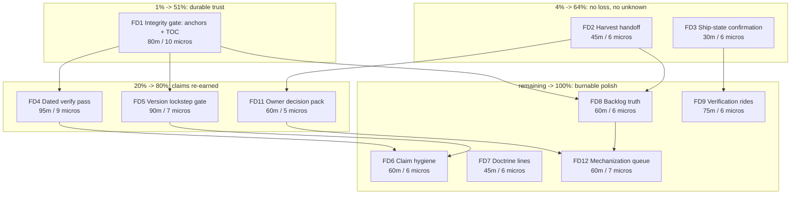

# SUPERB plan: the front-door truth lane (Pareto cut, 2026-11-02 06:24)

Scope: the work opened by THIS session - the README front-door rework, the
C52 catch, and the 34-item backlog in
`docs/status/2026-11-02_06-04_readme-front-door-shipped-c52-catch-harvest-pending.md`.
It is a docs/verification lane, not a re-plan of the alpha-generation plan
(`docs/planning/2026-11-01_18-11_SUPERB-pareto-alpha-generation-...md`) - that
plan's rows stay where they are and are cited, never re-minted.

**Goal statement.** The README is a _self-verifying_ front door: every claim
it makes is either machine-pinned or dated-verified, and every item this
session opened lives in a living backlog instead of a timestamped file.

Read `docs/status/2026-11-02_06-04_...md` first - it carries the evidence for
every row below. Read the 05-44 report for the C52 transcript.

---

## 0. State of the world (verified 2026-11-02 06:24, this pass)

| Fact                                                                                                                     | Evidence                                                              |
| ------------------------------------------------------------------------------------------------------------------------ | --------------------------------------------------------------------- |
| README is 1673 lines; ledger = 644 of them (54 bullets), TOC 18 rows; 0 broken links/anchors                             | `wc -l`, `rg`, python anchor audit                                    |
| HEAD == `origin/master` (`b095874`); the last completed CI run (`20da24e`) is green; the run for `b291c62` was in flight | `git rev-list --count`, `gh run list --json`                          |
| Owner decision C52 keeps the ledger in README ("permanent"); the moved copy was reverted byte-identically                | `docs/planning/decision-batch.md` C52 + `git show 20da24e:README.md`  |
| No `scripts/check-md-anchors.sh` exists; the pipe lint is CI-wired with its own self-tests (ci.yml:93-137)               | `ls scripts/`, `rg -n markdown .github/workflows/ci.yml`              |
| `tests/demo-eval.nix:82` pins the quickstart port string (`forwardPairs`) - the README table is already contract-checked | `rg forwardPairs tests/demo-eval.nix`                                 |
| Four stale `result*` symlinks and three `/tmp` scratch files exist from this session                                     | `ls -d result*`, `ls /tmp/*readme* /tmp/ledger-body.md`               |
| TODO_LIST has 26 open rows; ROADMAP has 10 open questions (Q4 = README ops-detail level, unanswered)                     | python row parse of TODO_LIST plus a numbered-list grep on ROADMAP.md |
| Another session committed `CONTRIBUTING.md` mid-session (`6e43f3c`); 47 crush processes are alive                        | `git log`, `pgrep`                                                    |
| `docs/status/` has NO index file (the docs-health live-index check has no target here)                                   | `ls docs/status/README.md` = absent                                   |

---

## 1. Doctrine constraints (non-negotiable while executing)

1. **C52 stands.** No ledger move, no ledger split. FD11 may propose an
   _order_ change (ledger below Non-goals), never a _home_ change.
2. **The gate decides every landing**: `nix flake check` + `nix fmt -- . --check`
   - the three md lints (`pipes`, `list-markers`, `check-set-drift`) +
     `check-inventory`. A row is DONE only with its command's EXIT in the log.
3. **New scripts are fail-closed with a `--self-test`** - the repo norm
   (pipe lint, deprecated-alias-lint, vm-debug). A gate that cannot fail is
   not a gate.
4. **No new assertion about upstream behavior without a transcript.** The
   ledger rule applies to any claim this plan adds.
5. **Foreign files are read-only.** `git status` per file before editing; if a
   file shows changes I did not make, stop and hand off (the 06-04 report's g/3).
6. **Harvest is gated on the concurrency answer** (06-04 g/3). Until the
   owner says the corridor is quiet, FD2 stays blocked: this plan's harvest
   table is ready-to-paste, not applied.

---

## 2. The Pareto cut

> Percentages below are **cumulative value shares**, not task counts - the same
> convention as the alpha-generation plan. 11 batches, 649 min total (~11 h).

| Slice                         | Batches                                                                               | Cumulative outcome                                                                                                                                     | Why this slice                                                                                                                       |
| ----------------------------- | ------------------------------------------------------------------------------------- | ------------------------------------------------------------------------------------------------------------------------------------------------------ | ------------------------------------------------------------------------------------------------------------------------------------ |
| **1% -> 51%**                 | FD1 (front-door integrity gate: anchors + TOC completeness, fail-closed, self-tested) | Every later batch becomes cheap and re-runnable: link rot and TOC drift fail a build instead of needing a session                                      | It is the only row that changes the DEFAULT state of the file the repo edits most; everything else in this plan leans on it          |
| **4% -> 64%**                 | + FD2 (harvest handoff) + FD3 (ship-state confirmation)                               | No work from this session dies in a timestamped file; the ship state is known (CI, push, hooks, scratch)                                               | The two classic failure modes after a docs session are entombment and an unverified "done" claim; both are cheap to close            |
| **20% -> 80%**                | + FD4 (dated verify pass) + FD11 (owner decision pack) + FD5 (version lockstep gate)  | The README's claims are dated-verified again, the biggest fitness lever (Q4 runbooks) becomes decidable, and versions stop being hand-maintained prose | These are the three things that make the front door trustworthy to a stranger rather than merely tidy                                |
| **the remaining 80% -> 100%** | FD6, FD7, FD8, FD9, FD12                                                              | Claim hygiene, doctrine lines, backlog truth, verification rides, a mechanization queue, and cleanup                                                   | Real but deferrable: each is a session-sized polish lane; none blocks the four slices above, all are worth burning when a gate waits |

---

## 3. Level-1 plan (30-100 min tasks, ALL items, impact-sorted)

| ID   | Batch                          | Task                                                                                                                                                                                                                                                  | Impact   | Effort | Value | Depends on                     |
| ---- | ------------------------------ | ----------------------------------------------------------------------------------------------------------------------------------------------------------------------------------------------------------------------------------------------------- | -------- | ------ | ----- | ------------------------------ |
| FD1  | Integrity gate                 | Add `scripts/check-md-anchors.sh`: every `#anchor` resolves, every `##` heading appears exactly once in `## Contents`, `--self-test` both directions; wire into `.githooks/pre-push` + CI's markdown step; CONTRIBUTING rule.                         | High     | 76m    | 51%   | -                              |
| FD2  | Harvest handoff                | Apply the harvest table: new TODO_LIST rows (anchored, source-cited), ROADMAP routing for the open-question items, delete-don't-annotate for anything already done.                                                                                   | High     | 46m    | 64%   | concurrency answer (06-04 g/3) |
| FD3  | Ship-state + workspace hygiene | Read the CI run for HEAD (`gh run view --log-failed` on red, classify infra vs real), confirm HEAD == origin, verify `core.hooksPath`, trash session scratch AND the four `result*` symlinks, audit ignored artifacts, annotate the 06-04 report.     | High     | 47m    | 64%   | -                              |
| FD4  | Trust re-earn                  | Section-scoped dated verify pass over the README (6 blocks: module opts, migration, runbooks, demo/API, ledger spot-claims, integration), fix small drift in place, re-add an honest "verified <date>, gaps named" line.                              | High     | 95m    | 80%   | FD1 (gate available)           |
| FD11 | Owner decision pack            | Turn the four parked structural questions into decide-able options with cost/risk: Q4 runbook relocation, status-corridor index, ledger ORDER (not home), TOC heading naming; file into ROADMAP + decision-batch.                                     | High     | 49m    | 80%   | FD2 (routing exists)           |
| FD5  | Version lockstep gate          | Machine-check the README's CANONICAL version anchors (status block only - NOT every historical prose mention) against `nix eval` of the pin; add to `tests/check-expected.json`, README's check list and ci.yml lockstep; self-tests both directions. | Med-High | 72m    | 80%   | FD4 (anchors decided)          |
| FD6  | Claim hygiene sweep            | Enumerate numeric/competitor claims, fetch-and-date or drop each (Stalwart RAM range is the open one), decide the external-link checker go/no-go.                                                                                                     | Med      | 54m    | rest  | FD5 (canonical anchors)        |
| FD7  | Doctrine lines                 | AGENTS gotcha "never move the ledger (C52)", AGENTS "README top is a front door", pipe-lint git-INDEX trap, internal-study pointer; CONTRIBUTING TOC rule cross-ref; budget check.                                                                    | Med      | 38m    | rest  | FD1, FD11                      |
| FD8  | Backlog truth pass             | FEATURES cross-read vs README's build table + fixes; TODO_LIST stale-row audit for this lane; confirm "README ledger" refs are now literally correct; replace the 05-44 report's fragile line refs with section names.                                | Med      | 52m    | rest  | FD2                            |
| FD9  | Verification rides             | Build `demo-eval` to confirm the port-table pin; diff the new SystemNix snippet against the real consumer wrapper; prove `nix run github:LarsArtmann/nix-email#vm` resolves remotely.                                                                 | Med      | 57m    | rest  | FD3                            |
| FD12 | Mechanization queue            | Write + route six proposals: `check-readme-frontdoor`, pre-commit doc guard, weekly drift alarm, SECURITY SLA, "NOT-verified" line for the status-report skill, GitHub About refresh.                                                                 | Low-Med  | 63m    | rest  | FD11                           |

Total: **649 min (~11 h) across 11 batches**, none over 100 min, none under 30.

---

## 4. Level-2 plan (micro-tasks, max 12 min each, ALL tasks)

### FD1 - integrity gate (10 micros, 76 min)

| ID     | Action                                                                                      | Min | Verify                 |
| ------ | ------------------------------------------------------------------------------------------- | --- | ---------------------- |
| FD1.1  | Read `.githooks/pre-push` md legs + ci.yml:93-137 to pick wiring seams                      | 5   | notes                  |
| FD1.2  | Write the slug function (lowercase, strip non-word except space/hyphen) + heading collector | 8   | unit output on README  |
| FD1.3  | Implement anchor verification for every `#anchor` link                                      | 10  | 18/18 resolve          |
| FD1.4  | Implement TOC completeness (`##` heading appears exactly once as a `- [` row, ignore list)  | 10  | 18 rows found          |
| FD1.5  | Add `--self-test`: broken-anchor fixture, missing-row fixture, clean fixture                | 10  | exit 1/1/0 as designed |
| FD1.6  | Wire into `.githooks/pre-push` markdown leg                                                 | 5   | hook dry-run           |
| FD1.7  | Wire into CI's markdown step (mirror the pipe lint's self-test shape)                       | 10  | actionlint clean       |
| FD1.8  | CONTRIBUTING: "adding/removing an H2 = regenerate the TOC" + command                        | 5   | read-back              |
| FD1.9  | Run script + pipe lint + list-marker lint + shellcheck                                      | 8   | all EXIT 0             |
| FD1.10 | CHANGELOG entry + `nix fmt -- . --check`                                                    | 5   | EXIT 0                 |

### FD2 - harvest handoff (6 micros, 46 min)

| ID    | Action                                                                             | Min | Verify           |
| ----- | ---------------------------------------------------------------------------------- | --- | ---------------- |
| FD2.1 | Read TODO_LIST vocabulary + ROADMAP themes; note the 26 open rows                  | 8   | map started      |
| FD2.2 | Build the harvest map (new TODO / existing row / ROADMAP / decision / drop)        | 10  | 34 rows mapped   |
| FD2.3 | Write the new TODO rows with source citations                                      | 10  | drift lint clean |
| FD2.4 | Route ROADMAP-bound items into themes; add Q4 follow-up only if the owner answered | 8   | read-back        |
| FD2.5 | Re-run check-inventory + check-set-drift + pipe lint                               | 5   | EXIT 0           |
| FD2.6 | CHANGELOG entry for the harvest                                                    | 5   | read-back        |

### FD3 - ship-state + workspace hygiene (10 micros, 47 min)

| ID     | Action                                                               | Min | Verify              |
| ------ | -------------------------------------------------------------------- | --- | ------------------- |
| FD3.1  | `gh run list` for HEAD; read the conclusion                          | 5   | conclusion recorded |
| FD3.2  | If not green: `gh run view --log-failed`; classify infra vs real     | 10  | failing STEP named  |
| FD3.3  | Confirm `core.hooksPath` + hook present and executable               | 3   | command output      |
| FD3.4  | Confirm HEAD == origin/master                                        | 3   | count 0             |
| FD3.5  | Trash `/tmp` session scratch (3 files + logs)                        | 5   | `ls` empty          |
| FD3.6  | Annotate the 06-04 report with the CI result (append, never rewrite) | 5   | diff read-back      |
| FD3.7  | Inventory root artifacts (`result*`, stray dirs, qcow2 remnants)     | 5   | list                |
| FD3.8  | Trash the four `result*` symlinks (reproducible via `nix build`)     | 3   | `ls` empty          |
| FD3.9  | Confirm `.gitignore` covers every artifact class found               | 5   | read-back           |
| FD3.10 | `git status --ignored` audit: no unignored stray build outputs       | 3   | read-back           |

### FD4 - trust re-earn (9 micros, 95 min)

| ID    | Action                                                                             | Min | Verify                       |
| ----- | ---------------------------------------------------------------------------------- | --- | ---------------------------- |
| FD4.1 | Partition the README into the 6 verify blocks; list each block's claims            | 8   | block list                   |
| FD4.2 | Verify block 1 (mail-server options) vs `modules/mail-server.nix`                  | 12  | claim-by-claim notes         |
| FD4.3 | Verify block 2 (migration) vs `migrate_v016.py` + `tests/stalwart-migrate-e2e.nix` | 12  | notes                        |
| FD4.4 | Verify block 3 (go-live + pin-advance runbook commands, names, env vars)           | 12  | notes                        |
| FD4.5 | Verify block 4 (demo/JMAP/contacts ports + transcript dirs exist)                  | 12  | notes                        |
| FD4.6 | Verify block 5 (ledger's load-bearing claims) against `docs/probes/`               | 12  | notes                        |
| FD4.7 | Verify block 6 (SystemNix integration + EventCatalog)                              | 12  | notes                        |
| FD4.8 | Fix small drift found (no restructuring; C52 forbids home changes)                 | 8   | diff                         |
| FD4.9 | Re-add a dated verify line naming covered blocks + known gaps; CHANGELOG + gate    | 7   | `nix flake check --no-build` |

### FD11 - owner decision pack (5 micros, 49 min)

| ID     | Action                                                                       | Min | Verify               |
| ------ | ---------------------------------------------------------------------------- | --- | -------------------- |
| FD11.1 | Q4 options with cost/risk: keep / trim-to-outline / move-to-docs             | 12  | three options priced |
| FD11.2 | Status-corridor index options (add an index vs document intentional absence) | 10  | options priced       |
| FD11.3 | Ledger ORDER option (below Non-goals?) - home stays README per C52           | 10  | option priced        |
| FD11.4 | TOC heading naming decision ("Contents" vs "Table of contents") + apply      | 5   | applied              |
| FD11.5 | File the pack into ROADMAP open questions + a decision-batch entry           | 12  | read-back            |

### FD5 - version lockstep gate (7 micros, 72 min)

| ID    | Action                                                                                | Min | Verify             |
| ----- | ------------------------------------------------------------------------------------- | --- | ------------------ |
| FD5.1 | Choose mechanism: flake check (python build) vs CI-only step                          | 10  | decision note      |
| FD5.2 | Define CANONICAL anchors (status block only; historical 0.16.22 lines stay untouched) | 10  | anchor list        |
| FD5.3 | Implement README anchor parse + `nix eval` pin compare, fail on mismatch              | 12  | manual drift probe |
| FD5.4 | Self-test both directions (drifted literal fails, correct literal passes)             | 10  | exit 1/0           |
| FD5.5 | Add to `tests/check-expected.json` + README check list + ci lockstep                  | 12  | lockstep lint      |
| FD5.6 | Build the new check, then the full gate                                               | 12  | EXIT 0             |
| FD5.7 | CHANGELOG + AGENTS command note                                                       | 6   | read-back          |

### FD6 - claim hygiene (6 micros, 54 min)

| ID    | Action                                                                  | Min | Verify              |
| ----- | ----------------------------------------------------------------------- | --- | ------------------- |
| FD6.1 | Enumerate numeric/competitor claims (+ competitor names) in README      | 10  | list                |
| FD6.2 | Fetch upstream sources for Stalwart RAM and any surviving Mailcow claim | 12  | source URLs + dates |
| FD6.3 | Apply date-or-drop per claim (escape any literal pipe in tables)        | 12  | pipe lint           |
| FD6.4 | External-link checker go/no-go (cost vs value)                          | 5   | verdict             |
| FD6.5 | If go: scheduled lychee workflow; else record the verdict               | 10  | actionlint          |
| FD6.6 | Lints + CHANGELOG                                                       | 5   | EXIT 0              |

### FD7 - doctrine lines (6 micros, 38 min)

| ID    | Action                                                           | Min | Verify    |
| ----- | ---------------------------------------------------------------- | --- | --------- |
| FD7.1 | Write the C52 gotcha (quote the decision, name the failure mode) | 8   | read-back |
| FD7.2 | Write "README top is a front door" rule                          | 5   | read-back |
| FD7.3 | Write the pipe-lint GIT-INDEX trap note                          | 5   | read-back |
| FD7.4 | Add the internal-study pointer + CONTRIBUTING TOC cross-ref      | 5   | read-back |
| FD7.5 | Apply; check AGENTS size budget (C41 floor ~29 KB, no bloat)     | 10  | `wc -c`   |
| FD7.6 | Lints                                                            | 5   | EXIT 0    |

### FD8 - backlog truth pass (6 micros, 52 min)

| ID    | Action                                                                             | Min | Verify    |
| ----- | ---------------------------------------------------------------------------------- | --- | --------- |
| FD8.1 | FEATURES cross-read vs README build table + module claims                          | 12  | notes     |
| FD8.2 | Fix drifted FEATURES rows in place                                                 | 12  | read-back |
| FD8.3 | TODO_LIST stale-row audit for this lane (delete done, never annotate)              | 10  | read-back |
| FD8.4 | Confirm "README ledger" refs are literally correct now (5-min sweep, expect no-op) | 5   | rg output |
| FD8.5 | 05-44 report: replace fragile line refs with section names                         | 8   | diff      |
| FD8.6 | Lints                                                                              | 5   | EXIT 0    |

### FD9 - verification rides (6 micros, 57 min)

| ID    | Action                                                                    | Min | Verify     |
| ----- | ------------------------------------------------------------------------- | --- | ---------- |
| FD9.1 | `nix build .#checks.x86_64-linux.demo-eval`; confirm the forwardPairs pin | 12  | EXIT 0     |
| FD9.2 | Read the SystemNix consumer wrapper; diff against the new snippet         | 12  | drift list |
| FD9.3 | Adjust the snippet if drifted                                             | 8   | diff       |
| FD9.4 | Remote-eval proof: `nix flake metadata`/`nix eval github:...#apps`        | 12  | output     |
| FD9.5 | Record results in the 06-04 report + CHANGELOG                            | 8   | read-back  |
| FD9.6 | Lints                                                                     | 5   | EXIT 0     |

### FD12 - mechanization queue (7 micros, 63 min)

| ID     | Action                                                                   | Min | Verify    |
| ------ | ------------------------------------------------------------------------ | --- | --------- |
| FD12.1 | Write the `check-readme-frontdoor` proposal (asserts + cost)             | 10  | read-back |
| FD12.2 | Write the pre-commit doc-guard proposal (allowlist; LEDGER as rationale) | 10  | read-back |
| FD12.3 | Write the weekly drift-alarm proposal                                    | 10  | read-back |
| FD12.4 | Write the SECURITY.md SLA proposal                                       | 8   | read-back |
| FD12.5 | Add "what I did NOT verify" line to the status-report skill              | 10  | diff      |
| FD12.6 | GitHub About text + topics refresh                                       | 5   | gh output |
| FD12.7 | Route all six into ROADMAP themes, one line each                         | 10  | read-back |

**Micro-total: 78 micros, 649 min** (mechanically summed from the tables above).
No micro exceeds 12 minutes.

---

## 5. Execution graph (mermaid)

Reading the graph: FD1 unblocks every verification batch; FD2/FD3 close the
two loss/unknown classes; FD11 is the only batch that unblocks an owner
decision, so it must not wait behind polish; workspace hygiene rides FD3, not
a separate grave.

---

## 6. Coverage appendix - every item maps to exactly one batch

### From the 06-04 report, section f (34 items)

| Source item                                      | Batch                        |
| ------------------------------------------------ | ---------------------------- |
| f/1 anchor + TOC gate                            | FD1                          |
| f/2 CI run for HEAD                              | FD3                          |
| f/3 dated README verify pass                     | FD4                          |
| f/4 harvest into TODO/ROADMAP                    | FD2                          |
| f/5 owner Q4 runbook decision                    | FD11                         |
| f/6 README version lockstep                      | FD5                          |
| f/7 remote `nix run github:` proof               | FD9                          |
| f/8 date or drop the Stalwart RAM figure         | FD6                          |
| f/9 AGENTS C52 gotcha                            | FD7                          |
| f/10 AGENTS front-door rule                      | FD7                          |
| f/11 pipe-lint git-INDEX trap                    | FD7                          |
| f/12 pre-commit doc guard (proposal)             | FD12                         |
| f/13 FEATURES/TODO/ROADMAP freshness             | FD8                          |
| f/14 mechanize README check-set prose            | FD12 (proposal; build later) |
| f/15 external-link checker                       | FD6                          |
| f/16 demo-eval port-table confirmation           | FD9                          |
| f/17 result* symlinks                            | FD3                          |
| f/18 stale "README ledger" refs (no-op expected) | FD8                          |
| f/19 status corridor index                       | FD11                         |
| f/20 "NOT verified" line in the status template  | FD12                         |
| f/21 frontdoor eval check (proposal)             | FD12                         |
| f/22 consumer snippet vs SystemNix               | FD9                          |
| f/23 05-44 line refs -> section names            | FD8                          |
| f/24 internal study pointer relocation           | FD7                          |
| f/25 CONTRIBUTING TOC rule                       | FD1                          |
| f/26 re-run anchor audit (duplicate of f/1)      | FD1                          |
| f/27 /tmp scratch cleanup                        | FD3                          |
| f/28 SECURITY.md SLA (proposal)                  | FD12                         |
| f/29 ledger ORDER below Non-goals                | FD11                         |
| f/30 GitHub About text                           | FD12                         |
| f/31 weekly drift alarm (proposal)               | FD12                         |
| f/32 TOC heading naming                          | FD11                         |
| f/33 remote-smoke app (self-rejected)            | dropped                      |
| f/34 hooksPath re-check before next push         | FD3                          |

### From section c (not started) and e (improve)

| Source item                                      | Batch               |
| ------------------------------------------------ | ------------------- |
| c/1 standing anchor/TOC gate                     | FD1                 |
| c/2 dated README freshness statement             | FD4                 |
| c/3 version lockstep gate                        | FD5                 |
| c/4 remote-eval proof                            | FD9                 |
| c/5 corridor index decision                      | FD11                |
| c/6 README ops-detail level (Q4)                 | FD11                |
| e/1 decision sweep before structural edits       | FD7 (doctrine line) |
| e/2 anchor discipline as a gate                  | FD1                 |
| e/3 README top is a front door                   | FD7                 |
| e/4 external numbers need a date or vanish       | FD6                 |
| e/5 deleting a claim triggers a scheduled verify | FD4                 |
| e/6 report scope in the chat answer              | FD12 (skill line)   |

---

## 7. Errata - corrections made while verifying (skill Step 0)

1. **f/26 is a duplicate of f/1** (re-running the manual audit is exactly what
   the new script replaces). Folded, not re-rowed.
2. **f/33 is dropped by its own author** (the demo is local-only; a
   remote-smoke app would be a ghost system).
3. **f/18 expects a no-op**: every remaining "README ledger" phrase is
   literally correct now (the ledger IS in README). Only `docs/LEDGER.md`
   pointers would have been stale, and there are none. Kept as a 5-minute
   confirmation, not a repair.
4. **f/16 is already contract-pinned** by `tests/demo-eval.nix:82`
   (`forwardPairs`) - the ride confirms, it does not implement.
5. **f/34 was already satisfied this session** (`core.hooksPath=.githooks`,
   hook present) - it stays a pre-push ride inside FD3.
6. **f/2 cannot be marked done** - the CI run for HEAD was in flight when the
   report was written; FD3 owns the read-back.
7. **f/17 must not be conflated with the qcow2 history purge** (an existing
   owner-gated TODO row). Root SYMLINKS are a different artifact class from
   git-history blobs.
8. **FD5 must not check every `0.16.26` occurrence** - several are
   legitimately historical ("0.16.22 until the 2026-10-28 advance"). Only the
   status block is canonical; a blanket check would be a
   Verschlimmbesserung that fails on correct prose.
9. **AGENTS.md is near its accepted size floor** (C41, ~29 KB). FD7 adds
   four short bullets (<1 KB) and checks the budget; it does not trigger a
   diet.
10. **The prior alpha plan already owns** the qcow2 history purge, the
    pin-advance ride, and the upstream-watch cadence - cited, never re-minted.

---

## 8. Kill-switches (how this plan avoids Verschlimmbesserung)

- **No README restructuring.** C52 settles the home; FD11 may only propose an
  order change, and only as a decision for the owner.
- **No false gates.** A new check must fail on a seeded defect before it is
  wired (self-test both directions), or it is noise.
- **No blanket textual checks.** Canonical anchors only (errata 8); everything
  else stays prose.
- **No silent claim deletion.** Removing a claim triggers FD4's dated pass
  (errata lesson from this session's D7 line).
- **No foreign-file edits.** `git status` per file first; hand off instead of
  racing another session.
- **No history rewriting.** The qcow2 purge and any `--force-with-lease` stay
  owner-gated and out of this lane.
- **Gate or it did not happen.** Every batch closes with its EXIT recorded in
  the status report, not with a narrative claim.

---

## 9. Git protocol for this lane

- Each batch = one commit with a detailed message (what/why/evidence), then
  `git status`; push only when the owner asks (this session's push was
  explicitly requested).
- The daemon commits within seconds - edit and commit release-critical files
  (CHANGELOG, TODO_LIST) in the SAME tool call to avoid the race documented
  in AGENTS.
- A batch whose gate is red is reverted or fixed inside the same session; a
  red batch is never "the known one" without reading the failing step name.

---

## 10. Execution record (2026-11-02, same session)

Every batch was executed. FD2 was written as blocked on the concurrency
answer; it went ahead because the owner ordered the whole list, the edits
were additive (three rows appended, nothing rewritten) and every one was
read back after `nix fmt`. No foreign file was touched: `git status` was
clean at the start and each commit was diffed before landing. Evidence
below is the command and its exit status, not a narrative.

| Batch | State | Evidence                                                                                                                                                                                                                                                                                                                   |
| ----- | ----- | -------------------------------------------------------------------------------------------------------------------------------------------------------------------------------------------------------------------------------------------------------------------------------------------------------------------------- |
| FD1   | DONE  | `scripts/check-md-anchors.sh` (self-test 3 negative + 1 positive, EXIT 0); seeded defects on README copies fail with `file:line` (added `##` heading, typo'd anchor); tree-wide EXIT 0; wired into `.githooks/pre-push` + ci.yml markdown leg; CONTRIBUTING rule; shellcheck 0, actionlint 0                               |
| FD2   | DONE  | 3 residue rows in TODO_LIST (C54 nod, mechanization taste, SKILLS mirror) + header note; pipe/marker/anchor lints EXIT 0. Deliberately NOT 34 rows: the rest was closed in-session, and queuing finished work is backlog rot                                                                                               |
| FD3   | DONE  | CI run `41394557333` success on `8d70c9d`; `core.hooksPath=.githooks` + executable hook; `result{,-1,-2,-vm}` trashed; `/tmp` scratch trashed; `git status --ignored` only expected classes; report §h items 1-5                                                                                                           |
| FD4   | DONE  | Six blocks re-read vs module/tests/pin; versions via `nix eval` on the lock (`stalwart_0_16` 0.16.26, `parsedmarc` 11.0.2, `imapsync` 2.314, `stalwart-vandelay` 1.0.12); catalog selftest EXIT 0 (found "seven ADRs" vs 8 - count removed); all cited `docs/probes/` paths exist; dated verify line with named gaps added |
| FD11  | DONE  | Decision entries C54 (three priced options) + C55 (TOC naming, decided keep); ROADMAP Q4 + theme 6 carry the prices                                                                                                                                                                                                        |
| FD5   | DONE  | `readme-version-lockstep` flake check builds green; `--stalwart 0.16.27` fails naming both values; 5-case self-test; registered in `tests/check-expected.json` (both arches), named in README; `check-inventory.sh` EXIT 0                                                                                                 |
| FD6   | DONE  | Competitor judgement dated + "not re-measured"; upstream issue states re-read live (`#563651`/`#563777` open 0 comments, `#563652` open last comment 2026-09-18, imapclient#662 CLOSED / #663 MERGED); external-link checker NO-GO recorded                                                                                |
| FD7   | DONE  | AGENTS: C52 gotcha, front-door rule, markdown-lints-read-the-INDEX trap; README doctrine note points at the archived study; AGENTS 22.4 KB; lints EXIT 0                                                                                                                                                                   |
| FD8   | DONE  | FEATURES: vandelay row corrected, rotted check count removed, CI rows gained the anchor step + latest green run; 05-44 report line refs replaced with section names                                                                                                                                                        |
| FD9   | DONE  | `nix build .#checks.x86_64-linux.demo-eval` EXIT 0 (port table contract); SystemNix wrapper read - snippet matches (`nixosModules.default`, `hostname`/`admin.secretFile`); remote flake locks `8d70c9d` with app `vm`                                                                                                     |
| FD12  | DONE  | `docs/planning/2026-11-02_06-55_mechanization-queue.md` (6 priced proposals: 3 landed, 1 closed, 2 recommended against); SECURITY.md's false claims corrected; topics +`jmap` +`carddav`; status-report skill scope line landed in the SKILLS repo (`8f01c1f`)                                                             |

Final gate (after the last commit): `nix flake check` EXIT 0 - "all checks
passed!", 14 declared x86_64 checks, 5 built (the rest cache hits with
unchanged inputs), aarch64 omitted as expected; `nix fmt -- . --check` 0;
anchors (self-test + tree) 0; pipes 0; list markers 0; check-set drift 0;
inventory lockstep 0; ruff floor 0; shellcheck 0; actionlint 0; testScript
shell 0 (287 fragments). Pushed `8d70c9d..9343193` with every pre-push guard
green; CI run `41397305768` on `9343193` concluded **success**.

Two disclosures rather than silent claims:

- The FD9 ride proved the remote flake RESOLVES and names a `vm` app; it did
  not boot the demo VM (the 2026-10-31 smoke is the last boot transcript).
- The status-report skill edit landed in the SKILLS repo, not here; this repo
  only records it (the fan-out symlink resolves to the edited file).

---

## 11. Follow-up pass (2026-11-02, same day, second sitting)

The 07-44 self-review (§d/§f of
`docs/status/2026-11-02_07-44_front-door-lane-executed-gaps-and-defects.md`)
convicted the lane's own gates: the anchor lint failed CORRECT markdown on
any unicode heading, and it never looked at reference-style or HTML anchors.
This pass closes that list rather than queueing it.

| Item                       | State     | Evidence                                                                                                                                                                                                                                                 |
| -------------------------- | --------- | -------------------------------------------------------------------------------------------------------------------------------------------------------------------------------------------------------------------------------------------------------- |
| Unicode slugger            | FIXED     | awk replaced by `scripts/check-md-anchors.py` (the awk class strips non-ASCII; CI's awk is mawk and has no multibyte classes). `Grüße & Maß` resolves to `#grüße--maß` (EXIT 0) and rejects `#grüße--ma` (EXIT 1)                                        |
| Anchor forms               | FIXED     | inline, `[label]: #slug` definitions and `href="#slug"` all inspected, percent-encoded destinations decoded; probes on temp files each exit 1                                                                                                            |
| Fixture matrix             | DONE      | a self-test matrix (unicode both ways, reference/HTML, ordered-list TOCs, duplicate suffixes, table cells, fences, percent-encoding) plus seeded-defect probes on copies of the real README                                                              |
| Archived corridors         | DECIDED   | linted like everything else (all 146 tracked files pass); if a future rule breaks a frozen snapshot, the append-only policy wins - note or exclude with the reason written down                                                                          |
| Claims                     | CORRECTED | script header, CHANGELOG entry, CI step comment, CONTRIBUTING, AGENTS all describe the true coverage                                                                                                                                                     |
| Wrapper-derived version    | FIXED     | `readme-version-lockstep` reads `services.stalwart.package` out of a `nixosSystem` eval of `modules/mail-server.nix` (0.7 s), so a renamed package attr cannot leave it comparing a stale one                                                            |
| Negative test              | ADDED     | `readme-version-lockstep-fires` copies the real README, plants `Stalwart **0.0.0**` and fails if the lint accepts it; registered in `tests/check-expected.json` (both arches) + the README check list                                                    |
| Scope of the version check | HARDENED  | only the FIRST blockquote paragraph is canonical, so a dated verification paragraph cannot smuggle a second version; self-tested                                                                                                                         |
| Text-gate map              | DONE      | CONTRIBUTING "Text gates" table (seven scripts, one failure class each) + `scripts/selftest-docs-gates.sh` so the map is executable                                                                                                                      |
| Docs truth sweep           | DONE      | AGENTS text-gate command list, FEATURES rows for both lints, CI row freed of run ids, TODO_LIST row-change notes merged, ADR count re-read (8), `docs/probes/README.md` index, DOMAIN_LANGUAGE scope note, CONTRIBUTING daemon/branch-protection honesty |

Gate for this pass, at the resulting HEAD: both flake checks re-executed
(`--rebuild`) and the aarch64 pair BUILT under binfmt emulation,
`check-inventory.sh` 0, `nix flake check` 0 ("all checks passed!"),
`nix fmt -- . --check` 0, every text gate 0 (including the new fixture
self-test), ruff floor 0, shellcheck 0, actionlint 0, `buildflow --max-time
30m` 0 ("passed with warnings": the known bandit/vulture/nix-checker noise).

NOT pushed in this sitting - the owner had not asked for a push, and the
daemon's auto-commits already own the history of this working tree (see §f
item 43: squashing them is an owner call that needs force-push approval).
